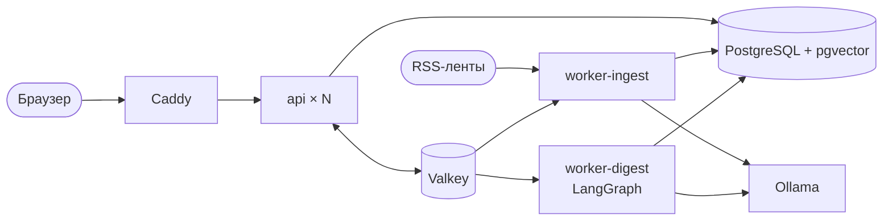

# Радар: ИИ-ассистент дайджестов по ИТ и ИБ для энергетики

Решение первого этапа хакатона «ИИ-ассистенты для энергетики». Ассистент забирает публикации из 35 источников, отбирает те, что отвечают интересам конкретного читателя, группирует их по темам и выдаёт дайджест в Markdown и DOCX со ссылками на источники. Интересы редактируются в интерфейсе, и видно, как каждая правка меняет подборку.


## Быстрый запуск

Нужен Docker с Compose v2. Порт `8080` должен быть свободен (меняется переменной `WEB_PORT`).

```bash
docker compose up -d --build
```

Откройте <http://localhost:8080>. При первом старте стек сам применит миграции, заведёт 35 источников и три профиля читателей, загрузит снимок из 964 реальных публикаций за 21-30 сентября 2026 года и поставит в очередь опрос лент. Дайджест можно собирать сразу, не дожидаясь опроса.

По умолчанию включён автономный режим без моделей: поиск по n-граммам и ключевым словам, выжимки берутся из текста статьи. Он нужен, чтобы прототип запускался на любой машине за минуту. Качество отбора и тексты в нём заметно проще, чем с моделями.

Режим с моделями через Ollama (нужна видеокарта NVIDIA от 8 ГБ и NVIDIA Container Toolkit):

```bash
cp .env.example .env
# в .env: RADAR_EMBEDDING_PROVIDER=ollama и RADAR_LLM_PROVIDER=ollama
docker compose -f docker-compose.yml -f docker-compose.gpu.yml --profile ollama up -d --build
```

При первом запуске скачаются модели `embeddinggemma:300m` (0,6 ГБ) и `qwen3.5:9b` (6,6 ГБ). Без видеокарты второй файл Compose не нужен, но сборка выпуска на процессоре займёт десятки минут.

Проверить, что всё работает от начала до конца:

```bash
uv run scripts/smoke.py            # или: uv run scripts/smoke.py http://host:port
```

Скрипт проходит путь пользователя: каталог, предпросмотр отбора, сборка выпуска с отслеживанием прогресса, оба экспорта, правка интересов и сравнение выпусков.

## Что показать на демонстрации

1. Откройте «Источники». Там 35 лент по пяти категориям (безопасность, АСУ ТП, ИТ, энергетика, регуляторы), статус последнего опроса и счётчики. На вкладке «Публикации» лежат исходные материалы с полнотекстовым поиском.
2. В разделе «Дайджест» выберите профиль и период и нажмите «Собрать дайджест». Прогресс идёт по этапам в реальном времени. В шапке готового выпуска видна воронка: сколько публикаций было за период, сколько стало кандидатами, сколько вошло.
3. Выпуск разбит на темы. У каждой записи есть ссылка на источник, выжимка, строка «почему важно» под роль читателя и ссылки на пересказы той же новости в других изданиях. Внизу блок «Не вошло в выпуск»: отброшенные кандидаты с оценкой и причиной.
4. Кнопки «Markdown» и «DOCX» в шапке выпуска скачивают дайджест.
5. В разделе «Интересы» добавьте ключевое слово, сдвиньте порог или удалите интерес. Панель справа сразу покажет, какие публикации появились и какие выпали. «Сохранить и собрать» строит новый выпуск, а раздел «Сравнение» кладёт два выпуска рядом: что появилось, что ушло, как изменились оценки.

| Сборка выпуска | Редактор интересов | Сравнение выпусков |
|---|---|---|
|  |  |  |

## Что реализовано

| Требование | Как сделано |
|---|---|
| Получать публикации из источников | 35 лент RSS и Atom, опрос каждые 15 минут с условными запросами, загрузка полного текста там, где в ленте только анонс, добавление своих источников из интерфейса |
| Отбирать по интересам пользователя | гибридный поиск (векторный и полнотекстовый) по каждому интересу, оценка каждого кандидата языковой моделью, исключения, порог, склейка пересказов |
| Группировать по темам, сохранять ссылки | кластеризация отобранных статей по векторам, названия и обзоры тем от модели, ссылка на источник у каждой записи и у каждого пересказа, пересказы одной новости склеиваются |
| Формировать дайджест в Markdown или DOCX | оба формата, с гиперссылками |
| Показать изменение подборки при смене интересов | мгновенный предпросмотр в редакторе профиля, версии профиля, сравнение двух выпусков |

Сверх требований: перевод заголовков и выжимок англоязычных источников на русский, строка «почему важно» под роль, прозрачность отбора (оценка и причина у каждого кандидата), работа без модели, возобновление сборки после сбоя.

## Два режима

| | Автономный | С моделями |
|---|---|---|
| Поиск | хеширование n-грамм и полнотекстовый поиск PostgreSQL | эмбеддинги `embeddinggemma:300m` и полнотекстовый поиск |
| Оценка релевантности | по совпадению ключевых слов | `qwen3.5:9b`, шкала 0-3 с объяснением |
| Темы | по интересам профиля | кластеризация и названия от модели |
| Тексты | первые предложения статьи | выжимка, перевод, «почему важно» |
| Сборка недельного выпуска | 0,5 с | полторы минуты; повторная по тому же профилю 7-10 с |
| Требования | любой компьютер с Docker | видеокарта NVIDIA от 8 ГБ: обе модели занимают 6,4 ГБ |

Время замерено на RTX 5070 12 ГБ, Ollama 0.35.0 в Docker Desktop на Windows 11: 60 кандидатов, 15-20 записей в выпуске, четыре замера дали 81, 91, 91 и 102 с. Повторная сборка быстрее, потому что ответы модели кешируются. Если модель отказывает посреди сборки, выпуск достраивается автономным алгоритмом и в нём указано, какая часть сделана без модели.

Почему выбраны именно эти модели и что показали замеры, описано в [docs/DECISIONS.md](docs/DECISIONS.md).

## Как устроено



Бэкенд: Python 3.14, FastAPI, SQLAlchemy 2.1, LangGraph 1.2, LangChain, taskiq. Хранилище: PostgreSQL 18 с pgvector 0.8.6 за PgBouncer, Valkey 9.1. Фронтенд: Vite 8, React 19, TypeScript 6, Tailwind CSS 4, Motion 13. Версии библиотек - последние на 30 сентября 2026 года, они зафиксированы в `backend/uv.lock` и `frontend/package-lock.json`.

Сборка выпуска идёт как граф LangGraph из девяти узлов с чекпоинтами в PostgreSQL. Оценка кандидатов и написание выжимок расходятся веером по одной задаче на статью, а каждый ответ модели кешируется, поэтому сборка, прерванная сбоем, продолжается с того же шага и не платит за уже полученные ответы. Подробности, формулы отбора и таблица отказов в [docs/ARCHITECTURE.md](docs/ARCHITECTURE.md).

Масштабирование без правки конфигурации:

```bash
docker compose up -d --scale api=4 --scale worker-ingest=2 --scale worker-digest=2
```

## Что проверено

Всё ниже запускалось на одной машине (12 логических ядер, 32 ГБ, RTX 5070), цифры относятся к этим условиям.

| Проверка | Результат |
|---|---|
| Тесты бэкенда, `uv run pytest` | 46 тестов; один из них интеграционный и пропускается без запущенного Valkey |
| Линтер и типы бэкенда, `ruff` и `mypy --strict` | без замечаний |
| Фронтенд: `tsc`, `oxlint`, `vitest` | без замечаний, 3 теста |
| Сквозной сценарий `scripts/smoke.py` через шлюз | проходит в обоих режимах |
| Нагрузка на чтение, k6, 50 виртуальных пользователей, 30 с | 2 реплики api: 406 запр/с, p95 189 мс; 4 реплики: 615 запр/с, p95 128 мс; ошибок 0 |
| Остановка одной из четырёх реплик api под нагрузкой | 0 неудачных запросов из 15 670 |
| Остановка Valkey | чтение работает, создание выпуска отвечает 503, после запуска всё восстанавливается |
| Остановка воркера посреди сборки | второй воркер забрал задачу по истечении таймаута (в тесте 300 с) и закончил выпуск за 65 с, сделав 54 вызова модели вместо 78: оценки, полученные до сбоя, взяты из кеша |
| Остановка Ollama посреди сборки | выпуск готов через 2 с: недостающие оценки и все тексты сделал автономный алгоритм, в выпуске стоит отметка об этом |
| Качество поиска на собственных данных, 845 статей, эталон от языковой модели | с `embeddinggemma:300m` в пул из 60 кандидатов попадает 10 из 12 самых важных статей; сочетание векторов с полнотекстовым поиском лучше каждого по отдельности у всех четырёх проверенных моделей |

Нагрузочный тест шёл одновременно с работой модели на видеокарте и генератором нагрузки на той же машине, так что цифры скорее занижены.

## Примеры

- `data/samples/articles.jsonl` - входные данные: 964 публикации из 32 источников (заголовок, анонс, до 3000 знаков текста, ссылка, дата). У трёх источников из 35 за эти десять дней публикаций не было.
- `examples/` - результаты: по выпуску на каждый из трёх профилей в Markdown и DOCX.
- `examples/change/` - выпуск до и после правки интересов, оба профиля и разница между выпусками.
- `docs/eval/` - оценки модели по всем публикациям недели и таблица сравнения способов поиска.

Снимок содержит фрагменты публикаций из открытых лент и приложен для проверки решения. Права на тексты принадлежат изданиям, ссылки на оригиналы сохранены.

## Ограничения

- Пользователей и прав доступа нет. Прототип однопользовательский и рассчитан на запуск в доверенной сети; что нужно доделать перед публикацией в интернет, перечислено в конце ARCHITECTURE.md.
- Источники только RSS и Atom. Сайты без ленты, Telegram-каналы и рассылки не подключены. `bdu.fstec.ru` и `ptsecurity.com` не читаются: у них сертификаты российского удостоверяющего центра, которого нет в стандартном наборе доверенных.
- Качество текстов ограничено локальной моделью на 9 миллиардов параметров. Она иногда ошибается в согласовании слов и может неточно перевести термин. Факты в выжимке берутся из текста статьи, но проверки фактов нет.
- Оценка релевантности относительная: без языковой модели в выпуск попадают самые близкие к интересу статьи периода, даже если по-настоящему подходящих не было.
- Вредоносная статья может повлиять на свою оценку через текст (prompt injection). Ущерб ограничен тем, что ответ модели зажат в JSON-схему и никуда, кроме текста выпуска, не попадает.
- Одна видеокарта обрабатывает запросы к модели по сути последовательно. Несколько выпусков одновременно встают в очередь.
- Автономный режим не понимает смысл и не переводит: англоязычные статьи находятся только по английским ключевым словам.

## Разработка

Бэкенд на хосте (Python ставит `uv`), база и брокер в Docker:

```bash
docker compose -f docker-compose.yml -f docker-compose.dev.yml up -d postgres valkey
cd backend
uv sync
uv run radar migrate --seed --sample ../data/samples/articles.jsonl
uv run pytest && uv run ruff check src tests && uv run mypy
uv run radar digest --profile "Специалист по ИБ АСУ ТП" --days 7 --out ../tmp
```

Фронтенд с горячей перезагрузкой, API берётся из запущенного стека на `8080`:

```bash
cd frontend
npm ci
npm run dev        # http://localhost:5173
npm run lint && npm run typecheck && npm test
```

## Структура репозитория

```
backend/                 сервис на Python
  src/radar/
    ingest/              загрузка лент, защита от SSRF
    selection/           поиск, правила отбора, кластеризация, предпросмотр
    ai/                  эмбеддеры, модель, автономный алгоритм, предохранитель
    pipeline/            граф LangGraph и его запуск
    render/              Markdown и DOCX
    api/, worker/        HTTP и фоновые задачи
    migrations/          схема базы
  tests/                 модульные тесты
  scripts/               оценка качества поиска
frontend/                интерфейс (Vite, React) и конфигурация Caddy
data/samples/            снимок публикаций
examples/                готовые выпуски
docs/                    архитектура, решения и замеры
scripts/                 сквозная проверка, нагрузочный сценарий, сборка примеров
docker-compose*.yml      основной стек, GPU, разработка
```
