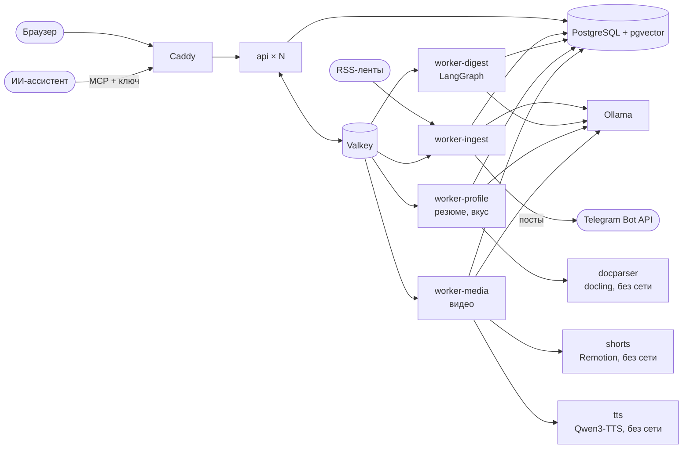

# Tail&Grep: ИИ-ассистент дайджестов по ИТ и ИБ для энергетики

Решение первого этапа хакатона «ИИ-ассистенты для энергетики». Ассистент забирает публикации из 35 источников, отбирает те, что отвечают интересам конкретного читателя, группирует их по темам и выдаёт дайджест в Markdown и DOCX со ссылками на источники. Интересы редактируются в интерфейсе, и видно, как каждая правка меняет подборку.

У каждого читателя свой аккаунт. При регистрации можно загрузить резюме: по нему ассистент определяет специализацию и предлагает профиль интересов. Раздел «Для вас» - персональная лента, которая учитывает интересы, резюме и оценки читателя и объясняет, почему каждая статья в ней оказалась.

Свои новости можно отдать ИИ-ассистенту: у каждого читателя есть MCP-сервер с личным ключом, и Claude, Cursor или любой MCP-клиент видит по нему только ленту, сохранённое, дайджесты и интересы этого читателя.

Раздел «Каналы» подключает Telegram-ботов и каналы: боты публикуют новости по расписанию под аудиторию каждого канала, каждый канал своим голосом и со своей подачей ссылок. Пока проверено на моке Bot API, который входит в стек.


## Быстрый запуск

Нужен Docker с Compose v2. Порт `8080` должен быть свободен (меняется переменной `WEB_PORT`).

```bash
docker compose up -d --build
```

Откройте <http://localhost:8080> и нажмите «Войти без регистрации»: появится временный аккаунт с тремя примерами профилей, он удалится через сутки. Можно и зарегистрироваться, тогда следующим шагом будет загрузка резюме.

При первом старте стек сам применит миграции, заведёт 35 источников и три примера профилей, загрузит снимок из 964 реальных публикаций за 21-30 сентября 2026 года и поставит в очередь опрос лент. Дайджест можно собирать сразу, не дожидаясь опроса.

По умолчанию включён автономный режим без моделей: поиск по n-граммам и ключевым словам, выжимки из текста статьи, резюме читается встроенным разборщиком (PDF с текстовым слоем, DOCX, TXT, Markdown) и сопоставляется с таблицей профессиональных направлений. Он нужен, чтобы прототип запускался на любой машине за минуту. Качество отбора и тексты в нём заметно проще, чем с моделями.

Режим с моделями через Ollama (нужна видеокарта NVIDIA от 8 ГБ и NVIDIA Container Toolkit):

```bash
cp .env.example .env
# в .env: RADAR_EMBEDDING_PROVIDER=ollama и RADAR_LLM_PROVIDER=ollama
docker compose -f docker-compose.yml -f docker-compose.gpu.yml --profile ollama up -d --build
```

При первом запуске скачаются модели `embeddinggemma:300m` (0,6 ГБ) и `qwen3.5:9b` (6,6 ГБ). Без видеокарты второй файл Compose не нужен, но сборка выпуска на процессоре займёт десятки минут.

Разбор резюме через docling (вёрстка в две колонки, сканы и фотографии страниц, PPTX, ODT, HTML) включается отдельным профилем. В `.env` раскомментируйте `RADAR_DOCPARSER_URL=http://docparser:8000` и добавьте `--profile docling` к команде запуска. Образ разборщика занимает около 4 ГБ, модели в нём уже лежат.

Короткие видео по выпуску, как в TikTok и Shorts, включаются двумя профилями. `video` добавляет сервис рендера на Remotion и воркер роликов: ролики получаются с субтитрами по словам, но без звука. `voice` добавляет озвучку Qwen3-TTS; на видеокарте NVIDIA к нему нужен `docker-compose.gpu.yml`. В `.env` раскомментируйте `RADAR_SHORTS_URL` и `RADAR_TTS_URL` для запущенных профилей:

```bash
docker compose -f docker-compose.yml -f docker-compose.gpu.yml \
  --profile ollama --profile video --profile voice up -d --build
```

Образ рендера занимает 1,3 ГБ: Node 24, Chrome Headless Shell и шрифты. Образ голоса тяжёлый: 14,8 ГБ на диске и 5,4 ГБ при скачивании. Из них 4,4 ГБ - PyTorch с библиотеками CUDA 13, 2,4 ГБ - сама модель, она уже лежит в образе. Его сборка заняла у меня около часа, большую часть времени Docker сжимал слои.


Публикация в Telegram включается секретом для шифрования токенов ботов. Чтобы попробовать без настоящего Telegram, добавьте профиль `telegram-mock` и направьте ботов в мок: подойдёт любой токен вида `123456789:AA...` и любой `@канал`, а отправленное видно на <http://localhost:8089>.

```bash
# в .env: RADAR_SECRET_KEY=<вывод openssl rand -base64 32>
#         RADAR_TELEGRAM_API_URL=http://telegram-mock:8089
docker compose --profile telegram-mock up -d --build
```

Для настоящего Telegram `RADAR_TELEGRAM_API_URL` не задавайте, а бота создайте у @BotFather и добавьте администратором в канал. Копии картинок статей по умолчанию лежат в томе `media`; профиль `s3` поднимает SeaweedFS, и с `RADAR_IMAGE_STORE=s3` копии уходят туда.

Подключить ассистента: на странице «Аккаунт» создайте ключ в блоке «Доступ для ИИ-ассистентов». Ключ показывается один раз, рядом готовая команда для Claude Code и настройки для Cursor:

```bash
claude mcp add --transport http tail-and-grep http://localhost:8080/api/mcp/ \
  --header "Authorization: Bearer tng_..."
```

Инструменты сервера: `my_feed` (лента с причинами и временем чтения), `search_my_news` (поиск только по своей ленте), `saved_news`, `my_digests`, `read_digest` (выпуск в Markdown со ссылками), `my_interests`.

Администратор может менять каталог источников. Роль выдаётся с сервера, а не по адресу почты при регистрации:

```bash
docker compose exec api radar grant-admin you@example.org
```

Проверить, что всё работает от начала до конца:

```bash
uv run scripts/smoke.py            # или: uv run scripts/smoke.py http://host:port
```

Скрипт проходит путь пользователя: каталог, предпросмотр отбора, сборка выпуска с отслеживанием прогресса, оба экспорта, правка интересов и сравнение выпусков. Затем регистрирует нового читателя, загружает резюме, создаёт профиль из предложенного, проверяет ленту и реакцию на дизлайк и удаляет аккаунт.

## Что показать на демонстрации

1. Нажмите «Войти без регистрации». Откройте «Источники»: 35 лент по пяти категориям (безопасность, АСУ ТП, ИТ, энергетика, регуляторы), статус последнего опроса и счётчики. На вкладке «Публикации» лежат исходные материалы с полнотекстовым поиском.
2. В разделе «Дайджест» выберите профиль и период и нажмите «Собрать дайджест». Прогресс идёт по этапам в реальном времени. В шапке готового выпуска видна воронка: сколько публикаций было за период, сколько стало кандидатами, сколько вошло.
3. Выпуск разбит на темы. У каждой записи есть ссылка на источник, выжимка, строка «почему важно» под роль читателя и ссылки на пересказы той же новости в других изданиях. Внизу блок «Не вошло в выпуск»: отброшенные кандидаты с оценкой и причиной.
4. Кнопки «Markdown» и «DOCX» в шапке выпуска скачивают дайджест.
5. В разделе «Интересы» добавьте ключевое слово, сдвиньте порог или удалите интерес. Панель справа сразу покажет, какие публикации появились и какие выпали. «Сохранить и собрать» строит новый выпуск, а раздел «Сравнение» кладёт два выпуска рядом: что появилось, что ушло, как изменились оценки.
6. Выйдите и зарегистрируйтесь. На следующем шаге перетащите резюме из `examples/resumes/`: через 10-30 секунд появятся должность, навыки и предложенные темы новостей. Оставьте нужные и нажмите «Создать профиль и открыть ленту».
7. Под шапкой готового выпуска выберите голос («Ведущий», «Ведущая», «Энергично», «Спокойно») и нажмите «Сделать видео». Карточка покажет этапы: сценарий, озвучка, монтаж. Примерно через три минуты появится вертикальный ролик: обложка с картинками новостей, по карточке на новость на фоне картинки статьи, с рисунком по главному числу (шкала CVSS, кольцо процентов, счётчик) или фото, фактами, которые отмечаются по ходу рассказа, и QR-кодом статьи, субтитры с подсветкой звучащего слова. Ролик можно посмотреть на странице и скачать в MP4.
8. В ленте «Для вас» у каждой статьи видны причины («Интерес «...»», «Из резюме: SCADA, МЭК 61850», «Похоже на ..., которое вы отметили») и разбор оценки по частям. Поставьте несколько лайков и дизлайков и нажмите «Пересобрать ленту»: справа появятся выученные темы и темы, которые лента показывает реже. Те же оценки сдвигают баллы в следующих дайджестах.
9. В разделе «Каналы» (стек с профилем `telegram-mock`) вставьте токен `123456789:AA` и 32 любых символа и нажмите «Подключить», затем «Канал» и `@radar_demo`. «Пост сейчас» напишет и опубликует пост под аудиторию канала, «Черновик» положит его в очередь на модерацию. Второй канал с тем же сюжетом получит другой текст. «Править» открывает редактор: жирный, курсив, спойлер, цитата, списки, ссылки, картинки и кнопки, предпросмотр так, как пост покажет Telegram, обычный пост или rich-пост. «Настроить» - тон, аудитория, подача ссылок, формат, расписание и правила отбора.
10. На странице «Аккаунт» создайте ключ MCP, подключите ассистента командой из карточки и спросите его, например, «что нового по уязвимостям в моей ленте». Инструменты отдают ассистенту статьи со ссылками, причинами отбора и временем чтения.
11. В разделе «Интересы» нажмите «Поделиться», затем «Создать ссылку», и откройте ссылку в другом браузере. После входа появится окно с профилем: «Добавить себе» кладёт копию и сразу выбирает её на странице выпуска, «Не нужно» ничего не меняет. «Закрыть доступ» у владельца выключает ссылку. Там же, в значке профиля, кружок с радугой открывает свой цвет: оттенок, насыщенность или код.

| Регистрация | Профиль из резюме | Персональная лента |
|---|---|---|
|  |  |  |

| Сборка выпуска | Редактор интересов | Сравнение выпусков |
|---|---|---|
|  |  |  |

| Видео по выпуску | Монтаж, телефон | Готовый ролик, телефон |
|---|---|---|
|  |  |  |

| Каналы и очередь постов | Редактор поста | Что получил Telegram (мок) |
|---|---|---|
|  |  |  |

| Вход | Ключ для ИИ-ассистента | Значок профиля |
|---|---|---|
|  |  |  |

| Ссылка на профиль | Окно получателя | Окно получателя, телефон |
|---|---|---|
|  |  |  |

## Что реализовано

| Требование | Как сделано |
|---|---|
| Получать публикации из источников | 35 лент RSS и Atom, опрос каждые 15 минут с условными запросами, загрузка полного текста там, где в ленте только анонс, добавление своих источников из интерфейса |
| Отбирать по интересам пользователя | гибридный поиск (векторный и полнотекстовый) по каждому интересу, оценка каждого кандидата языковой моделью, исключения, порог, склейка пересказов, поправка по оценкам читателя |
| Группировать по темам, сохранять ссылки | кластеризация отобранных статей по векторам, названия и обзоры тем от модели, ссылка на источник у каждой записи и у каждого пересказа |
| Формировать дайджест в Markdown или DOCX | оба формата, с гиперссылками |
| Показать изменение подборки при смене интересов | мгновенный предпросмотр в редакторе профиля, версии профиля, сравнение двух выпусков |

Сверх требований:

- аккаунты: вход по паролю, сессия в httpOnly-cookie, у каждого читателя свои профили, выпуски и оценки, временные гостевые аккаунты;
- резюме при регистрации: разбор через docling или встроенный разборщик, удаление контактов до анализа, должность, навыки и темы от модели или по таблице направлений, файл не хранится после разбора;
- персональная лента: интересы, резюме, темы, выученные по лайкам и сохранениям, темы, которых читатель избегает, предпочтения по источникам, «нравится коллегам с похожим профилем», место для статей вне привычных тем, объяснение каждой позиции;
- короткое видео по выпуску: сценарий от модели с проверкой цифр по тексту новости, четыре голоса Qwen3-TTS на выбор с проверкой каждой строки распознаванием, картинки статей на обложке и фоном карточек, рисунок по главному числу новости, QR-код статьи, субтитры по словам, рендер на Remotion, без голоса - ролик с субтитрами;
- публикация в Telegram: несколько ботов и каналов в любых сочетаниях, свой голос, аудитория, подача ссылок и расписание у каждого канала, разный текст одного сюжета в разных каналах, обычные и rich-посты, редактор с предпросмотром, модерация, обзор недели, доставка без дублей, мок Bot API в стеке;
- картинки статей из лент и страниц, копии в томе или в S3 там, где ссылки недостаточно;
- MCP-сервер для ИИ-ассистентов: личные ключи, шесть инструментов только по новостям владельца ключа, лимит запросов на ключ;
- время чтения статьи по полному тексту в ленте, выпуске и ответах MCP;
- значок и цвет профиля на выбор: 21 иконка, 9 цветов из общей палитры или свой цвет, без новой версии профиля;
- профиль по ссылке: получатель видит его в отдельном окне и сам решает, добавить ли копию, владелец закрывает ссылку в любой момент;
- интерфейс в духе Material 3 на shadcn: единая палитра для сайта и видео, иконки Material Symbols, светлая и тёмная тема, ленивая загрузка страниц, выделение, которое перетекает к выбранному пункту, заголовок выпуска, который вырастает из строки истории, свой диапазон дат для выпуска;
- перевод заголовков и выжимок англоязычных источников, строка «почему важно» под роль, прозрачность отбора, работа без модели, возобновление сборки после сбоя.

## Два режима

| | Автономный | С моделями |
|---|---|---|
| Поиск | хеширование n-грамм и полнотекстовый поиск PostgreSQL | эмбеддинги `embeddinggemma:300m` и полнотекстовый поиск |
| Оценка релевантности | по совпадению ключевых слов | `qwen3.5:9b`, шкала 0-3 с объяснением |
| Темы | по интересам профиля | кластеризация и названия от модели |
| Тексты | первые предложения статьи | выжимка, перевод, «почему важно» |
| Резюме | таблица из 17 профессиональных направлений | должность, сводка, навыки и темы от модели |
| Сценарий видео | заголовки и первые фразы выжимок | фразы для диктора от модели, цифры сверяются с новостью |
| Сборка недельного выпуска | 0,5 с | полторы минуты; повторная по тому же профилю 7-10 с |
| Требования | любой компьютер с Docker | видеокарта NVIDIA от 8 ГБ: обе модели занимают 6,4 ГБ |

Время замерено на RTX 5070 12 ГБ, Ollama 0.35.0 в Docker Desktop на Windows 11: 60 кандидатов, 15-20 записей в выпуске, четыре замера дали 81, 91, 91 и 102 с. Повторная сборка быстрее, потому что ответы модели кешируются. Если модель отказывает посреди сборки, выпуск достраивается автономным алгоритмом и в нём указано, какая часть сделана без модели.

Почему выбраны именно эти модели и что показали замеры, описано в [docs/DECISIONS.md](docs/DECISIONS.md).

## Как устроено



Бэкенд: Python 3.14, FastAPI, SQLAlchemy 2.1, LangGraph 1.2, LangChain, taskiq, pwdlib (Argon2). Разбор документов: docling 2.131 на Python 3.13 в отдельном контейнере. Видео: Remotion 4.0.531 на Node 24, голос Qwen3-TTS 12Hz 0.6B Base (`qwen-tts` 0.1.1, PyTorch 2.14 с CUDA 13) и проверка строк faster-whisper 1.2.1 на Python 3.13, QR-коды `qrcode` 1.5.4, иконки `lucide-react` 1.49. Хранилище: PostgreSQL 18 с pgvector 0.8.6 за PgBouncer, Valkey 9.1. Публикация: cryptography 50.0.2 (Fernet), копии картинок в S3 через SDK MinIO 7.2.20 и SeaweedFS 4.48. Фронтенд: Vite 8, React 19, TypeScript 6, Tailwind CSS 4, Motion 13, компоненты shadcn 4.21 на Radix, палитра и тона своего цвета профиля из `@material/material-color-utilities` 0.4.0, редактор постов TipTap 3.31, иконки Material Symbols через unplugin-icons 24, календарь react-day-picker 10. MCP-сервер: официальный SDK `mcp` 2.2.0. Версии библиотек - последние на 30 сентября 2026 года, они зафиксированы в `backend/uv.lock`, `docparser/uv.lock`, `tts/uv.lock`, `shorts/package-lock.json` и `frontend/package-lock.json`.

Сборка выпуска идёт как граф LangGraph из девяти узлов с чекпоинтами в PostgreSQL. Оценка кандидатов и написание выжимок расходятся веером по одной задаче на статью, а каждый ответ модели кешируется, поэтому сборка, прерванная сбоем, продолжается с того же шага и не платит за уже полученные ответы.

Лента строится одним SQL-запросом по всем «граням» вкуса читателя сразу: интересам, резюме, выученным темам и темам, которых он избегает. Каждая статья периода получает z-оценку близости к каждой грани, дальше оценки смешиваются с весами, подобранными на собственных данных, и список переставляется ради разнообразия. Подробности, формулы и таблица отказов в [docs/ARCHITECTURE.md](docs/ARCHITECTURE.md).

Масштабирование без правки конфигурации:

```bash
docker compose up -d --scale api=4 --scale worker-ingest=2 --scale worker-digest=2 --scale worker-profile=2
```

## Что проверено

Всё ниже запускалось на одной машине (12 логических ядер, 32 ГБ, RTX 5070), цифры относятся к этим условиям.

| Проверка | Результат |
|---|---|
| Тесты бэкенда, `uv run pytest` | 204 теста; 29 из них идут через HTTP на отдельной базе PostgreSQL, ещё один требует Valkey, без них они пропускаются |
| Линтер и типы бэкенда, `ruff` и `mypy --strict` | без замечаний |
| Фронтенд: `tsc`, `oxlint`, `vitest` | без ошибок, 16 тестов; четыре предупреждения `only-export-components` в сгенерированных файлах shadcn |
| Сервис рендера и сервис голоса | `tsc` и 20 тестов `node --test`; `ruff`, `mypy --strict` и 17 тестов `pytest` |
| Публикация в браузере на моке Bot API | гость подключил бота и два канала, «Пост сейчас» опубликовал пост, «Черновик» положил второй на модерацию, редактор открылся с предпросмотром; ошибок в консоли нет. Тот же сюжет в двух каналах вышел разными текстами |
| Видео с картинками статей | два заказа с голосом «Энергично»: от кнопки до плеера 195 с на компьютере и 192 с на телефоне, ролик на 53 с, 13,2 МБ, картинки нашлись для двух новостей из четырёх; ошибок в консоли нет |
| Интерфейс на экране 360 px | семь разделов без горизонтальной прокрутки, проверено скриптом по ширине каждого элемента |
| Интерфейс на телефоне 390 px | все разделы в светлой и тёмной теме: выбранный раздел, профиль и период видны, нижняя панель не перекрывает содержимое, ошибок в консоли нет |
| Ссылка на профиль и свой цвет в браузере | на компьютере в светлой и тёмной теме и на телефоне 390 px: владелец выбрал свой цвет ползунками и создал ссылку; гость без входа попал на страницу входа с пояснением, после входа вернулся к окну профиля, «Добавить себе» создало копию и выбрало её на странице выпуска; повторное открытие сказало, что профиль уже есть; другой гость нажал «Не нужно», и его профили не изменились; закрытая ссылка ответила «Профиль не открылся»; ошибок в консоли нет, горизонтальной прокрутки нет |
| Страница не дёргается при выборе | положение заголовка и окна выбора записано по кадрам после выбора значка и цвета: не сдвигается ни на пиксель |
| MCP через шлюз | ключ создан в браузере; `initialize`, список из шести инструментов, лента, поиск по своей ленте и выпуски отвечают через `/api/mcp/`; без ключа и с отозванным ключом 401; ключ одного читателя не открывает выпуск другого (тест) |
| Сквозной сценарий `scripts/smoke.py` через шлюз | проходит в автономном режиме со встроенным разбором резюме и в режиме с моделями, docling и видео |
| Видео в браузере, светлая тема на компьютере и тёмная на телефоне | с выбранным голосом «Энергично»: от кнопки до плеера 192 с на компьютере и 195 с на телефоне, ролики на 57 и 61 с, 14,9 и 15,8 МБ; перемотка работает через Range, ошибок в консоли нет; на экране 390 px карточка в одну колонку без горизонтальной прокрутки. Дорожка первого ролика, нарезанная по 8 секунд, распознаётся как русская с вероятностью 0,97-1,00 |
| Видео без голоса | когда сервис голоса отказал, ролик собрался без звука с субтитрами в темпе чтения, в карточке написано «без озвучки» |
| Чистый запуск с `.env.example` | стек поднялся, сценарий прошёл, в том числе разбор резюме в процессе, который убивается по таймауту |
| Доступ к чужим данным | профиль, выпуск, экспорт, сравнение, поток прогресса и удаление чужого выпуска отвечают 404; изменение каталога не администратором - 403; запрос с чужого сайта с верной cookie - 403 |
| Разбор резюме docling в контейнере | PDF в две колонки 17 с, DOCX 12 с, Markdown 13 с, скан PNG с распознаванием 39 с; всё вместе с анализом моделью |
| Лента на своих данных, эталон от языковой модели | читатель «ИБ АСУ ТП» до первых оценок: nDCG@20 0,546 против 0,120 у ленты «по свежести»; после оценок первых 20 статей остальные ранжируются с nDCG@20 0,545 против 0,375 без них; неудачные случаи ниже |
| Нагрузка на чтение, k6, 50 виртуальных пользователей, 30 с | 2 реплики api: 406 запр/с, p95 189 мс; 4 реплики: 615 запр/с, p95 128 мс; ошибок 0 |
| Остановка одной из четырёх реплик api под нагрузкой | 0 неудачных запросов из 15 670 |
| Остановка воркера посреди сборки | второй воркер забрал задачу по истечении таймаута и закончил выпуск, сделав 54 вызова модели вместо 78 |
| Остановка Ollama посреди сборки | выпуск готов через 2 с, недостающее сделал автономный алгоритм, в выпуске стоит отметка об этом |

Нагрузочный тест снимался до появления аккаунтов, сценарий `scripts/load/read.js` с тех пор входит под гостем и добавил запрос ленты; заново его не прогоняли.

Качество ленты измерено скриптом `backend/scripts/eval_recsys.py` на неделе публикаций (871 статья) для двух читателей с профилями и резюме из `examples/resumes/`. Таблицы целиком лежат в [docs/eval/recsys.md](docs/eval/recsys.md), разбор - в DECISIONS.md. Там же честно записано, где лента пока проигрывает: после оценок только десяти статей у одного из читателей nDCG@20 упал с 0,498 до 0,431.

## Примеры

- `data/samples/articles.jsonl` - входные данные: 964 публикации из 32 источников (заголовок, анонс, до 3000 знаков текста, ссылка, дата). У трёх источников из 35 за эти десять дней публикаций не было.
- `examples/` - результаты: по выпуску на каждый из трёх профилей в Markdown и DOCX.
- `examples/change/` - выпуск до и после правки интересов, оба профиля и разница между выпусками.
- `examples/resumes/` - четыре резюме выдуманных людей в разных форматах (PDF в две колонки, DOCX с таблицей, Markdown, скан PNG) и рядом с каждым `.result.json`: что из него извлечено и какой профиль предложен. Результаты получены в режиме с docling и `qwen3.5:9b`, пересобираются `scripts/resume_examples.py`.
- `docs/eval/` - оценки модели по всем публикациям недели для двух профилей, таблицы сравнения способов поиска и качества ленты.

Снимок содержит фрагменты публикаций из открытых лент и приложен для проверки решения. Права на тексты принадлежат изданиям, ссылки на оригиналы сохранены.

## Ограничения

- Почта при регистрации не подтверждается, восстановления пароля нет. Гостевой вход удобен для демонстрации, на сервере в интернете его стоит выключить (`RADAR_DEMO_LOGIN=false`).
- Контакты из резюме вырезаются по шаблонам: телефоны, почта, ссылки, строки вида «Адрес: ...» и имя в начале. Необычная вёрстка может что-то пропустить. Поэтому сам текст резюме нигде не хранится, а хранятся только должность, сводка, навыки и темы.
- Распознавание сканов идёт на процессоре, около 40 секунд на страницу. Старый формат `.doc` не принимается.
- Лента учится медленно: одна-две оценки почти ничего не меняют, заметный эффект начинается с десятка-полутора. Сигнал «нравится коллегам» включается, только когда похожих читателей с одинаковым выбором не меньше трёх, поэтому на стенде с несколькими аккаунтами он почти не срабатывает и не измерен.
- Источники только RSS и Atom. Сайты без ленты, Telegram-каналы и рассылки не подключены. `bdu.fstec.ru` и `ptsecurity.com` не читаются: у них сертификаты российского удостоверяющего центра, которого нет в стандартном наборе доверенных.
- Качество текстов ограничено локальной моделью на 9 миллиардов параметров. Она иногда ошибается в согласовании слов и может неточно перевести термин. Факты в выжимке берутся из текста статьи, но проверки фактов нет.
- Оценка релевантности относительная: без языковой модели в выпуск попадают самые близкие к интересу статьи периода, даже если по-настоящему подходящих не было.
- Вредоносная статья или резюме может повлиять на ответ модели через текст (prompt injection). Ущерб ограничен тем, что ответ зажат в JSON-схему, а предложенный по резюме профиль читатель просматривает перед сохранением.
- Одна видеокарта обрабатывает запросы к модели по сути последовательно. Несколько выпусков одновременно встают в очередь.
- Remotion бесплатен для частных лиц, команд до трёх человек и оценки; компании для работы нужна платная лицензия (DECISIONS.md). Chrome внутри рендера работает без собственной песочницы, изоляцию даёт контейнер.
- Время слов в субтитрах рассчитывается по слогам внутри фразы, а не распознаётся по звуку. На странице субтитров из двух-четырёх слов расхождение не видно, но на медленно сказанном длинном слове подсветка может опередить голос.
- Голос проверен только на видеокарте. Без неё сервис запустится на процессоре, но скорость там не измерялась; без сервиса голоса ролики получаются беззвучными. Готовые ролики хранятся, пока жив выпуск, срока хранения нет.
- Голоса - четыре синтетических образца, сделанных моделью по описанию; свой голос добавляется файлом в `tts/voices/`. Проверка строк ловит речь, которая не совпала с текстом, но не оценивает интонацию, и неудачное ударение она не заметит.
- Время чтения известно только для статей, полный текст которых прочитан: из ленты, если она его отдаёт, или со страницы статьи после того, как статья попалась читателю. Пока страница не прочитана, время не показывается, а не угадывается по анонсу.
- Ссылка на профиль действует, пока владелец её не закроет, срока у неё нет. Она отдаёт профиль в текущем виде, так что правки после отправки дойдут и до тех, кто откроет её позже. Открыть её может только вошедший читатель, гостевой вход тоже подходит.
- Свой цвет профиля рисуется функцией CSS `light-dark()`: нужны Chrome 123, Safari 17.5 или Firefox 120 и новее. В более старом браузере плашка такого профиля останется без цвета.
- MCP-сервер отвечает только на запросы с ключом; браузерный MCP-клиент с чужого сайта не пройдёт, так как CORS разрешает лишь свой адрес. Ключи живут до отзыва, срока у них нет.
- Публикация проверена только на моке Bot API. Формат запросов сверен с документацией, но настоящий Telegram, и особенно rich-посты из Bot API 10.x, ни один реальный клиент ещё не показывал.
- Пост, ответ на который потерялся, помечается неудачным и ждёт человека: Telegram не даёт отличить «не дошло» от «дошло, но ответ пропал», а повтор мог бы опубликовать пост дважды. Ротации ключа шифрования токенов нет: новый `RADAR_SECRET_KEY` делает сохранённые токены нечитаемыми, ботов придётся подключить заново.
- Предпросмотр поста грузит картинку с сайта издания, чтобы показать её так, как увидит Telegram. CSP поэтому разрешает картинки с любого `https:`, и сайт с картинкой видит адрес читателя.
- QR-код ведёт на статью в интернете, на сайт издания. Если источник закрыт или статья снята, код откроет ошибку издания. Адреса длиннее 200 знаков в код не кладутся: модуль кода стал бы мельче четырёх пикселей, и камера его не прочтёт.

## Разработка

Бэкенд на хосте (Python ставит `uv`), база и брокер в Docker:

```bash
docker compose -f docker-compose.yml -f docker-compose.dev.yml up -d postgres valkey
cd backend
uv sync
uv run radar migrate --seed --sample ../data/samples/articles.jsonl
uv run pytest && uv run ruff check src tests && uv run mypy
uv run radar digest --profile "Специалист по ИБ АСУ ТП" --days 7 --out ../tmp
```

Тесты через HTTP сами создают базу `radar_test` на том же сервере PostgreSQL и не трогают рабочую. Мок Bot API запускается и без Docker: `uv run radar telegram-mock --port 8089`, тогда в `.env` `RADAR_TELEGRAM_API_URL=http://127.0.0.1:8089`.

Фронтенд с горячей перезагрузкой, API берётся из запущенного стека на `8080`:

```bash
cd frontend
npm ci
npm run dev        # http://localhost:5173
npm run lint && npm run typecheck && npm test
npx tsx scripts/palette.mjs   # палитра Material 3 из одного цвета для сайта и видео
```

Сцены ролика правятся в Remotion Studio на примере из `shorts/src/sample.ts`, сервис голоса запускается на хосте с видеокартой:

```bash
cd shorts
npm ci
npm run studio          # предпросмотр сцен
npm run render:sample   # out/sample.mp4 без бэкенда
npm run typecheck && npm test

cd ../tts
uv sync
uv run pytest
TTS_PORT=8201 uv run radar-tts    # в .env: RADAR_TTS_URL=http://host.docker.internal:8201
```

## Структура репозитория

```
backend/                 сервис на Python
  src/radar/
    ingest/              загрузка лент, защита от SSRF
    selection/           поиск, правила отбора, кластеризация, предпросмотр
    ai/                  эмбеддеры, модель, автономный алгоритм, предохранитель
    pipeline/            граф LangGraph и его запуск
    auth/                пароли, сессии, гостевые аккаунты
    resume/              приём файла, разбор, удаление контактов, извлечение профиля
    recsys/              вкус читателя, оценка и перестановка ленты
    shorts/              сценарий, голос, картинки и разметка короткого видео
    publishing/          боты, каналы, расписание, тексты постов, отправка, мок Bot API
    mcp_server/          MCP-сервер для ассистентов и ключи доступа
    images/              картинки статей: поиск, проверка, копии в томе или S3
    render/              Markdown и DOCX
    api/, worker/        HTTP и фоновые задачи
    migrations/          схема базы
  tests/                 модульные тесты и тесты API
  scripts/               оценка поиска и ленты
docparser/               сервис разбора документов на docling
shorts/                  сцены ролика на Remotion и сервис рендера
tts/                     сервис голоса на Qwen3-TTS
frontend/                интерфейс (Vite, React) и конфигурация Caddy
data/samples/            снимок публикаций
examples/                готовые выпуски, резюме и что из них извлечено
docs/                    архитектура, решения и замеры
scripts/                 сквозная проверка, нагрузочный сценарий, сборка примеров
docker-compose*.yml      основной стек, GPU, разработка
```
