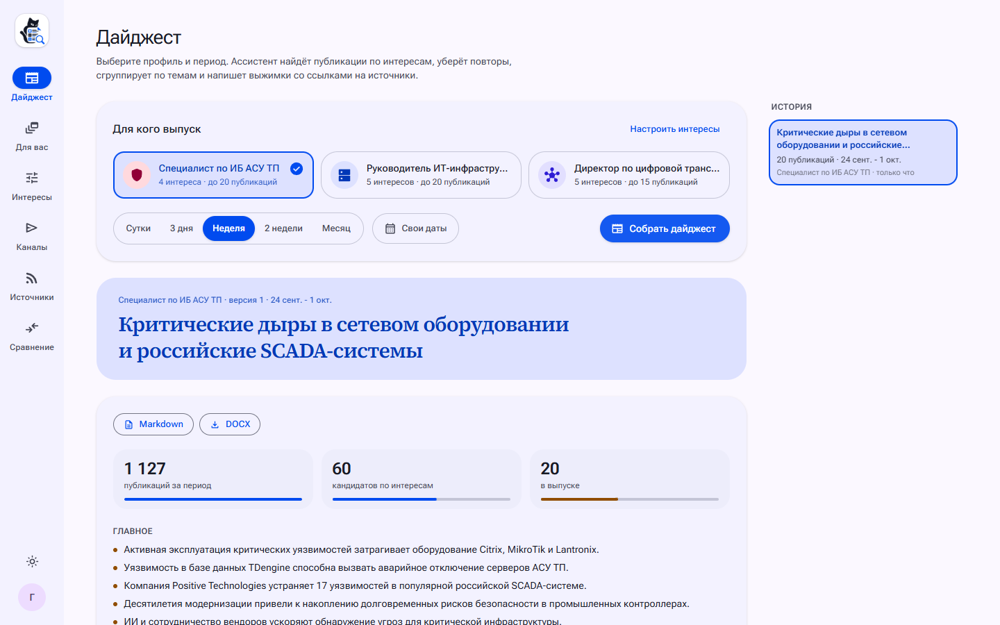

# Scrap&Grep: ИИ-ассистент дайджестов по ИТ и ИБ для энергетики

Scrap&Grep собирает новости ИТ и ИБ для энергокомпании и пишет по ним два выпуска: специалисту ИБ подробно за сутки, руководству тезисно за неделю. Новости приходят из 104 источников, включая сайты без ленты, защищённые от ботов, и Telegram-каналы, отбираются по интересам читателя, получают приоритет по правилу датасета организаторов и сверяются с текстом статей, CISA KEV и БДУ ФСТЭК. Аналитик ИБ собрал те же два выпуска за ту же неделю вручную: по его журналу 205 минут против 85 секунд у ассистента ([сравнение](docs/eval/vs-analyst.md)).

Решение хакатона «ИИ-ассистенты для энергетики» ([задание](docs/task/TASK.md)). [Видео](https://git.codenrock.com/codenrock/ii-assistenty/misis-mojarung/assistent-dlya-sozdaniya-it-ib-daydzhestov/uploads/36d3943d5863dd953afaaeee3f1b9afe/scrapgrep-demo.mp4), 5,5 минуты, без голоса, с субтитрами. [Презентация](docs/presentation/scrapgrep.pdf), 24 слайда, и её [редактируемая версия в PPTX](docs/presentation/scrapgrep.pptx). Примеры: [выпуск специалисту за сутки](examples/specialist-daily.md), [выпуск руководству за неделю](examples/management-weekly.md).



| Выпуск специалисту: уязвимости | Выпуск руководству |
|---|---|
|  |  |
| **Источники** | **Персональная лента** |
|  |  |

## Возможности

- 104 источника: ленты RSS и Atom, Telegram-каналы, сайты без ленты и сайты, защищённые от ботов. Любой читатель добавляет свой адрес, а ассистент сам понимает, лента это, страница новостей или канал ([как идёт сбор](docs/ARCHITECTURE.md#сбор)).
- Отбор по интересам читателя: поиск по смыслу и по словам, 60 лучших кандидатов оценивает модель, пересказы одной новости склеиваются в одну запись, у каждого отказа видна причина.
- Два выпуска в формате датасета, в Markdown и DOCX, из браузера или одной командой в консоли: специалисту разделы «Атаки» и «Уязвимости» с карточками и приоритетом, руководству тезисы с признаками датасета и блоком «Что это значит для нас» ([примеры](examples/README.md)).
- Сверка по базам: пока модель пишет карточку, она спрашивает инструмент `lookup_vulnerability` о CISA KEV, БДУ ФСТЭК, NVD, EPSS и Exploit-DB, а код сверяет карточку с текстом статьи.
- План на смену с галочками, где у невыпущенного исправления первыми идут временные меры, матрица риска 3×3 и путь каждой уязвимости по датам.
- Персональная лента «Для вас» подбирает статьи по интересам, резюме и отметкам читателя и объясняет каждую, а по отметкам профиль получает предложения новых тем.
- Читалка открывает статью в приложении, модель переводит английские и китайские тексты на русский, оригинал возвращается одной кнопкой.
- Вертикальный ролик по выпуску с субтитрами по словам и озвучкой, брифинг голосом для руководства на две минуты ([кадры ролика](docs/INSTALL.md#модули)).
- Telegram-каналы: боты публикуют новости по расписанию, у каждого канала своя аудитория и подача, посты правятся в редакторе с предпросмотром.
- MCP-сервер: Claude, Cursor или любой MCP-клиент читает ленту, выпуски и интересы читателя по его личному ключу.
- Модель меняется в `.env`: Yandex AI Studio, локальная модель в Ollama или vLLM для [закрытого контура](docs/INSTALL.md#закрытый-контур) или автономный режим без модели.
- Вход в один клик кнопками «Войти как читатель» и «Войти как администратор», а новый читатель проходит тур по всем разделам и собирает первый выпуск.

## Быстрый запуск

Нужен Docker с Compose v2. Порт `8080` должен быть свободен (меняется переменной `WEB_PORT`).

```bash
docker compose up -d --build
```

Откройте <http://localhost:8080> и нажмите «Войти как читатель»: откроется общий аккаунт с четырьмя примерами профилей, пароль не нужен. «Войти как администратор» открывает те же профили и вдобавок раздел «Аналитика» и инструменты каталога. Свой аккаунт заводится на вкладке «Регистрация», после неё откроется знакомство: тур по всем разделам, первый профиль интересов (по резюме, из шаблона или вручную) и первый выпуск. С `RADAR_AUTH=off` в `.env` экрана входа нет: каждый посетитель сразу получает свой временный аккаунт с примерами профилей.

При первом старте стек сам применит миграции, заведёт 104 источника и четыре примера профилей, загрузит снимок: 2068 реальных публикаций 75 источников каталога за 23 сентября - 3 октября 2026 года, и поставит в очередь опрос лент. Выпуск руководству за неделю собирается сразу. Выпуску специалисту за сутки нужны публикации последних суток: первый опрос приносит их за две-три минуты, а с `--fresh` сборка сама опросит источники, это около минуты.

Без браузера выпуск собирается из терминала, файлы `.md` и `.docx` появляются в папке `out/`:

```bash
docker compose run --rm cli digest --audience specialist   # специалисту за сутки
docker compose run --rm cli digest --audience management   # руководству за неделю
ls out/
```

Период, свой профиль и свои источники для консоли описаны в [docs/INSTALL.md](docs/INSTALL.md#выпуск-из-консоли).

По умолчанию включён автономный режим без моделей: поиск по n-граммам и ключевым словам, выжимки из текста статьи, резюме читается встроенным разборщиком (PDF с текстовым слоем, DOCX, TXT, Markdown) и сопоставляется с таблицей профессиональных направлений. Он нужен, чтобы прототип запускался на любой машине за минуту. Оценку каждого кандидата, выжимки, переводы и названия тем добавляет режим с моделями.

Режим с моделями. Оценки и тексты пишет Qwen3.6 35B-A3B, одна из моделей финала, в Ollama внутри стека. Эмбеддинги считает та же Ollama. Наружу ничего не уходит, ключи не нужны:

```bash
cp .env.example .env
# в .env: RADAR_EMBEDDING_PROVIDER=ollama и RADAR_LLM_PROVIDER=ollama
docker compose -f docker-compose.yml -f docker-compose.gpu.yml --profile ollama up -d --build
```

Размеры моделей, работа без видеокарты, vLLM и закрытый контур описаны в [docs/INSTALL.md](docs/INSTALL.md).

### Модули

Модули стека включаются профилями Compose, команды и переменные для каждого - в [docs/INSTALL.md](docs/INSTALL.md#модули).

| Профиль | Что добавляет |
|---|---|
| `ollama` | локальную языковую модель и эмбеддинги в Ollama |
| `docling` | разбор резюме через docling: вёрстка в две колонки, сканы, PPTX, ODT, HTML |
| `video` | короткие видео по выпуску: рендер на Remotion и воркер роликов |
| `voice` | озвучку роликов и брифинг голосом на Qwen3-TTS |
| `telegram-mock` | мок Bot API, чтобы попробовать публикацию в каналы без Telegram |
| `mail` | Mailpit, чтобы смотреть письма с выпусками без своего почтового сервера |
| `s3` | SeaweedFS для копий картинок статей |
| `solver` | FlareSolverr для сайтов, которые проверяют посетителя скриптом |

## Модели Яндекса

Стек целиком переходит на Yandex AI Studio без видеокарты и без Ollama. Нужны ключ API и идентификатор каталога Yandex Cloud, для голоса у сервисного аккаунта роль `ai.speechkit-tts.user`. В `.env` раскомментируйте три блока из `.env.example` и подставьте каталог и ключ:

```bash
# языковая модель: OpenAI-совместимый API
RADAR_LLM_PROVIDER=openai
RADAR_LLM_BASE_URL=https://ai.api.cloud.yandex.net/v1
RADAR_LLM_MODEL=gpt://<каталог>/qwen3.6-35b-a3b/latest
RADAR_LLM_PROJECT=<каталог>
RADAR_LLM_API_KEY=<ключ>
# эмбеддинги text-embeddings-v2: модель для статей и модель для запросов
RADAR_EMBEDDING_PROVIDER=openai
RADAR_EMBEDDING_BASE_URL=https://ai.api.cloud.yandex.net/v1
RADAR_EMBEDDING_MODEL=emb://<каталог>/text-embeddings-v2-doc/latest
RADAR_EMBEDDING_QUERY_MODEL=emb://<каталог>/text-embeddings-v2-query/latest
RADAR_EMBEDDING_PROJECT=<каталог>
RADAR_EMBEDDING_API_KEY=<ключ>
# голос роликов и брифингов: SpeechKit
RADAR_TTS_PROVIDER=yandex
RADAR_TTS_API_KEY=<ключ>
RADAR_TTS_FOLDER=<каталог>
RADAR_SHORTS_URL=http://shorts:3000
```

На одном сценарии Qwen3.6 35B в Yandex AI Studio собрала выпуск специалисту за 24 с и руководству за 17 с, `gpt-oss-120b` в облаке Ollama - за 193 и 113 с, а эмбеддинги Yandex v2 подняли точность первых 20 кандидатов профиля «Специалист по ИБ АСУ ТП» с 0,40 до 0,65. Команда запуска с роликами и все замеры - в [docs/INSTALL.md](docs/INSTALL.md#модели-яндекса).

## Документация

| Документ | Что внутри |
|---|---|
| [docs/SUMMARY.md](docs/SUMMARY.md) | возможности на двух страницах и главные замеры |
| [docs/TASK-MAP.md](docs/TASK-MAP.md) | где в решении каждое требование задания и ответ на каждый вопрос жюри, что нового в финале |
| [docs/DEMO.md](docs/DEMO.md) | план показа на 7 минут и все возможности по шагам со скриншотами |
| [docs/INSTALL.md](docs/INSTALL.md) | ключи консоли, модели, модули и профили Compose, закрытый контур, требования к железу, условия работы, разработка |
| [docs/ARCHITECTURE.md](docs/ARCHITECTURE.md) | что реализовано по требованиям, два режима, компоненты, путь данных, отказы, безопасность, стек и структура репозитория |
| [docs/DECISIONS.md](docs/DECISIONS.md) | почему решения такие и что показали замеры |
| [docs/QUALITY.md](docs/QUALITY.md) | тесты по частям, что проверено на запущенном стеке, примеры и входные данные |
| [docs/BUSINESS.md](docs/BUSINESS.md) | читатели, внедрение, стоимость и пилот; экономика: четырём читателям с недельными выпусками ассистент экономит 27 486 ₽ в месяц и окупается, пока ручной выпуск дольше 22 минут |
| [docs/CI.md](docs/CI.md) | задания GitLab CI/CD и GitHub Actions, запуск проверок у себя, выкатка стенда |
| [docs/eval/](docs/eval/) | сравнение с аналитиком, поиск, лента, подстройка профиля, ранжирование, склейка дублей, стоимость контура |
| [examples/](examples/README.md) | готовые выпуски в Markdown и DOCX, резюме, смена интересов, датасет организаторов, тот же выпуск на пяти моделях |
| [docs/presentation/](docs/presentation/README.md) | презентация на 24 слайда в PDF и PPTX |

## Тесты

966 тестов бэкенда на настоящих PostgreSQL, Valkey и ClickHouse с покрытием строк 86%, 841 тест фронтенда в 115 файлах с покрытием строк 98%; `ruff`, `mypy --strict`, `oxlint` и `tsc` без замечаний. GitLab (`.gitlab-ci.yml`, 17 заданий) и GitHub Actions (`.github/workflows/ci.yml`, 15 заданий) запускают одни и те же скрипты из `ci/`, прогон GitHub Actions всего кода 15 октября 2026 года прошёл целиком.

Задания и запуск у себя описаны в [docs/CI.md](docs/CI.md), результаты по частям - в [docs/QUALITY.md](docs/QUALITY.md#тесты).
