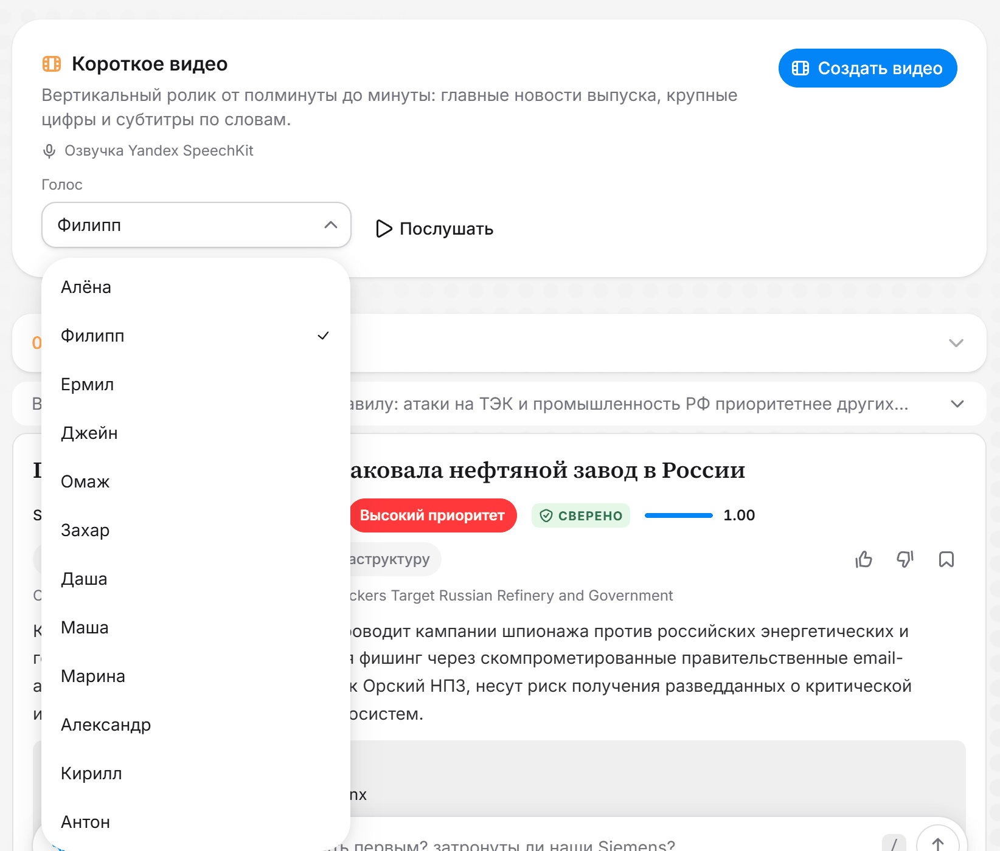
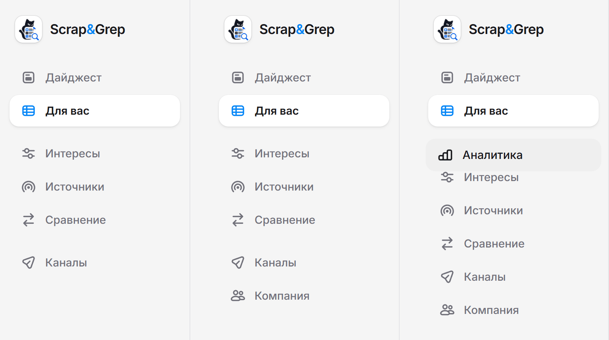
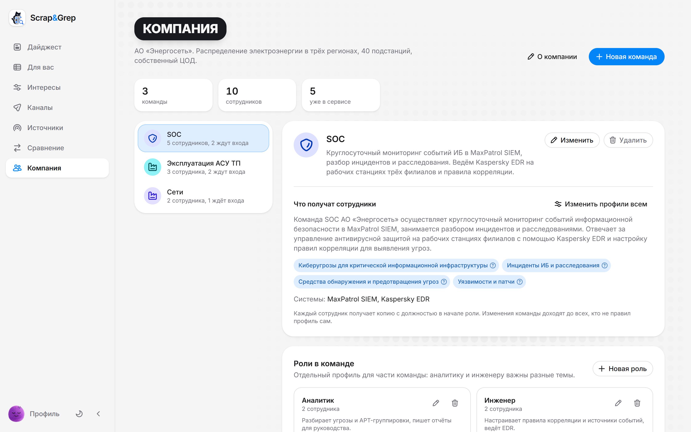
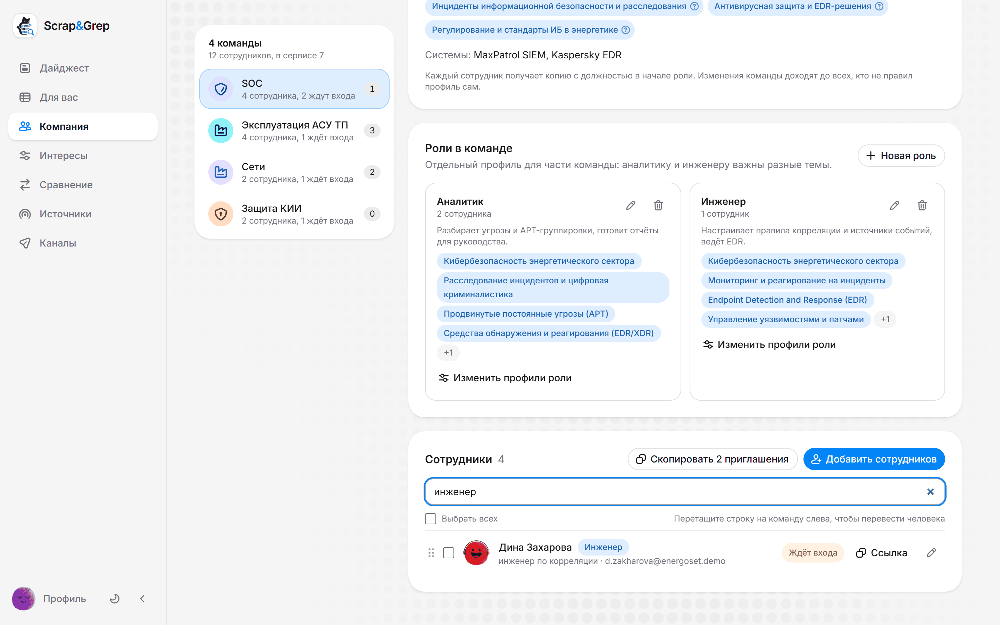
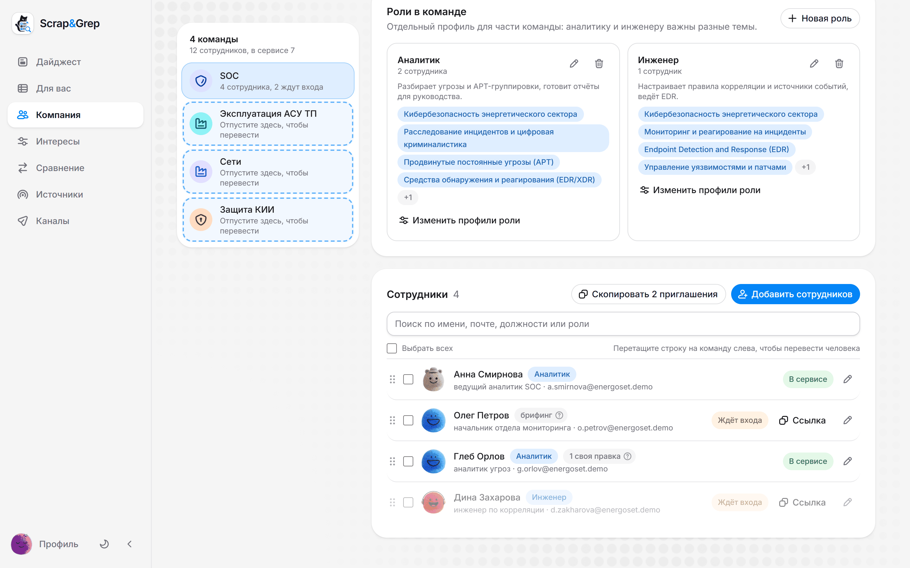
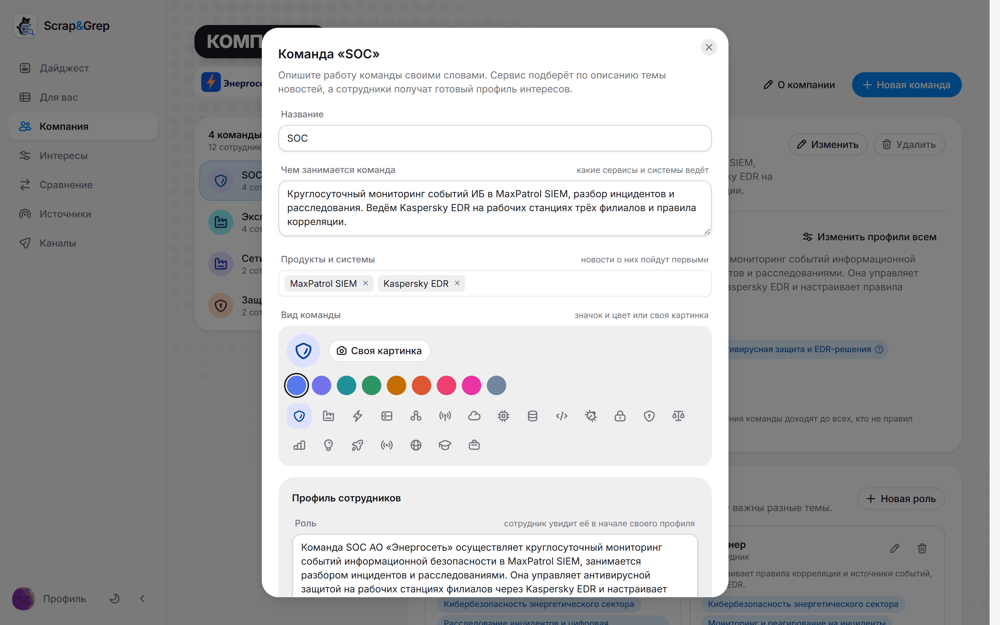
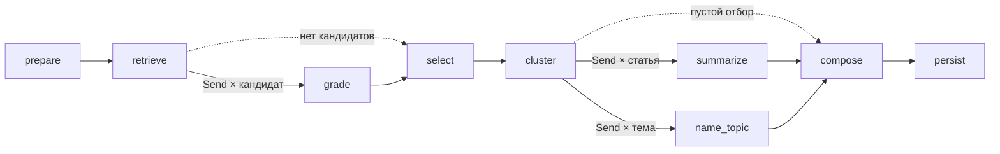

# Scrap&Grep: ИИ-ассистент дайджестов по ИТ и ИБ для энергетики

Scrap&Grep собирает новости ИТ и ИБ для энергокомпании и пишет по ним два выпуска: специалисту ИБ подробно за сутки, руководству тезисно за неделю. Новости приходят из 104 источников, включая сайты без ленты, защищённые от ботов, и Telegram-каналы, отбираются по интересам читателя, получают приоритет по правилу датасета организаторов и сверяются с текстом статей, CISA KEV и БДУ ФСТЭК. Аналитик ИБ собрал те же два выпуска за ту же неделю вручную: по его журналу 205 минут против 85 секунд у ассистента ([сравнение](docs/eval/vs-analyst.md)).

Руководитель заводит команды компании один раз, а сотрудники входят по ссылке с готовым профилем интересов.

Решение хакатона «ИИ-ассистенты для энергетики» ([задание](docs/task/TASK.md)). [Видео](https://git.codenrock.com/codenrock/ii-assistenty/misis-mojarung/assistent-dlya-sozdaniya-it-ib-daydzhestov/uploads/b74d86585f09e62fd997d44dbcdfa74d/scrapgrep-demo.mp4), 1 мин 30 с, с субтитрами. [Презентация](docs/presentation/scrapgrep.pdf), 13 слайдов, и её [редактируемая версия в PPTX](docs/presentation/scrapgrep.pptx). Примеры: [выпуск специалисту за сутки](examples/specialist-daily.md), [выпуск руководству за неделю](examples/management-weekly.md).


| Выпуск специалисту: уязвимости | Выпуск руководству |
|---|---|
|  |  |
| **Источники** | **Лента «Для вас»** |
|  |  |

## Возможности

Все шаги со скриншотами собраны в [DEMO, «Все возможности по шагам»](docs/DEMO.md#все-возможности-по-шагам).

### Сбор

- 104 источника: 68 лент RSS и Atom, 22 Telegram-канала, 12 сайтов без ленты, CISOCLUB через WordPress API и бюллетени Symantec через API Broadcom. Опрос каждые 15 минут ([сбор](docs/ARCHITECTURE.md#сбор)).
- Защищённые сайты читаются лестницей способов: заголовки Chrome, TLS-отпечаток Chrome через curl_cffi, браузер в стеке, FlareSolverr, прокси. Ступень и причина видны у источника ([лестница](docs/DECISIONS.md#сбор-лестница-способов-чтения)).
- Telegram-каналы читаются через открытое превью `t.me/s` без аккаунта и ключей. Короткий пост со ссылкой становится той статьёй, на которую ссылается.
- БДУ ФСТЭК приходит с полным текстом каждой уязвимости, рядом новости Positive Technologies.
- Свой источник по любому адресу: ассистент сам понимает, лента это, страница новостей, WordPress или канал, и до сохранения показывает три статьи.
- Здоровье источников: доля удачных опросов за сутки, ошибки по родам и источники, которые молчат дольше обычного ([здоровье](docs/DECISIONS.md#здоровье-источников)).

### Отбор

- Поиск по каждому интересу идёт по смыслу и по словам, 60 лучших кандидатов оценивает модель по шкале 0-3 и называет тип записи ([отбор](docs/ARCHITECTURE.md#отбор)).
- Пересказы одной новости склеиваются по тексту, заголовку, смыслу и номерам CVE и БДУ, ссылки на пересказы остаются в записи ([склейка](docs/eval/duplicates.md)).
- У каждого отказа есть причина, отказы видны в блоке «Не вошло в выпуск».
- Профиль интересов: роль, интересы с весом и ключевыми словами, исключения, порог и «Наши системы». Подборка пересчитывается в редакторе при каждой правке.
- Профиль подстраивается под отметки: смысл интересов сдвигается к понравившимся статьям, новые темы приходят предложениями ([подстройка](docs/eval/adaptation.md)).


### Выпуски

- Два формата датасета: специалисту разделы «Атаки» и «Уязвимости» с карточками и приоритетом, руководству тезисы с признаками и блоком «Что это значит для нас» ([примеры](examples/README.md)).
- Оба выпуска одного профиля собираются за один запуск, а выпуск переключается между чтением «Инженер» и «Руководитель».
- Карточка сверяется с текстом статьи. Пока модель её пишет, инструмент `lookup_vulnerability` спрашивает CISA KEV, БДУ ФСТЭК, NVD, EPSS и Exploit-DB.
- План на смену с галочками: у невыпущенного исправления первыми идут временные меры, отметки хранятся на сервере.
- Матрица риска 3×3 и путь каждой уязвимости по датам: NVD, эксплойт, CISA KEV, новость.
- Что изменилось за 30 дней у уязвимостей прошлых выпусков, а руководству период в цифрах против прошлого выпуска.
- Выгрузка «Для SOC»: индикаторы, CVE, BDU и техники ATT&CK в STIX 2.1, событием MISP и в CSV.
- Вопрос к выпуску получает ответ только по его записям, с их номерами.
- Сравнение двух выпусков показывает причину у каждой пришедшей и ушедшей статьи.
- Расписание: каждый день, по будням или раз в неделю, в своё время.
- Markdown и DOCX со ссылками, отправка на почту с DOCX во вложении.
- «Поля карточек» и «Блоки выпуска» в профиле прячут строки карточек и блоки вокруг записей, которые читателю не нужны.

### Лента и чтение

- «Для вас»: лента по интересам, резюме и отметкам, у каждой статьи объяснение, почему она здесь ([лента](docs/ARCHITECTURE.md#персональная-лента)).
- Вид «Посты» показывает ленту как канал Telegram: картинка статьи, аватар источника, реакции.
- Читалка открывает статью внутри приложения. Английские и китайские статьи модель переводит на русский, оригинал возвращается одной кнопкой ([читалка](docs/ARCHITECTURE.md#читалка-и-поиск-по-публикациям)).
- Поиск по публикациям по словам и по смыслу, время чтения по полному тексту статьи.

### Медиа

- Вертикальный ролик по выпуску: картинки статей, QR-код статьи, субтитры по словам, рендер на Remotion ([короткие видео](docs/ARCHITECTURE.md#короткие-видео)).
- Озвучка: четыре голоса Qwen3-TTS в стеке с проверкой каждой строки распознаванием или 12 русских голосов Yandex SpeechKit. Голос выбирается из выпадающего списка, а кнопка «Послушать» рядом с ним проигрывает образец.
- Брифинг голосом для руководства на две минуты из уже написанных текстов ([брифинг](docs/ARCHITECTURE.md#брифинг-голосом)).



### Каналы

- Telegram-боты публикуют новости в каналы по расписанию, у каждого канала своя аудитория, голос и подача ссылок ([публикация](docs/ARCHITECTURE.md#публикация-в-telegram)).
- Обычные и rich-посты, редактор с предпросмотром, модерация, обзор недели и мок Bot API для проверки без Telegram.

### Интеграции

- MCP-сервер: Claude, Cursor или другой MCP-клиент читает ленту, выпуски и интересы читателя по его личному ключу ([MCP](docs/ARCHITECTURE.md#mcp-для-ассистентов-и-время-чтения)).
- События в ClickHouse: показы с местом в списке, открытия, отметки, выпуски, вызовы MCP.
- Раздел «Аналитика» для администратора: доли открытий и отметок по дням, местам в ленте, источникам и категориям.
- Обучаемое ранжирование ленты на LightGBM: модель учится каждую ночь и включается, только если обгоняет ручные веса ([ранжирование](docs/eval/ranker.md)).


### Аккаунты

- Регистрация по почте и паролю, у каждого читателя свои профили, выпуски и отметки.
- Резюме при регистрации: контакты вырезаются до анализа, по должности и навыкам предлагается профиль ([резюме](docs/ARCHITECTURE.md#резюме)).
- Вход в один клик кнопками «Войти как читатель» и «Войти как администратор».
- Девять готовых аватарок или своё фото, свой значок и цвет у профиля, профиль можно отдать коллеге по ссылке.
- Разделы меню перетаскиваются в удобный порядок, он сохраняется в аккаунте и одинаков в любом браузере.
- Знакомство: тур по всем разделам, первый профиль интересов и первый выпуск.

| Вход | Меню читателя, руководителя компании и администратора |
|---|---|
|  |  |

### Компания и команды

- Раздел «Компания»: руководитель описывает команды своими словами, а модель по описанию подбирает каждой роль, темы новостей и продукты, которые команда ведёт. Без модели темы подбирает справочник направлений, как для резюме.
- Список сотрудников вставляется строками «имя, почта, должность» или столбцами из таблицы, и до добавления видно, как прочитана каждая строка. Каждый получает аккаунт с профилем команды и личную ссылку: задаёт пароль и сразу открывает свои выпуски.
- Роли внутри команды: аналитик и инженер одного SOC получают разные профили. Роль сама находит людей по должности, а руководители по должности читают брифинг вместо карточек.
- Одна правка уходит сразу всей команде, одной роли или выбранным людям: темы, исключения, продукты, формат и размер выпуска. Правка для отдельных людей сохраняется, когда меняется команда.
- Сотрудник переходит в другую команду перетаскиванием: за указателем едет карточка с именем, а команды, куда можно отпустить, подсвечиваются. Новый сотрудник получает профиль команды, а профиль, который человек поправил сам, остаётся его.
- Поиск над списком сотрудников сразу отбирает людей по имени, почте, должности или роли, а у каждой команды слева видно, сколько в ней совпадений.
- У команды свой вид: значок и цвет или своя картинка.
- Логотип компании загружается в окне «О компании» и виден сотрудникам в приглашении и в аккаунте.
- Меню зависит от роли. Читатель сам по себе ведёт выпуски, ленту и свои Telegram-каналы, а пространство компании заводит со страницы «Аккаунт». Сотрудник, которого добавила компания, читает выпуски и ленту. Руководитель пространства ведёт команды и каналы компании, администратор вдобавок видит «Аналитику».



| Поиск по сотрудникам | Перевод в другую команду | Вид команды |
|---|---|---|
|  |  |  |

### Модели

- Yandex AI Studio: тексты пишет Qwen3.6 35B или Alice AI LLM, эмбеддинги считает text-embeddings-v2, озвучивает SpeechKit ([«Модели Яндекса»](#модели-яндекса)).
- Ollama в стеке: Qwen3.6 35B-A3B и `embeddinggemma:300m`, данные остаются внутри.
- vLLM или любой сервер с OpenAI-совместимым API, модель меняется в `.env` без правки кода.
- Автономный режим без модели и закрытый контур с поставкой образов и моделей одной папкой ([закрытый контур](docs/INSTALL.md#закрытый-контур)).

## Стек

| Слой | Технологии |
|---|---|
| API | Python 3.14, FastAPI 0.142, SQLAlchemy 2.1, Pydantic 2.13, uvicorn; шлюз Caddy 2.11 |
| Воркеры и очереди | taskiq 0.13 на потоках Valkey; один образ бэкенда в шести ролях: `api`, `worker-ingest`, `worker-digest`, `worker-profile`, `worker-media`, `scheduler` |
| Граф сборки | LangGraph 1.2 с чекпоинтами в PostgreSQL, LangChain Core 1.6 |
| Хранилище | PostgreSQL 18 с pgvector 0.8.6 за PgBouncer 1.26, Valkey 9.1, ClickHouse 26.9.8; по желанию S3 на SeaweedFS 4.48 |
| Модели | Ollama 0.35.0, vLLM 0.30.0, Yandex AI Studio или любой OpenAI-совместимый API; ранжирование LightGBM 4.7 |
| Сбор | feedparser 6.0, trafilatura 2.2, curl_cffi 0.16 |
| Защищённые сайты | браузер Camoufox 0.5.6 в сервисе `browser`, FlareSolverr 3.5.2 |
| Резюме | docling 2.131 на Python 3.13 в отдельном контейнере, встроенный разбор на pypdf и python-docx |
| Фронтенд | Vite 8, React 19, TypeScript 6, Tailwind CSS 4, HeroUI 3.2 на React Aria Components 1.22, TanStack Query 5, TipTap 3.31, Motion 13 |
| Видео | Remotion 4.0.531 на Node 24 |
| Голос | Qwen3-TTS 12Hz 0.6B Base (`qwen-tts` 0.1.1, PyTorch 2.14 с CUDA 13), проверка строк faster-whisper 1.2.1, Yandex SpeechKit |
| MCP | официальный SDK `mcp` 2.2.0 |
| CI | GitLab CI/CD и GitHub Actions; ruff, mypy, pytest 9, oxlint, Vitest 5, hadolint, shellcheck, gitleaks, osv-scanner |

Версии зафиксированы в `backend/uv.lock`, `frontend/package-lock.json`, `shorts/package-lock.json`, `tts/uv.lock`, `docparser/uv.lock` и в образах `docker-compose.yml`. Почему выбраны эти технологии, написано в [DECISIONS](docs/DECISIONS.md).

## Как работает

Выпуск собирает граф LangGraph из девяти узлов (`backend/src/radar/pipeline/graph.py`). Оценка и тексты расходятся веером через `Send`: по задаче на кандидата, на статью и на тему.



| Узел | Что делает |
|---|---|
| `prepare` | досчитывает эмбеддинги статей периода, которых ещё нет |
| `retrieve` | ищет по каждому интересу по смыслу и по словам, берёт 60 лучших кандидатов |
| `grade` | модель оценивает кандидата по шкале 0-3 и называет тип записи: атака, уязвимость или новость |
| `select` | поправка по отметкам читателя, исключения, порог, склейка пересказов, лимит выпуска; у каждого отказа причина |
| `cluster` | специалисту раскладывает записи по разделам «Атаки» и «Уязвимости», остальное делит на темы по векторам |
| `summarize` | выжимка, «почему важно» и карточка с вызовом `lookup_vulnerability`, затем сверка карточки со статьёй |
| `name_topic` | название и обзор темы |
| `compose` | склеивает записи об одной уязвимости уже по карточкам и пишет обзор выпуска |
| `persist` | сохраняет выпуск, отказы и цифры сборки |

Чекпоинты лежат в PostgreSQL: упавший воркер продолжает с прерванного шага, а готовые ответы модели берутся из кеша. Прогресс по этапам идёт в браузер через SSE.

### Сбор публикаций

- Планировщик раз в 15 минут ставит опрос, по задаче на источник. Ленты запрашиваются с `If-None-Match` и `If-Modified-Since`, ответ 304 обходится без работы.
- Где в ленте только анонс, полный текст подтягивает trafilatura. Если сайт отказал, загрузчик поднимается по лестнице способов чтения.
- Адрес статьи приводится к каноническому виду, вставка идёт через `ON CONFLICT (url) DO NOTHING`, поэтому повторный опрос не даёт дублей.
- После вставки статья получает эмбеддинг. Векторы хранятся отдельно для каждой модели, при смене модели новые досчитываются в фоне.
- Справочные базы обновляются сами: CISA KEV и NVD раз в час, EPSS и Exploit-DB раз в сутки.

### Персональная лента

Вкус читателя складывается из граней: интересы, резюме, темы, выученные по лайкам и сохранениям, и темы, которых он избегает. Один SQL-запрос считает близость статей двух недель к каждой грани, к оценке добавляются свежесть, источник и «нравится коллегам». Каждое седьмое место отдаётся статье вне привычных тем, а ночью LightGBM учится на событиях из ClickHouse.

Компоненты стека, путь данных и отказы описаны в [ARCHITECTURE](docs/ARCHITECTURE.md).

## Запуск

### Быстрый запуск

Нужны Docker с Compose v2 и свободный порт `8080`, он меняется переменной `WEB_PORT`. Ключи и видеокарта для первого запуска не нужны.

```bash
git clone https://git.codenrock.com/codenrock/ii-assistenty/misis-mojarung/assistent-dlya-sozdaniya-it-ib-daydzhestov.git scrap-and-grep
cd scrap-and-grep
docker compose up -d --build
```

Откройте <http://localhost:8080> и нажмите «Войти как читатель»: откроется общий аккаунт с четырьмя примерами профилей, пароль не нужен. «Войти как администратор» открывает те же профили и вдобавок раздел «Аналитика» и инструменты каталога. Свой аккаунт заводится на вкладке «Регистрация», после неё откроется знакомство: тур по всем разделам, первый профиль интересов (по резюме, из шаблона или вручную) и первый выпуск. С `RADAR_AUTH=off` в `.env` экрана входа нет: каждый посетитель сразу получает свой временный аккаунт с примерами профилей.

При первом старте стек сам применит миграции, заведёт 104 источника и четыре примера профилей, загрузит снимок: 2068 реальных публикаций 75 источников каталога за 23 сентября - 3 октября 2026 года, и поставит в очередь опрос лент. Выпуск руководству за неделю собирается сразу. Выпуску специалисту за сутки нужны публикации последних суток: первый опрос приносит их за две-три минуты, а с `--fresh` сборка сама опросит источники, это около минуты.

### Требования к железу

Сборка - выпуск специалисту по ИБ АСУ ТП: 60 кандидатов, 20 записей, кеш ответов пуст. Одна карта собирает выпуски по очереди, параллельность дают вторая карта, vLLM или облако.

| Конфигурация | Железо | Сборка |
|---|---|---|
| Автономный режим | любой компьютер с Docker: стек без Ollama занял 2,3 ГБ памяти в пике, образы ядра 3,0 ГБ | 0,5 с |
| Yandex AI Studio | то же, видеокарта не нужна | 24 с на Qwen3.6 35B |
| `qwen3.5:9b` в Ollama | карта NVIDIA от 8 ГБ, замер на RTX 5070 12 ГБ; образ Ollama 10,4 ГБ и модель 6,6 ГБ | 81-102 с, 35-44 выпуска в час |
| `qwen3.5:0.8b` на процессоре | ноутбук Ryzen 7 7840HS, 16 ГБ, без видеокарты; стек 7,0 ГБ в пике | 731,5 с |
| `gpt-oss-120b` в vLLM | одна карта 80 ГБ, H100 или A100, веса 65 ГБ | около 45 с на H100 и 70 с на A100, расчёт по опубликованным скоростям |

Qwen3.6 35B-A3B, модель финала, весит в Ollama 22,6 ГБ и встаёт на карту 24 ГБ; на карте 12-16 ГБ слои, которые не поместились, Ollama считает на процессоре. В vLLM та же модель идёт с весами AWQ 25 ГБ на карте от 24 ГБ. Где снят каждый замер и как повторить его на своей карте, написано в [INSTALL, «Требования к железу»](docs/INSTALL.md#требования-к-железу).

### Режимы

| Режим | Что даёт | Что нужно |
|---|---|---|
| Автономный, по умолчанию | поиск по n-граммам и ключевым словам, выжимки из текста статьи, резюме по таблице 17 направлений; выпуск за 0,5 с | любой компьютер с Docker |
| Локальная Qwen3.6 в Ollama | оценки, выжимки, переводы и названия тем внутри стека, ключи не нужны | видеокарта NVIDIA, без неё модель работает на процессоре |
| Yandex AI Studio | Qwen3.6 35B, эмбеддинги text-embeddings-v2 и голос SpeechKit из облака | ключ API и каталог Yandex Cloud |
| vLLM | та же Qwen3.6 35B-A3B с пакетной обработкой запросов | карта от 24 ГБ |

Локальная модель. Оценки и тексты пишет Qwen3.6 35B-A3B, одна из моделей финала, эмбеддинги считает та же Ollama. При первом запуске скачаются `embeddinggemma:300m` (0,6 ГБ) и `qwen3.6:35b-a3b` (22,6 ГБ). Без видеокарты файл `docker-compose.gpu.yml` убирается из команды.

```bash
cp .env.example .env
# в .env: RADAR_EMBEDDING_PROVIDER=ollama и RADAR_LLM_PROVIDER=ollama
docker compose -f docker-compose.yml -f docker-compose.gpu.yml --profile ollama up -d --build
```

vLLM. Языковая модель переходит в vLLM, эмбеддинги остаются в Ollama:

```bash
# в .env: RADAR_EMBEDDING_PROVIDER=ollama
#         RADAR_LLM_PROVIDER=openai
#         RADAR_LLM_BASE_URL=http://vllm:8000/v1
#         RADAR_LLM_MODEL=qwen3.6-35b-a3b
#         RADAR_LLM_CONCURRENCY=8
docker compose -f docker-compose.yml -f docker-compose.vllm.yml --profile ollama --profile vllm up -d
```

### Модели Яндекса

Стек целиком переходит на Yandex AI Studio без видеокарты и без Ollama. Нужны ключ API и идентификатор каталога Yandex Cloud, для голоса у сервисного аккаунта роль `ai.speechkit-tts.user`. В `.env` раскомментируйте три блока из `.env.example` и подставьте каталог и ключ:

```bash
# языковая модель: OpenAI-совместимый API
RADAR_LLM_PROVIDER=openai
RADAR_LLM_BASE_URL=https://ai.api.cloud.yandex.net/v1
RADAR_LLM_MODEL=gpt://<каталог>/qwen3.6-35b-a3b/latest
RADAR_LLM_PROJECT=<каталог>
RADAR_LLM_API_KEY=<ключ>
# эмбеддинги text-embeddings-v2: модель для статей и модель для запросов
RADAR_EMBEDDING_PROVIDER=openai
RADAR_EMBEDDING_BASE_URL=https://ai.api.cloud.yandex.net/v1
RADAR_EMBEDDING_MODEL=emb://<каталог>/text-embeddings-v2-doc/latest
RADAR_EMBEDDING_QUERY_MODEL=emb://<каталог>/text-embeddings-v2-query/latest
RADAR_EMBEDDING_PROJECT=<каталог>
RADAR_EMBEDDING_API_KEY=<ключ>
# голос роликов и брифингов: SpeechKit
RADAR_TTS_PROVIDER=yandex
RADAR_TTS_API_KEY=<ключ>
RADAR_TTS_FOLDER=<каталог>
RADAR_SHORTS_URL=http://shorts:3000
```

Стек с роликами поднимается так:

```bash
docker compose --profile video up -d --build
```

На одном сценарии Qwen3.6 35B в Yandex AI Studio собрала выпуск специалисту за 24 с и руководству за 17 с, `gpt-oss-120b` в облаке Ollama - за 193 и 113 с, а эмбеддинги Yandex v2 подняли точность первых 20 кандидатов профиля «Специалист по ИБ АСУ ТП» с 0,40 до 0,65. Все замеры - в [INSTALL](docs/INSTALL.md#модели-яндекса).

### Модули

Модуль включается профилем Compose: `--profile <имя>` в команде запуска и строка из `.env.example` в `.env`. Подробности по каждому - в [INSTALL, «Модули»](docs/INSTALL.md#модули).

| Профиль | Что добавляет |
|---|---|
| `ollama` | локальную языковую модель и эмбеддинги в Ollama |
| `docling` | разбор резюме через docling: вёрстка в две колонки, сканы, PPTX, ODT, HTML |
| `video` | короткие видео по выпуску: рендер на Remotion и воркер роликов |
| `voice` | озвучку роликов и брифинг голосом на Qwen3-TTS |
| `telegram-mock` | мок Bot API, чтобы попробовать публикацию в каналы без Telegram |
| `mail` | Mailpit, чтобы смотреть письма с выпусками без своего почтового сервера |
| `s3` | SeaweedFS для копий картинок статей |
| `solver` | FlareSolverr для сайтов, которые проверяют посетителя скриптом |
| `vllm` | языковую модель в vLLM, вместе с файлом `docker-compose.vllm.yml` |

### Закрытый контур

На машине с интернетом `scripts/offline_bundle.sh` собирает поставку одной папкой: образы, модели Ollama и сам репозиторий. На целевой машине нужен только Docker:

```bash
scripts/offline_bundle.sh save /media/radar-bundle                     # на машине с интернетом
bash /media/radar-bundle/offline_bundle.sh load /media/radar-bundle /srv/radar
cd /srv/radar
docker compose -f docker-compose.yml -f docker-compose.gpu.yml -f docker-compose.airgap.yml --profile ollama up -d --no-build
```

`load` сверяет контрольные суммы, загружает образы и раскладывает модели. `docker-compose.airgap.yml` делает все сети Docker внутренними, а источники читаются через один прокси стека `egress`: он пускает только к публичным адресам на порты 80 и 443 и пишет каждый запрос в журнал, с `EGRESS_UPSTREAM` в `.env` ходит через корпоративный прокси. Подробности в [INSTALL, «Закрытый контур»](docs/INSTALL.md#закрытый-контур).

### Консоль

Без браузера выпуск собирается из терминала, файлы `.md` и `.docx` появляются в папке `out/`:

```bash
docker compose run --rm cli digest --audience specialist   # специалисту за сутки
docker compose run --rm cli digest --audience management   # руководству за неделю
ls out/
```

- Без `--audience` собираются оба выпуска.
- `--days` меняет длину периода, `--period-end` переносит его конец в прошлое, например на снимок.
- `--fresh` опрашивает источники перед сборкой.
- `--profile-file` берёт профиль из файла в формате [examples/profiles](examples/profiles), `--sources` добавляет свои адреса из файла в `out/`.
- `--mail-to` отправляет выпуск на почту, когда настроен почтовый сервер.

Все ключи описаны в [INSTALL, «Выпуск из консоли»](docs/INSTALL.md#выпуск-из-консоли).

### Главные переменные `.env`

Значения по умолчанию взяты из `docker-compose.yml`, стек запускается и без `.env`.

| Переменная | По умолчанию | Что задаёт |
|---|---|---|
| `WEB_PORT` | `8080` | порт интерфейса |
| `RADAR_AUTH` | `on` | `off` убирает экран входа, каждый посетитель получает временный аккаунт |
| `RADAR_PRESET_LOGIN` | `true` | кнопки «Войти как читатель» и «Войти как администратор» |
| `RADAR_DEMO_LOGIN` | `false` | гостевой вход «Войти без регистрации» с аккаунтом на сутки |
| `RADAR_LLM_PROVIDER` | `heuristic` | `ollama` или `openai` включают языковую модель |
| `RADAR_LLM_MODEL` | `qwen3.6:35b-a3b` | имя языковой модели |
| `RADAR_LLM_BASE_URL`, `RADAR_LLM_API_KEY`, `RADAR_LLM_PROJECT` | пусто | адрес, ключ и каталог OpenAI-совместимого сервера |
| `RADAR_LLM_REASONING` | `off` | рассуждения модели: `off`, `low`, `medium`, `high` |
| `RADAR_LLM_CONCURRENCY` | `2` | одновременных запросов к модели на воркер |
| `RADAR_EMBEDDING_PROVIDER` | `hashing` | `ollama` или `openai` включают эмбеддинги модели |
| `RADAR_EMBEDDING_MODEL` | `embeddinggemma:300m` | модель эмбеддингов статей |
| `RADAR_EMBEDDING_QUERY_MODEL`, `RADAR_EMBEDDING_BASE_URL`, `RADAR_EMBEDDING_API_KEY`, `RADAR_EMBEDDING_PROJECT` | пусто | модель запросов, адрес, ключ и каталог для Yandex AI Studio |
| `RADAR_TTS_PROVIDER` | `service` | `yandex` переводит озвучку на SpeechKit |
| `RADAR_TTS_URL` | пусто | сервис голоса `http://tts:8000`, профиль `voice` |
| `RADAR_TTS_API_KEY`, `RADAR_TTS_FOLDER` | пусто | ключ и каталог SpeechKit |
| `RADAR_SHORTS_URL` | пусто | рендер роликов `http://shorts:3000`, профиль `video` |
| `RADAR_SECRET_KEY` | пусто | ключ шифрования токенов ботов Telegram: `openssl rand -base64 32` |

Остальные переменные с пояснениями лежат в `.env.example`.

### Остановка

```bash
docker compose down
```

Данные остаются в томах Docker: база, события, очереди, модели Ollama и медиафайлы, и следующий `up` продолжает с того же места. Стек с профилями и файлами override останавливается с теми же `-f` и `--profile`, что и запуск. Начать с чистой базы помогает `docker compose down -v`.

Все ключи консоли, модули, условия работы и запуск для разработки описаны в [docs/INSTALL.md](docs/INSTALL.md).

## Документация

| Документ | Что внутри |
|---|---|
| [docs/SUMMARY.md](docs/SUMMARY.md) | возможности на двух страницах и главные замеры |
| [docs/TASK-MAP.md](docs/TASK-MAP.md) | где в решении каждое требование задания и ответ на каждый вопрос жюри, что нового в финале |
| [docs/DEMO.md](docs/DEMO.md) | план показа на 7 минут и все возможности по шагам со скриншотами |
| [docs/INSTALL.md](docs/INSTALL.md) | ключи консоли, модели, модули и профили Compose, закрытый контур, требования к железу, условия работы, разработка |
| [docs/ARCHITECTURE.md](docs/ARCHITECTURE.md) | что реализовано по требованиям, два режима, компоненты, путь данных, отказы, безопасность, стек и структура репозитория |
| [docs/DECISIONS.md](docs/DECISIONS.md) | почему решения такие и что показали замеры |
| [docs/QUALITY.md](docs/QUALITY.md) | тесты по частям, что проверено на запущенном стеке, примеры и входные данные |
| [docs/BUSINESS.md](docs/BUSINESS.md) | читатели, внедрение, стоимость и пилот; экономика: четырём читателям с недельными выпусками ассистент экономит 27 486 ₽ в месяц и окупается, пока ручной выпуск дольше 22 минут |
| [docs/CI.md](docs/CI.md) | задания GitLab CI/CD и GitHub Actions, запуск проверок у себя, выкатка стенда |
| [docs/eval/](docs/eval/) | сравнение с аналитиком, поиск, лента, подстройка профиля, ранжирование, склейка дублей, стоимость контура |
| [examples/](examples/README.md) | готовые выпуски в Markdown и DOCX, резюме, смена интересов, датасет организаторов, тот же выпуск на пяти моделях |
| [docs/presentation/](docs/presentation/README.md) | презентация на 13 слайдов в PDF и PPTX с анимированными экранами |

## Нагрузка

Сценарий `scripts/load/read.js` для k6: 50 виртуальных пользователей 30 секунд листают статьи, ищут по тексту, открывают список выпусков, выпуск и ленту. Запросы идут через шлюз Caddy. Замер 30 сентября на одной машине (12 логических ядер, 32 ГБ, RTX 5070), где одновременно работали генератор нагрузки и модель на видеокарте.

| Реплик `api` | Запросов в секунду | p95 | p99 | Ошибок |
|---|---|---|---|---|
| 2 | 406 | 189 мс | 269 мс | 0 из 12 241 |
| 4 | 615 | 128 мс | 159 мс | 0 из 18 565 |
| 4, одну остановили `docker kill` на 10-й секунде | 519 | 151 мс | 194 мс | 0 из 15 670 |

Реплики добавляются командой `docker compose up -d --scale api=4` без перезапуска шлюза: Caddy находит их по DNS и уводит запросы с упавшей. Повторить замер:

```bash
docker run --rm --network radar_default -v "${PWD}/scripts/load:/scripts" \
  -e BASE=http://web grafana/k6 run /scripts/read.js
```

Остановка Valkey, воркера посреди сборки и сервера модели разобрана в [DECISIONS, «Нагрузка и отказы»](docs/DECISIONS.md#нагрузка-и-отказы).

## Тесты и CI

1005 тестов бэкенда на настоящих PostgreSQL, Valkey и ClickHouse с покрытием строк 87%, 903 теста фронтенда в 126 файлах с покрытием строк 96,8%; `ruff`, `mypy --strict`, `oxlint` и `tsc` без замечаний. GitLab CI (`.gitlab-ci.yml`, 17 заданий) и GitHub Actions (`.github/workflows/ci.yml`, 16 заданий) запускают одни и те же скрипты из `ci/`, и каждый из них запускается у себя командой `sh ci/<скрипт>.sh`. Задание `stand:yandex` поднимает весь стек коммита на моделях Yandex AI Studio и проходит по нему путь жюри: выпуск, ролик с голосом, резюме и пространство компании.

Задания и запуск у себя описаны в [docs/CI.md](docs/CI.md), результаты по частям - в [docs/QUALITY.md](docs/QUALITY.md#тесты).
