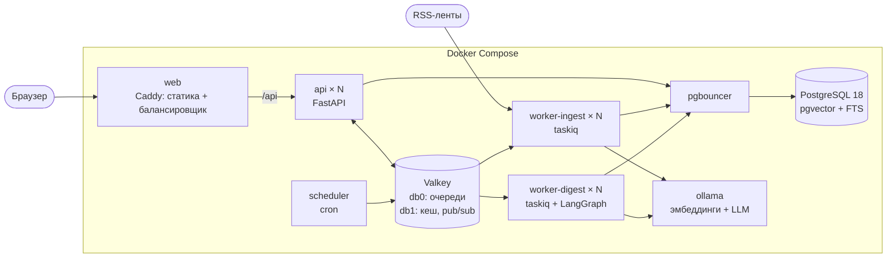
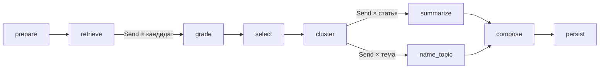

# Архитектура

Документ описывает, из чего состоит «Радар», как данные проходят от RSS-ленты до готового выпуска и что происходит, когда что-то ломается. Обоснование выбора технологий и замеры вынесены в [DECISIONS.md](DECISIONS.md).

## Компоненты



Один образ бэкенда запускается в четырёх ролях: `api`, `worker-ingest`, `worker-digest`, `scheduler`. Состояния в них нет, поэтому первые три масштабируются флагом `--scale` без перенастройки. Всё, что хранит данные, вынесено в отдельные сервисы.

| Сервис | Что делает | Масштабирование |
|---|---|---|
| `web` | Caddy 2.11 отдаёт собранный фронтенд и проксирует `/api/*` на реплики `api` | реплики за внешним балансировщиком |
| `api` | REST, поток прогресса SSE, постановка задач в очередь | `--scale api=N` |
| `worker-ingest` | опрос лент, загрузка полного текста, эмбеддинги новых статей | `--scale worker-ingest=N` |
| `worker-digest` | сборка выпуска: граф LangGraph с чекпоинтами | `--scale worker-digest=N`, упирается в модель |
| `scheduler` | раз в 15 минут ставит задачу опроса, раз в 10 минут чистит зависшие выпуски | один экземпляр |
| `pgbouncer` | пул соединений в режиме transaction | не нужно |
| `postgres` | статьи, векторы, профили, выпуски, чекпоинты графа | вертикально, реплики на чтение |
| `valkey` | очереди (Streams), кеш, блокировки, pub/sub | отдельные экземпляры под очередь и кеш |
| `ollama` | модели, профиль `ollama` | по экземпляру на GPU |

Наружу опубликован один порт, `web`. База, брокер и Ollama доступны только внутри сети Compose.

## Путь данных

### Сбор

Планировщик ставит задачу `ingest_all`, та раскладывает по одной задаче на источник. Воркер берёт блокировку на источник в Valkey, запрашивает ленту с `If-None-Match` и `If-Modified-Since` и на ответ 304 ничего не делает. Из записей ленты получаются статьи: заголовок и анонс очищаются от HTML, адрес приводится к каноническому виду (без `utm_*`, якоря, `www.`), будущая дата обрезается до текущего момента. Вставка идёт через `ON CONFLICT (url) DO NOTHING`, поэтому повторная доставка задачи не создаёт дублей.

У источников, где в ленте только анонс, включена загрузка полного текста через trafilatura: не больше 40 страниц за проход и не больше 4 одновременно. Если страница не открылась, остаётся анонс.

После вставки ставится задача эмбеддинга. Векторы лежат в отдельной таблице с ключом `(article_id, model)`. При смене модели старые векторы остаются, а новые досчитываются в фоне или прямо при сборке первого выпуска.

Адрес ленты вводит пользователь, а запрос уходит изнутри сети, поэтому каждый запрос проходит проверку: схема только `http` или `https`, все адреса хоста публичные, соединение идёт на тот адрес, который прошёл проверку (имя остаётся в `Host` и SNI). Редиректы обрабатываются вручную с той же проверкой на каждом шаге, размер ответа ограничен 8 МБ, общее время загрузки 60 секундами.

### Отбор

Профиль читателя состоит из роли, списка интересов (название, описание, ключевые слова, важность), исключений, порога релевантности и размера выпуска.

Для каждого интереса выполняется один SQL-запрос по окну периода. Он считает косинусную близость вектора интереса ко всем статьям окна, берёт лучшие по близости и лучшие по полнотекстовому поиску и возвращает их объединение вместе со средним и стандартным отклонением близости по окну.

Ключевое решение здесь такое: порог применяется не к самой близости, а к её z-оценке, то есть к тому, насколько статья ближе к интересу, чем типичная статья периода. Сырые косинусы у разных моделей несравнимы: одна укладывает всё в 0,4-0,7, другая в 0,0-0,3. С z-оценкой порог 0,5 в профиле значит одно и то же при любой модели.

```
оценка поиска = 0,2 + 0,18 · z + 0,12 (если есть совпадение по ключевым словам)
```

Дальше каждого кандидата оценивает языковая модель по шкале 0-3 со структурированным ответом по JSON-схеме. Итог складывается так: 70% оценки модели и 30% оценки поиска, затем умножение на важность интереса. Без модели в итог идёт только оценка поиска.

После оценки применяются правила, и они не зависят от модели:

1. Исключения. Статья отбрасывается, если в ней есть все значимые слова исключения или она по смыслу ближе к исключению, чем к интересу, причём z не меньше 3,5.
2. Порог релевантности из профиля.
3. Склейка пересказов. Две статьи считаются одной новостью, если совпадает хеш текста, либо заголовки делят не меньше трёх слов при коэффициенте Жаккара от 0,6, либо косинус векторов выше порога модели (0,76 для `embeddinggemma:300m`). Остаётся версия с большей оценкой, остальные сохраняются как ссылки «также об этом».
4. Лимит выпуска.

Все оценённые кандидаты, включая отброшенных, записываются в базу с причиной отказа. В интерфейсе они видны в блоке «Не вошло в выпуск».

### Группировка и тексты

Отобранные статьи кластеризуются по векторам: агломеративная кластеризация со связью Уорда на нормированных векторах. Число тем берётся из размера выпуска, примерно одна тема на пять записей, от двух до шести. Если при этом получается тема из одной статьи, число уменьшается. Порог расстояния не используется по той же причине, что и сырой косинус в отборе. Выбор числа тем по силуэту я пробовал и отказался от него, подробности в DECISIONS.md.

Модель даёт каждой теме название и обзор, каждой статье пишет выжимку и строку «почему важно» под роль читателя, английские заголовки переводит. Русские заголовки остаются как в источнике: при перефразировании модель один раз заменила «выпустит» на «представил», и этого хватило, чтобы запретить ей трогать оригинал.

### Граф сборки



Граф описан в `backend/src/radar/pipeline/graph.py`. Состояние хранит только JSON-совместимые словари. Оценка и выжимка расходятся веером через `Send`: одна задача на кандидата, одна на статью, одна на тему.

Чекпоинты пишутся в PostgreSQL через `AsyncPostgresSaver`, идентификатор потока графа равен идентификатору выпуска. После падения воркера сборка продолжается с того шага, на котором оборвалась, а завершённые шаги (поиск, отбор) не повторяются.

Внутри шага-веера гарантия слабее, чем я рассчитывал. Если одна задача шага упала с ошибкой, результаты остальных сохраняются и при повторе выполняется только она. Если же процесс убит, шаг начинается заново: LangGraph записывает результаты задач шага при его завершении. От повторной оплаты вызовов модели защищает другой слой: каждый ответ модели кешируется в момент получения, и перезапущенный шаг берёт уже готовые оценки из кеша.

Узлы сообщают о прогрессе через `get_stream_writer()`. Воркер публикует события в канал Valkey, любая реплика `api` отдаёт их браузеру по SSE. Раз в несколько процентов прогресс пишется в строку выпуска, поэтому клиент, подключившийся позже, сразу видит текущее состояние.

## Кеш

| Что | Ключ | Срок |
|---|---|---|
| Векторы интересов и исключений | модель + текст | 7 дней |
| Оценка статьи моделью | модель + версия промпта + отпечаток профиля + хеш текста | 7 дней |
| Выжимка статьи | модель + версия промпта + роль + интерес + хеш текста | 30 дней |
| Предпросмотр отбора | модель + отпечаток профиля + окно, округлённое до 5 минут | 60 секунд |
| Экспорт Markdown и DOCX | идентификатор выпуска | сутки |
| Состояние ленты (ETag, Last-Modified) | в таблице `sources` | до следующего ответа 200 |

В кеш попадают только ответы модели. Ответ резервного алгоритма не кешируется, иначе после восстановления модели он подменял бы её.

Любая операция с кешем при ошибке Valkey превращается в промах. Политика вытеснения `volatile-lru` удаляет только ключи со сроком жизни, а у сообщений очереди срока нет.

## Отказы

| Что сломалось | Что происходит |
|---|---|
| Упала реплика `api` | Caddy получает отказ соединения, повторяет запрос на другой реплике и 10 секунд не шлёт на упавшую |
| Упал `worker-digest` посреди сборки | сообщение остаётся неподтверждённым в потоке; по истечении `RADAR_DIGEST_TASK_TIMEOUT_SECONDS` (по умолчанию 20 минут) его забирает другой воркер и продолжает с прерванного шага; оценки, полученные до сбоя, берутся из кеша ответов модели |
| Сборка идёт дольше лимита | задача прерывается до истечения блокировки и повторяется с чекпоинта, всего до трёх попыток; после третьей выпуск помечается неудачным |
| Недоступен сервер LLM | после трёх ошибок подряд предохранитель на 30 секунд перестаёт к нему обращаться; оценки и тексты делает резервный алгоритм, в выпуске указано, какая часть обработана без модели |
| Недоступен сервер эмбеддингов | поиск идёт только полнотекстовый, ранее посчитанные векторы продолжают работать |
| Недоступен Valkey | чтение работает без кеша, ограничение частоты запросов отключается, создание выпуска отвечает 503 |
| Лента отвечает ошибкой | три попытки с растущей паузой, затем ошибка записывается у источника и видна в интерфейсе; остальные источники не затронуты |
| Выпуск завис в очереди | через три лимита сборки фоновая задача помечает его неудачным |

Первые две строки, четвёртая и шестая проверены на запущенном стеке, результаты в [DECISIONS.md](DECISIONS.md).

## Масштабирование

Запросы на чтение упираются в процессор реплик `api`, и добавление реплик помогает сразу. Замер с двумя и четырьмя репликами приведён в DECISIONS.md.

Сборка выпусков упирается в скорость генерации модели. На одной видеокарте параллельные запросы к Ollama общую пропускную способность не увеличили (76 против 84 токенов в секунду), поэтому больше воркеров сборки на одну карту не ускоряют работу, а только удлиняют очередь. Прирост даёт второй экземпляр Ollama на второй карте или замена сервера моделей. Для замены нужно реализовать два интерфейса из `backend/src/radar/ai/`: `Embedder` и `Intelligence`.

Сбор лент ограничен сетью, и его воркеры масштабируются независимо от сборки: у них отдельная очередь. Это сделано, чтобы пачка запросов на выпуски не задерживала опрос источников.

На одном экземпляре PostgreSQL система проживёт долго, но есть три места, которые придётся менять при росте:

- Поиск сейчас точный, полным проходом по окну периода. На неделе публикаций (около 850 статей) это миллисекунды. После нескольких сотен тысяч статей в окне плотную часть запроса нужно перевести на индекс HNSW с итеративным сканом, а статистику считать по выборке. Индекс уже создан.
- Таблицу `articles` стоит секционировать по месяцам, когда счёт пойдёт на миллионы.
- Очередь и кеш сейчас делят один экземпляр Valkey в разных логических базах. Под нагрузкой их нужно разнести: у очереди требование надёжности, у кеша требование скорости.

## Безопасность

Прототип однопользовательский и рассчитан на запуск в доверенной сети: учётных записей и разграничения доступа нет. Что сделано и чего нет, перечислено честно.

Сделано: защита от SSRF с привязкой соединения к проверенному адресу; экранирование текста статей и ответов модели в Markdown; ссылки во фронтенде проходят проверку схемы; CSP без inline-скриптов; ограничение частоты для изменяющих запросов, предпросмотра и создания выпусков; контейнеры бэкенда работают без root, с файловой системой только на чтение и без capabilities; текст статьи в промпте обёрнут в блок данных, закрыть который статья не может; ответ модели ограничен JSON-схемой и не попадает ни в SQL, ни в адреса, ни в командную строку.

Не сделано, и перед выходом в открытую сеть это обязательно: аутентификация и разделение данных по пользователям, TLS, пароль у Valkey и свой пароль у PostgreSQL, ограничение частоты для GET-запросов и потоков SSE, отключение `/api/docs`. Вредоносная статья по-прежнему может уговорить модель поставить себе высокую оценку и попасть в выпуск: структурированный вывод ограничивает ущерб, но не исключает само влияние.
