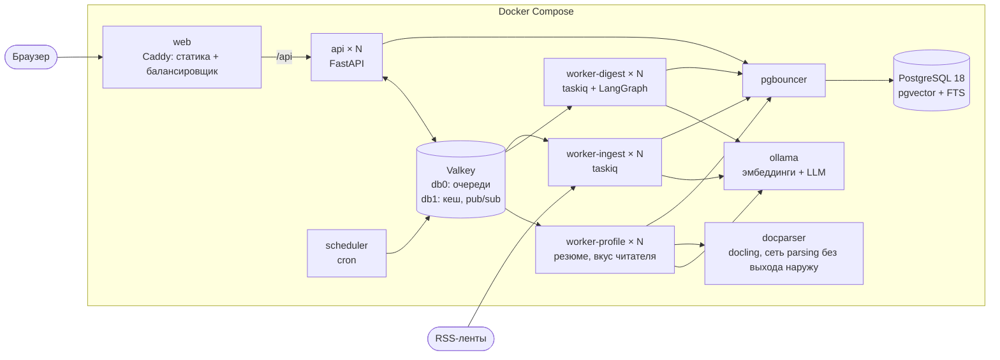
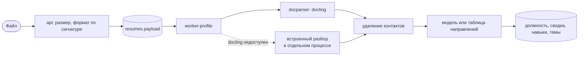
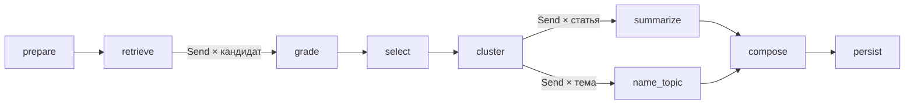

# Архитектура

Документ описывает, из чего состоит «Радар», как данные проходят от RSS-ленты до готового выпуска и персональной ленты, как устроены аккаунты и разбор резюме и что происходит, когда что-то ломается. Обоснование выбора технологий и замеры вынесены в [DECISIONS.md](DECISIONS.md).

## Компоненты



Один образ бэкенда запускается в пяти ролях: `api`, `worker-ingest`, `worker-digest`, `worker-profile`, `scheduler`. Состояния в них нет, поэтому все, кроме планировщика, масштабируются флагом `--scale` без перенастройки. Всё, что хранит данные, вынесено в отдельные сервисы. Разборщик документов `docparser` - отдельный образ на Python 3.13 с docling и CPU-сборкой PyTorch.

| Сервис | Что делает | Масштабирование |
|---|---|---|
| `web` | Caddy 2.11 отдаёт собранный фронтенд и проксирует `/api/*` на реплики `api` | реплики за внешним балансировщиком |
| `api` | REST, поток прогресса SSE, постановка задач в очередь | `--scale api=N` |
| `worker-ingest` | опрос лент, загрузка полного текста, эмбеддинги новых статей | `--scale worker-ingest=N` |
| `worker-digest` | сборка выпуска: граф LangGraph с чекпоинтами | `--scale worker-digest=N`, упирается в модель |
| `worker-profile` | разбор резюме, пересчёт вектора вкуса после оценок: работа, которую читатель ждёт у экрана | `--scale worker-profile=N` |
| `docparser` | docling: документ на входе, Markdown на выходе; профиль `docling` | реплики за DNS-именем |
| `scheduler` | раз в 15 минут ставит задачу опроса, раз в 10 минут чистит зависшие выпуски и резюме, истёкшие сессии и гостевые аккаунты старше суток | один экземпляр |
| `pgbouncer` | пул соединений в режиме transaction | не нужно |
| `postgres` | статьи, векторы, пользователи, сессии, профили, выпуски, оценки читателей, чекпоинты графа | вертикально, реплики на чтение |
| `valkey` | очереди (Streams), кеш, блокировки, pub/sub | отдельные экземпляры под очередь и кеш |
| `ollama` | модели, профиль `ollama` | по экземпляру на GPU |

Наружу опубликован один порт, `web`. База, брокер и Ollama доступны только внутри сети Compose. `docparser` подключён только к сети `parsing`, у которой нет выхода наружу; кроме него в ней один `worker-profile`. Разборщик получает чужие файлы, поэтому у него нет ни паролей, ни доступа к базе, ни интернета, а модели запечены в образ при сборке.

## Путь данных

### Сбор

Планировщик ставит задачу `ingest_all`, та раскладывает по одной задаче на источник. Воркер берёт блокировку на источник в Valkey, запрашивает ленту с `If-None-Match` и `If-Modified-Since` и на ответ 304 ничего не делает. Из записей ленты получаются статьи: заголовок и анонс очищаются от HTML, адрес приводится к каноническому виду (без `utm_*`, якоря, `www.`), будущая дата обрезается до текущего момента. Вставка идёт через `ON CONFLICT (url) DO NOTHING`, поэтому повторная доставка задачи не создаёт дублей.

У источников, где в ленте только анонс, включена загрузка полного текста через trafilatura: не больше 40 страниц за проход и не больше 4 одновременно. Если страница не открылась, остаётся анонс.

После вставки ставится задача эмбеддинга. Векторы лежат в отдельной таблице с ключом `(article_id, model)`. При смене модели старые векторы остаются, а новые досчитываются в фоне или прямо при сборке первого выпуска.

Адрес ленты вводит пользователь, а запрос уходит изнутри сети, поэтому каждый запрос проходит проверку: схема только `http` или `https`, все адреса хоста публичные, соединение идёт на тот адрес, который прошёл проверку (имя остаётся в `Host` и SNI). Редиректы обрабатываются вручную с той же проверкой на каждом шаге, размер ответа ограничен 8 МБ, общее время загрузки 60 секундами.

### Отбор

Профиль читателя состоит из роли, списка интересов (название, описание, ключевые слова, важность), исключений, порога релевантности и размера выпуска.

Для каждого интереса выполняется один SQL-запрос по окну периода. Он считает косинусную близость вектора интереса ко всем статьям окна, берёт лучшие по близости и лучшие по полнотекстовому поиску и возвращает их объединение вместе со средним и стандартным отклонением близости по окну.

Ключевое решение здесь такое: порог применяется не к самой близости, а к её z-оценке, то есть к тому, насколько статья ближе к интересу, чем типичная статья периода. Сырые косинусы у разных моделей несравнимы: одна укладывает всё в 0,4-0,7, другая в 0,0-0,3. С z-оценкой порог 0,5 в профиле значит одно и то же при любой модели.

```
оценка поиска = 0,2 + 0,18 · z + 0,12 (если есть совпадение по ключевым словам)
```

Дальше каждого кандидата оценивает языковая модель по шкале 0-3 со структурированным ответом по JSON-схеме. Итог складывается так: 70% оценки модели и 30% оценки поиска, затем умножение на важность интереса. Без модели в итог идёт только оценка поиска.

После оценки применяются правила, и они не зависят от модели:

1. Исключения. Статья отбрасывается, если в ней есть все значимые слова исключения или она по смыслу ближе к исключению, чем к интересу, причём z не меньше 3,5.
2. Порог релевантности из профиля.
3. Склейка пересказов. Две статьи считаются одной новостью, если совпадает хеш текста, либо заголовки делят не меньше трёх слов при коэффициенте Жаккара от 0,6, либо косинус векторов выше порога модели (0,76 для `embeddinggemma:300m`). Остаётся версия с большей оценкой, остальные сохраняются как ссылки «также об этом».
4. Лимит выпуска.

Все оценённые кандидаты, включая отброшенных, записываются в базу с причиной отказа. В интерфейсе они видны в блоке «Не вошло в выпуск».

### Группировка и тексты

Отобранные статьи кластеризуются по векторам: агломеративная кластеризация со связью Уорда на нормированных векторах. Число тем берётся из размера выпуска, примерно одна тема на пять записей, от двух до шести. Если при этом получается тема из одной статьи, число уменьшается. Порог расстояния не используется по той же причине, что и сырой косинус в отборе. Выбор числа тем по силуэту я пробовал и отказался от него, подробности в DECISIONS.md.

Модель даёт каждой теме название и обзор, каждой статье пишет выжимку и строку «почему важно» под роль читателя, английские заголовки переводит. Русские заголовки остаются как в источнике: при перефразировании модель один раз заменила «выпустит» на «представил», и этого хватило, чтобы запретить ей трогать оригинал.

### Аккаунты и доступ

Вход по почте и паролю. Пароль хешируется Argon2id (pwdlib) в отдельном потоке, чтобы не держать цикл событий. Для неизвестного адреса проверка идёт против подставного хеша, так что время ответа не выдаёт, зарегистрирован ли адрес, и текст ошибки в обоих случаях один.

Сессия - случайный токен из 32 байт в cookie `radar_session` с флагами `HttpOnly` и `SameSite=Lax`. В таблице `sessions` лежит только SHA-256 токена, поэтому утечка таблицы не даёт готовых cookie. Любая реплика `api` проверяет сессию сама; разрешённая сессия кешируется в Valkey на 60 секунд. Выход удаляет строку и запись в кеше.

Каждая строка профиля и выпуска принадлежит пользователю (`user_id`), и каждый запрос фильтрует по нему. Чужой идентификатор получает 404, а не 403, чтобы ответ не подтверждал, что такая запись есть. Поток прогресса SSE сначала проверяет владельца и только потом подписывается на канал. Каталог источников общий: читать его может любой вошедший, менять - администратор. Роль выдаётся командой `radar grant-admin`, а не по адресу при регистрации: иначе её получил бы тот, кто первым зарегистрирует нужный адрес.

«Войти без регистрации» создаёт гостевой аккаунт с копиями примеров профилей. Каждый гость видит только своё и не может испортить демонстрацию другим. Гости не бывают администраторами, не участвуют в подборке «нравится коллегам» и удаляются через сутки.

От подделки запросов с чужих сайтов защищают два слоя: cookie с `SameSite=Lax` и проверка заголовка `Sec-Fetch-Site` у всех изменяющих запросов (для старых браузеров - `Origin`). Разрешены только `same-origin` и прямые запросы, и адрес dev-сервера Vite из настроек.

### Резюме



`api` читает тело запроса с ограничением 8 МБ, считая байты по мере прихода, и определяет формат по сигнатуре, а не по имени: PDF, DOCX, PPTX и ODT различаются по содержимому архива, архив, который распаковывается больше чем в 30 МБ, отклоняется. Файл ложится в строку `resumes` и ждёт воркер. Имя файла не сохраняется.

Воркер отправляет байты в `docparser`. Если docling не отвечает, PDF, DOCX и текст читает встроенный разборщик (pypdf, python-docx), а сканы и слайды возвращаются в очередь на повтор. Встроенный разборщик работает в отдельном процессе с ограничением памяти и таймаутом 60 секунд: поток после таймаута продолжил бы работать, процесс убивается.

До анализа из текста вырезаются почта, телефоны, ссылки, строки с адресом, датой рождения и другими личными данными и имя в первых строках. Все шаблоны работают за линейное время: мегабайт пустых строк или одного длинного слова обрабатывается за полсекунды. Дальше модель по JSON-схеме пишет должность, уровень, сводку в третьем лице, навыки, области и от трёх до шести тем новостей с ключевыми словами. Без модели те же поля заполняются по таблице из 17 направлений: у каждого есть названия технологий и основы слов, по которым оно узнаётся в тексте.

После разбора файл удаляется из строки, текст не сохраняется нигде. Остаются только извлечённые факты и предложенный профиль, который читатель просматривает и правит перед сохранением.

### Персональная лента

Вкус читателя - набор граней:

| Грань | Откуда | Вектор | Ключевые слова |
|---|---|---|---|
| интерес | интересы всех профилей читателя, повторы склеиваются | эмбеддинг описания | да |
| резюме | должность, области, навыки и сводка | эмбеддинг этого текста | навыки |
| выученная | лайки, сохранения и открытые статьи, сгруппированные по смыслу | взвешенный центр группы | нет |
| избегаемая | дизлайки и скрытые статьи, сгруппированные так же | взвешенный центр группы | нет |

Сигналы весят по-разному (сохранение 1,2, лайк 1,0, открытие 0,4, скрытие -0,7, дизлайк -1,0) и вдвое слабеют за три недели. Одна группа приходится на каждые четыре сигнала, групп не больше четырёх: читатель, который лайкает статьи на две разные темы, получает две грани, а не одно размытое среднее.

Один SQL-запрос считает близость каждой статьи окна (две недели) к каждой грани, переводит её в z-оценку внутри окна и возвращает пул: лучшие по каждой грани по смыслу и по ключевым словам плюс самые свежие статьи. Дальше оценка статьи складывается так:

```
совпадение с гранью = 0,2 + 0,18 · z + 0,12 при совпадении ключевого слова
доверие к грани     = интерес 0,45; резюме 0,10; выученная 0,35 · уверенность
релевантность       = 0,3 · лучшее совпадение с поправкой на доверие
                    + 0,7 · среднее совпадение, взвешенное доверием
оценка              = релевантность + свежесть + источник + «нравится коллегам»
                      − близость к избегаемому − уже открыта
```

Уверенность растёт с суммой положительных сигналов и равна единице с шести. Веса подобраны перебором по сетке на данных одного читателя и проверены на другом (DECISIONS.md). Статьи ниже 0,35 в ленту не попадают. Список проходит перестановку по принципу максимальной предельной релевантности: копии одной истории выбрасываются, серии из одного источника разбиваются. Каждое седьмое место отдаётся статье вне привычных тем: свежей и не похожей на отвергнутое. Выбор стабилен в течение дня и у каждого читателя свой.

Лента кешируется снимком на 30 минут: первая страница строит список и получает его идентификатор, следующие страницы берут тот же снимок, поэтому лайк между страницами не перемешивает продолжение. Оценки на карточках всегда читаются из базы.

Те же грани работают и в дайджесте. На шаге отбора выученные и избегаемые грани, предпочтения по источникам и выбор похожих читателей дают поправку к оценке кандидата от -0,2 до +0,15, а статьи, которые читатель скрыл или отметил дизлайком, не попадают в выпуск. Поправка и её причина сохраняются у каждой записи выпуска.

Подборка «нравится коллегам с похожим профилем» ищет до 20 соседей по вектору вкуса (центр граней за вычетом среднего вектора статей, иначе все читатели похожи друг на друга) и учитывает только лайки и сохранения. Статья помечается, только если её выбрали не меньше трёх соседей: с одним-двумя подсказка выдавала бы, что читает конкретный коллега.

### Граф сборки



Граф описан в `backend/src/radar/pipeline/graph.py`. Состояние хранит только JSON-совместимые словари. Оценка и выжимка расходятся веером через `Send`: одна задача на кандидата, одна на статью, одна на тему.

Чекпоинты пишутся в PostgreSQL через `AsyncPostgresSaver`, идентификатор потока графа равен идентификатору выпуска. После падения воркера сборка продолжается с того шага, на котором оборвалась, а завершённые шаги (поиск, отбор) не повторяются.

Внутри шага-веера гарантия слабее, чем я рассчитывал. Если одна задача шага упала с ошибкой, результаты остальных сохраняются и при повторе выполняется только она. Если же процесс убит, шаг начинается заново: LangGraph записывает результаты задач шага при его завершении. От повторной оплаты вызовов модели защищает другой слой: каждый ответ модели кешируется в момент получения, и перезапущенный шаг берёт уже готовые оценки из кеша.

Узлы сообщают о прогрессе через `get_stream_writer()`. Воркер публикует события в канал Valkey, любая реплика `api` отдаёт их браузеру по SSE. Раз в несколько процентов прогресс пишется в строку выпуска, поэтому клиент, подключившийся позже, сразу видит текущее состояние.

## Кеш

| Что | Ключ | Срок |
|---|---|---|
| Векторы интересов и исключений | модель + текст | 7 дней |
| Оценка статьи моделью | модель + версия промпта + отпечаток профиля + хеш текста | 7 дней |
| Выжимка статьи | модель + версия промпта + роль + интерес + хеш текста | 30 дней |
| Предпросмотр отбора | модель + отпечаток профиля + окно, округлённое до 5 минут | 60 секунд |
| Экспорт Markdown и DOCX | идентификатор выпуска | сутки |
| Разрешённая сессия | SHA-256 токена | 60 секунд |
| Вкус читателя | читатель + модель + номер поколения | час; 60 секунд, если эмбеддинги не посчитались |
| Снимок ленты | читатель + случайный идентификатор | 30 минут |
| Состояние ленты (ETag, Last-Modified) | в таблице `sources` | до следующего ответа 200 |

В кеш попадают только ответы модели. Ответ резервного алгоритма не кешируется, иначе после восстановления модели он подменял бы её.

Вкус читателя не удаляется из кеша, а устаревает сменой поколения: любая оценка, правка профиля или резюме увеличивает счётчик читателя, и ключи с новым номером пусты. Удаление ключа гонялось бы с запросом, который начался до изменения: он дописал бы старый вкус обратно под тем же ключом.

Любая операция с кешем при ошибке Valkey превращается в промах. Политика вытеснения `volatile-lru` удаляет только ключи со сроком жизни, а у сообщений очереди срока нет.

## Отказы

| Что сломалось | Что происходит |
|---|---|
| Упала реплика `api` | Caddy получает отказ соединения, повторяет запрос на другой реплике и 10 секунд не шлёт на упавшую |
| Упал `worker-digest` посреди сборки | сообщение остаётся неподтверждённым в потоке; по истечении `RADAR_DIGEST_TASK_TIMEOUT_SECONDS` (по умолчанию 20 минут) его забирает другой воркер и продолжает с прерванного шага; оценки, полученные до сбоя, берутся из кеша ответов модели |
| Сборка идёт дольше лимита | задача прерывается до истечения блокировки и повторяется с чекпоинта, всего до трёх попыток; после третьей выпуск помечается неудачным |
| Недоступен сервер LLM | после трёх ошибок подряд предохранитель на 30 секунд перестаёт к нему обращаться; оценки и тексты делает резервный алгоритм, в выпуске указано, какая часть обработана без модели |
| Недоступен сервер эмбеддингов | поиск идёт только полнотекстовый, ранее посчитанные векторы продолжают работать |
| Недоступен Valkey | чтение работает без кеша, ограничение частоты запросов отключается, создание выпуска отвечает 503 |
| Лента отвечает ошибкой | три попытки с растущей паузой, затем ошибка записывается у источника и видна в интерфейсе; остальные источники не затронуты |
| Недоступен `docparser` | PDF, DOCX и текст читает встроенный разборщик; сканы и слайды возвращаются в очередь и повторяются, после трёх попыток резюме помечается неудачным с понятным сообщением |
| Разбор резюме завис | встроенный разборщик убивается через 60 секунд; если воркер пропал, фоновая задача через 18 минут помечает резюме неудачным и удаляет файл |
| Недоступен сервер эмбеддингов при построении вкуса | грани остаются с ключевыми словами, лента строится полнотекстовым поиском, такой вкус кешируется на минуту и не перезаписывает вектор для подборки «нравится коллегам» |
| Выпуск завис: задача потеряна или воркер падает на каждой попытке | если сборка не подаёт признаков жизни три лимита подряд (час при настройках по умолчанию), фоновая задача помечает выпуск неудачным; повторная доставка его уже не оживляет |

Первые две строки, четвёртая и шестая проверены на запущенном стеке, результаты в [DECISIONS.md](DECISIONS.md).

## Масштабирование

Запросы на чтение упираются в процессор реплик `api`, и добавление реплик помогает сразу. Замер с двумя и четырьмя репликами приведён в DECISIONS.md.

Сборка выпусков упирается в скорость генерации модели. На одной видеокарте параллельные запросы к Ollama общую пропускную способность не увеличили (76 против 84 токенов в секунду), поэтому больше воркеров сборки на одну карту не ускоряют работу, а только удлиняют очередь. Прирост даёт второй экземпляр Ollama на второй карте или замена сервера моделей. Для замены нужно реализовать два интерфейса из `backend/src/radar/ai/`: `Embedder` и `Intelligence`.

Сбор лент ограничен сетью, и его воркеры масштабируются независимо от сборки: у них отдельная очередь. Это сделано, чтобы пачка запросов на выпуски не задерживала опрос источников.

На одном экземпляре PostgreSQL система проживёт долго, но есть три места, которые придётся менять при росте:

- Поиск сейчас точный, полным проходом по окну периода. На неделе публикаций (около 850 статей) это миллисекунды. После нескольких сотен тысяч статей в окне плотную часть запроса нужно перевести на индекс HNSW с итеративным сканом, а статистику считать по выборке. Индекс уже создан.
- Таблицу `articles` стоит секционировать по месяцам, когда счёт пойдёт на миллионы.
- Очередь и кеш сейчас делят один экземпляр Valkey в разных логических базах. Под нагрузкой их нужно разнести: у очереди требование надёжности, у кеша требование скорости.

## Безопасность

Обновлено с появлением аккаунтов.

Сделано: аккаунты с сессиями в httpOnly-cookie и хешем токена в базе, Argon2id для паролей, одинаковый ответ на неверный пароль и неизвестный адрес, ограничение неудачных попыток входа на адрес и на клиента, разделение данных по владельцу с ответом 404 на чужое, роль администратора только с сервера, проверка `Sec-Fetch-Site` у изменяющих запросов, ограничение числа потоков SSE на читателя. Резюме: проверка формата по сигнатуре, лимит размера по потоку, защита от архивных бомб и от картинок на миллиарды пикселей, разборщик без сети и паролей с лимитами памяти и процессора, встроенный разбор в процессе, который убивается, удаление контактов до модели, файл удаляется после разбора. Остальное как раньше: защита от SSRF с привязкой соединения к проверенному адресу, экранирование текста в Markdown, проверка схемы ссылок во фронтенде, CSP без inline-скриптов, ограничение частоты изменяющих запросов, контейнеры без root, с файловой системой только на чтение и без capabilities, текст статьи и резюме в промпте обёрнут в блок данных, ответ модели ограничен JSON-схемой.

Код проверяли три отдельных ревью: безопасность, бэкенд и фронтенд. Что они нашли и что исправлено, записано в DECISIONS.md.

Не сделано, и перед выходом в открытую сеть это обязательно: TLS и флаг `Secure` у cookie (`RADAR_COOKIE_SECURE=true`), подтверждение почты и восстановление пароля, выключенный гостевой вход, пароль у Valkey и свой пароль у PostgreSQL, ограничение частоты GET-запросов, отключение `/api/docs`. Лимит неудачных входов на адрес позволяет постороннему заблокировать вход владельцу адреса на минуту; это цена защиты от подбора. Если Valkey недоступен, ограничения частоты не действуют. Вредоносная статья по-прежнему может уговорить модель поставить себе высокую оценку: структурированный вывод ограничивает ущерб, но не исключает само влияние.
