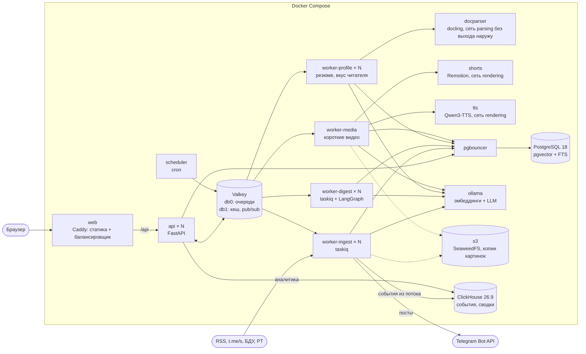
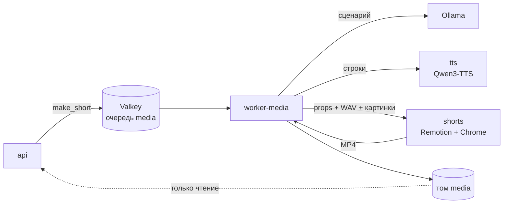
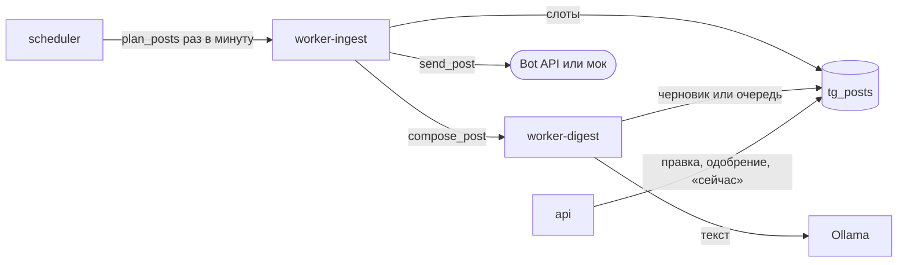
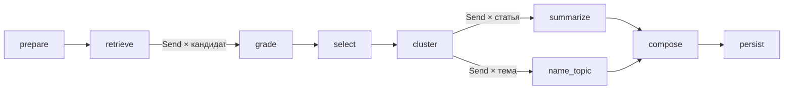

# Архитектура

Документ описывает, из чего состоит Tail&Grep, как данные проходят от RSS-ленты до готового выпуска, персональной ленты и поста в Telegram-канале, как устроены аккаунты, разбор резюме, события и обучаемое ранжирование и что происходит, когда что-то ломается. Обоснование выбора технологий и замеры вынесены в [DECISIONS.md](DECISIONS.md).

## Компоненты



Один образ бэкенда запускается в шести ролях: `api`, `worker-ingest`, `worker-digest`, `worker-profile`, `worker-media`, `scheduler`. Состояния в них нет, поэтому все, кроме планировщика, масштабируются флагом `--scale` без перенастройки. Всё, что хранит данные, вынесено в отдельные сервисы. Разборщик документов `docparser` - отдельный образ на Python 3.13 с docling и CPU-сборкой PyTorch.

| Сервис | Что делает | Масштабирование |
|---|---|---|
| `web` | Caddy 2.11 отдаёт собранный фронтенд и проксирует `/api/*` на реплики `api` | реплики за внешним балансировщиком |
| `api` | REST, поток прогресса SSE, постановка задач в очередь, MCP-сервер для ассистентов на `/api/mcp/` | `--scale api=N` |
| `worker-ingest` | опрос лент, загрузка полного текста, эмбеддинги новых статей; планирование и отправка постов в Telegram; запись событий в ClickHouse и ночное обучение ранжирования | `--scale worker-ingest=N` |
| `worker-digest` | сборка выпуска: граф LangGraph с чекпоинтами; написание постов | `--scale worker-digest=N`, упирается в модель |
| `worker-profile` | разбор резюме, пересчёт вектора вкуса после оценок: работа, которую читатель ждёт у экрана | `--scale worker-profile=N` |
| `docparser` | docling: документ на входе, Markdown на выходе; профиль `docling` | реплики за DNS-именем |
| `worker-media` | сценарий, голос и монтаж короткого видео, запись MP4 в том `media`; профиль `video` | один ролик за раз на воркер |
| `shorts` | Remotion 4 и Chrome Headless Shell: props и WAV на входе, MP4 на выходе; профиль `video` | реплики за DNS-именем, упирается в процессор |
| `tts` | Qwen3-TTS 0.6B Base голосами из `tts/voices/`, каждая строка проверяется whisper: строки на входе, WAV и разметка строк на выходе; профиль `voice` | по экземпляру на GPU |
| `scheduler` | раз в 15 минут ставит задачу опроса, раз в минуту планирование постов и запись событий, раз в 10 минут чистит зависшие выпуски и резюме, истёкшие сессии и гостевые аккаунты старше суток, в 03:30 обучает ранжирование | один экземпляр |
| `telegram-mock` | мок Bot API для проверки публикации без Telegram, страница отправленного на `127.0.0.1:8089`; профиль `telegram-mock` | не нужно |
| `s3` | SeaweedFS 4.48, хранилище S3 для копий картинок статей; профиль `s3`, без опубликованных портов | не нужно |
| `pgbouncer` | пул соединений в режиме transaction | не нужно |
| `postgres` | статьи, векторы, пользователи, сессии, профили, выпуски, оценки читателей, чекпоинты графа | вертикально, реплики на чтение |
| `valkey` | очереди (Streams), кеш, блокировки, pub/sub, поток событий по пути в ClickHouse | отдельные экземпляры под очередь и кеш |
| `clickhouse` | события: что показано, увидено, открыто и отмечено, выпуски, вызовы MCP; дневные сводки для аналитики; потолок памяти 1 ГБ | реплики и шарды ClickHouse, когда событий станут миллиарды |
| `ollama` | модели, профиль `ollama` | по экземпляру на GPU |

Наружу опубликован один порт, `web`. База, брокер и Ollama доступны только внутри сети Compose. `docparser` подключён только к сети `parsing`, у которой нет выхода наружу; кроме него в ней один `worker-profile`. Разборщик получает чужие файлы, поэтому у него нет ни паролей, ни доступа к базе, ни интернета, а модели запечены в образ при сборке. Так же устроена сеть `rendering`: в ней `shorts`, `tts` и `worker-media`, наружу из неё выхода нет, шрифты, браузер и модель голоса лежат в образах.

## Путь данных

### Сбор

Планировщик ставит задачу `ingest_all`, та раскладывает по одной задаче на источник. Воркер берёт блокировку на источник в Valkey, запрашивает ленту с `If-None-Match` и `If-Modified-Since` и на ответ 304 ничего не делает. Из записей ленты получаются статьи: заголовок и анонс очищаются от HTML, адрес приводится к каноническому виду (без `utm_*`, якоря, `www.`), будущая дата обрезается до текущего момента. Вставка идёт через `ON CONFLICT (url) DO NOTHING`, поэтому повторная доставка задачи не создаёт дублей.

У источников, где в ленте только анонс, включена загрузка полного текста через trafilatura: не больше 40 страниц за проход и не больше 4 одновременно. Если страница не открылась, остаётся анонс.

Источник вида `telegram` - публичный канал. Воркер читает его открытую страницу `t.me/s/<имя>`: двадцать последних постов и ссылка `?before=` на более ранние. Курсор `sources.last_post_id` хранит номер последнего прочитанного поста, и следующий проход листает назад, пока не дойдёт до него, но не дальше пяти страниц. Новый канал читается на три дня назад, а если он молчал дольше, берётся его последняя страница. Курсор записывается после вставки, так что упавший проход перечитает те же посты, и дублей не будет из-за того же `ON CONFLICT`.

Пост становится статьёй с адресом `https://t.me/<канал>/<номер>`: заголовок из первого предложения без эмодзи, текст по абзацам, хештеги в теги, автор пересланного поста в поле автора, фото или кадр видео в картинку. Короткий пост, меньше 600 знаков, со ссылкой на статью (карточка ссылки или голый адрес последней строкой) становится этой статьёй: её адрес, анонс из поста, полный текст потом загружает trafilatura, как для лент с анонсами. Если эту статью уже принесла лента сайта, пост не добавляет ничего. Ссылка на видео или соцсеть статьёй не считается. Реклама с пометкой по закону («Реклама. ООО ...», `erid`) пропускается, как и короткие поздравления, служебные сообщения и цитата, на которую пост отвечает. Строка, которой канал заканчивает треть постов, считается подписью и отрезается с конца.

Страница без ленты или с постами, ни один из которых не разобрался, - ошибка источника: так видна смена разметки t.me, а не пустой канал. Канал без превью отвечает редиректом на `t.me/<имя>`, и источник показывает «канала нет или у него закрыто веб-превью». Адреса берутся из `RADAR_TELEGRAM_PREVIEW_URLS` по очереди: сначала `t.me`, потом `telegram.me`. Следующий адрес пробуется только при сетевой ошибке, 5xx или 429, а отказ вроде 404 возвращается сразу.

Ссылки на картинки в CDN Telegram со временем перестают работать. Когда копия картинки нужна (пост в канал, видео), а сохранённый адрес не отвечает, адрес ищется заново: для поста на t.me - на странице встраивания `?embed=1`, где разметка та же, для остальных - в `og:image`. Страница самого поста не годится: у поста без фото её `og:image` - аватар канала.

После вставки ставится задача эмбеддинга. Векторы лежат в отдельной таблице с ключом `(article_id, model)`. При смене модели старые векторы остаются, а новые досчитываются в фоне или прямо при сборке первого выпуска.

Адрес ленты вводит пользователь, а запрос уходит изнутри сети, поэтому каждый запрос проходит проверку: схема только `http` или `https`, все адреса хоста публичные, соединение идёт на тот адрес, который прошёл проверку (имя остаётся в `Host` и SNI). Редиректы обрабатываются вручную с той же проверкой на каждом шаге, размер ответа ограничен 8 МБ, общее время загрузки 60 секундами.

Официальные источники - это БДУ ФСТЭК и трендовые уязвимости Positive Technologies. Их сайты подписаны удостоверяющим центром Минцифры. У загрузчика два пула соединений: обычный и тот, что вдобавок доверяет корневому и промежуточным сертификатам Минцифры из `backend/src/radar/ingest/certs/`. Пул выбирается по имени, с которым TLS сверяет сертификат (SNI запроса с привязкой к адресу или хост адреса), и второй достаётся только доменам из `RADAR_RUSSIAN_CA_HOSTS`. Для остальных сайтов сертификат этого центра недействителен, как и раньше.

У БДУ читаются две RSS-ленты: уязвимости, которые используют в атаках, и самые опасные за неделю. Анонс в них - одна фраза по шаблону, а страница уязвимости рисует поля в браузере из JSON внутри страницы. Поэтому полный текст для адреса `bdu.fstec.ru/vul/<номер>` собирается из этого JSON (`radar.ingest.bdu`):
- уязвимое ПО с версиями;
- уровень опасности, вектор CVSS 3.1 и CWE;
- CVE;
- эксплойт и использование в атаках;
- статус и меры по устранению.

Остальные страницы по-прежнему читает trafilatura, тот же выбор делает и замер времени чтения.

У трендовых уязвимостей PT ленты нет. Источник вида `pt_trending` читает первую страницу `ptsecurity.com/research/trending-vulnerabilities/` с условным запросом по ETag. Карточки находятся по `data-testid` блока с рейтингом и по парам «метка: значение», а не по классам: страница собрана на Next.js, и классы меняются с каждой сборкой. Карточка становится статьёй сразу с текстом: описание, рейтинг, CVSS, вендор, продукт и день, когда уязвимость стала трендовой. Этот день и становится датой статьи (полночь по Москве).

### Отбор

Профиль читателя состоит из роли, списка интересов (название, описание, ключевые слова, важность), исключений, порога релевантности и размера выпуска.

Для каждого интереса выполняется один SQL-запрос по окну периода. Он считает косинусную близость вектора интереса ко всем статьям окна, берёт лучшие по близости и лучшие по полнотекстовому поиску и возвращает их объединение вместе со средним и стандартным отклонением близости по окну.

Ключевое решение здесь такое: порог применяется не к самой близости, а к её z-оценке, то есть к тому, насколько статья ближе к интересу, чем типичная статья периода. Сырые косинусы у разных моделей несравнимы: одна укладывает всё в 0,4-0,7, другая в 0,0-0,3. С z-оценкой порог 0,5 в профиле значит одно и то же при любой модели.

```
оценка поиска = 0,2 + 0,18 · z + 0,12 (если есть совпадение по ключевым словам)
```

Дальше каждого кандидата оценивает языковая модель по шкале 0-3 со структурированным ответом по JSON-схеме. Итог складывается так: 70% оценки модели и 30% оценки поиска, затем умножение на важность интереса. Без модели в итог идёт только оценка поиска.

После оценки применяются правила, и они не зависят от модели:

1. Исключения. Статья отбрасывается, если в ней есть все значимые слова исключения или она по смыслу ближе к исключению, чем к интересу, причём z не меньше 3,5.
2. Порог релевантности из профиля.
3. Склейка пересказов. Две статьи считаются одной новостью, если совпадает хеш текста, либо заголовки делят не меньше трёх слов при коэффициенте Жаккара от 0,6, либо косинус векторов выше порога модели (0,76 для `embeddinggemma:300m`). Остаётся версия с большей оценкой, остальные сохраняются как ссылки «также об этом».
4. Лимит выпуска.

Все оценённые кандидаты, включая отброшенных, записываются в базу с причиной отказа. В интерфейсе они видны в блоке «Не вошло в выпуск».

### Группировка и тексты

Отобранные статьи кластеризуются по векторам: агломеративная кластеризация со связью Уорда на нормированных векторах. Число тем берётся из размера выпуска, примерно одна тема на пять записей, от двух до шести. Если при этом получается тема из одной статьи, число уменьшается. Порог расстояния не используется по той же причине, что и сырой косинус в отборе. Выбор числа тем по силуэту я пробовал и отказался от него, подробности в DECISIONS.md.

Модель даёт каждой теме название и обзор, каждой статье пишет выжимку и строку «почему важно» под роль читателя, английские заголовки переводит. Русские заголовки остаются как в источнике: при перефразировании модель один раз заменила «выпустит» на «представил», и этого хватило, чтобы запретить ей трогать оригинал.

### Аккаунты и доступ

Вход по почте и паролю. Пароль хешируется Argon2id (pwdlib) в отдельном потоке, чтобы не держать цикл событий. Для неизвестного адреса проверка идёт против подставного хеша, так что время ответа не выдаёт, зарегистрирован ли адрес, и текст ошибки в обоих случаях один.

Сессия - случайный токен из 32 байт в cookie `radar_session` с флагами `HttpOnly` и `SameSite=Lax`. В таблице `sessions` лежит только SHA-256 токена, поэтому утечка таблицы не даёт готовых cookie. Любая реплика `api` проверяет сессию сама; разрешённая сессия кешируется в Valkey на 60 секунд. Выход удаляет строку и запись в кеше.

Каждая строка профиля и выпуска принадлежит пользователю (`user_id`), и каждый запрос фильтрует по нему. Чужой идентификатор получает 404, а не 403, чтобы ответ не подтверждал, что такая запись есть. Поток прогресса SSE сначала проверяет владельца и только потом подписывается на канал. Каталог источников общий: читать его может любой вошедший, менять - администратор. Роль выдаётся командой `radar grant-admin`, а не по адресу при регистрации: иначе её получил бы тот, кто первым зарегистрирует нужный адрес.

«Войти без регистрации» создаёт гостевой аккаунт с копиями примеров профилей. Каждый гость видит только своё и не может испортить демонстрацию другим. Гости не бывают администраторами, не участвуют в подборке «нравится коллегам» и удаляются через сутки.

От подделки запросов с чужих сайтов защищают два слоя: cookie с `SameSite=Lax` и проверка заголовка `Sec-Fetch-Site` у всех изменяющих запросов (для старых браузеров - `Origin`). Разрешены только `same-origin` и прямые запросы, и адрес dev-сервера Vite из настроек.

### Резюме


`api` читает тело запроса с ограничением 8 МБ, считая байты по мере прихода, и определяет формат по сигнатуре, а не по имени: PDF, DOCX, PPTX и ODT различаются по содержимому архива, архив, который распаковывается больше чем в 30 МБ, отклоняется. Файл ложится в строку `resumes` и ждёт воркер. Имя файла не сохраняется.

Воркер отправляет байты в `docparser`. Если docling не отвечает, PDF, DOCX и текст читает встроенный разборщик (pypdf, python-docx), а сканы и слайды возвращаются в очередь на повтор. Встроенный разборщик работает в отдельном процессе с ограничением памяти и таймаутом 60 секунд: поток после таймаута продолжил бы работать, процесс убивается.

До анализа из текста вырезаются почта, телефоны, ссылки, строки с адресом, датой рождения и другими личными данными и имя в первых строках. Все шаблоны работают за линейное время: мегабайт пустых строк или одного длинного слова обрабатывается за полсекунды. Дальше модель по JSON-схеме пишет должность, уровень, сводку в третьем лице, навыки, области и от трёх до шести тем новостей с ключевыми словами. Без модели те же поля заполняются по таблице из 17 направлений: у каждого есть названия технологий и основы слов, по которым оно узнаётся в тексте.

После разбора файл удаляется из строки, текст не сохраняется нигде. Остаются только извлечённые факты и предложенный профиль, который читатель просматривает и правит перед сохранением.

### Персональная лента

Вкус читателя - набор граней:

| Грань | Откуда | Вектор | Ключевые слова |
|---|---|---|---|
| интерес | интересы всех профилей читателя, повторы склеиваются | эмбеддинг описания | да |
| резюме | должность, области, навыки и сводка | эмбеддинг этого текста | навыки |
| выученная | лайки, сохранения и открытые статьи, сгруппированные по смыслу | взвешенный центр группы | нет |
| избегаемая | дизлайки и скрытые статьи, сгруппированные так же | взвешенный центр группы | нет |

Сигналы весят по-разному (сохранение 1,2, лайк 1,0, открытие 0,4, скрытие -0,7, дизлайк -1,0) и вдвое слабеют за три недели. Одна группа приходится на каждые четыре сигнала, групп не больше четырёх: читатель, который лайкает статьи на две разные темы, получает две грани, а не одно размытое среднее.

Один SQL-запрос считает близость каждой статьи окна (две недели) к каждой грани, переводит её в z-оценку внутри окна и возвращает пул: лучшие по каждой грани по смыслу и по ключевым словам плюс самые свежие статьи. Дальше оценка статьи складывается так:

```
совпадение с гранью = 0,2 + 0,18 · z + 0,12 при совпадении ключевого слова
доверие к грани     = интерес 0,45; резюме 0,10; выученная 0,35 · уверенность
релевантность       = 0,3 · лучшее совпадение с поправкой на доверие
                    + 0,7 · среднее совпадение, взвешенное доверием
оценка              = релевантность + свежесть + источник + «нравится коллегам»
                      − близость к избегаемому − уже открыта
```

Уверенность растёт с суммой положительных сигналов и равна единице с шести. Веса подобраны перебором по сетке на данных одного читателя и проверены на другом (DECISIONS.md). Статьи ниже 0,35 в ленту не попадают. Список проходит перестановку по принципу максимальной предельной релевантности: копии одной истории выбрасываются, серии из одного источника разбиваются. Каждое седьмое место отдаётся статье вне привычных тем: свежей и не похожей на отвергнутое. Выбор стабилен в течение дня и у каждого читателя свой.

Лента кешируется снимком на 30 минут: первая страница строит список и получает его идентификатор, следующие страницы берут тот же снимок, поэтому лайк между страницами не перемешивает продолжение. Оценки на карточках всегда читаются из базы.

Те же грани работают и в дайджесте. На шаге отбора выученные и избегаемые грани, предпочтения по источникам и выбор похожих читателей дают поправку к оценке кандидата от -0,2 до +0,15, а статьи, которые читатель скрыл или отметил дизлайком, не попадают в выпуск. Поправка и её причина сохраняются у каждой записи выпуска.

Подборка «нравится коллегам с похожим профилем» ищет до 20 соседей по вектору вкуса (центр граней за вычетом среднего вектора статей, иначе все читатели похожи друг на друга) и учитывает только лайки и сохранения. Статья помечается, только если её выбрали не меньше трёх соседей: с одним-двумя подсказка выдавала бы, что читает конкретный коллега.

### Короткие видео

Из готового выпуска можно сделать вертикальный ролик 1080×1920 на полминуты-минуту, как в TikTok или Shorts: крупный заход, карточка на каждую новость с цифрой, субтитры по словам с подсветкой произносимого слова и озвучка.



1. Отбор. В ролик идут до четырёх записей: сначала сильнейшая запись каждой темы, затем сильнейшие из остальных, по убыванию оценки.
2. Сценарий. Модель по JSON-схеме пишет заход, для каждой новости тип («Уязвимость», «Регулятор»), заголовок для экрана до 90 знаков, крупный факт, два-три коротких факта списком, вид новости для рисунка и одну-две фразы для диктора, и финальную фразу. Источник, адрес статьи для QR-кода и дата у каждой карточки берутся из выпуска, а не из ответа модели; из адреса убираются метки отслеживания. Факт показывается, только если каждое его число есть в тексте самой новости: «CVSS 9.1» при «9.8» в статье выбрасывается. Строки модели со ссылкой, почтой, телефоном или чужим числом заменяются текстом выпуска. Без модели сценарий собирается из заголовков и выжимок, факт ищется шаблонами (CVE, оценка CVSS, проценты, суммы), а вид новости угадывается по словам.
3. Голос. Читатель выбирает голос из списка сервиса `tts`: модель Qwen3-TTS 0.6B Base говорит голосами из `tts/voices/`, синтетическими образцами носителей русского языка. Сервис озвучивает все строки одним пакетом, потом whisper base на процессоре слушает каждую и сравнивает с текстом; строка, которая сказала не то, генерируется заново, до двух раз. Дальше обрезается тишина по краям строк, выравнивается громкость, строки склеиваются с паузой 380 мс. В ответе WAV и место каждой строки на дорожке в миллисекундах. Модель загружается при первом запросе и выгружается через 10 минут простоя: видеокарта общая с языковой моделью выпусков. Список голосов медиа-воркер кладёт в Valkey при старте и раз в 10 минут, а `api` отдаёт его в `meta`: сам `api` до сервиса голоса не достаёт.
4. Раскладка. Внутри строки время делится между словами по слогам, с добавкой после запятых и точек; цифры считаются по два слога, аббревиатуры вроде «ФСТЭК» и «CVE» - по буквам. Карточки сменяются посередине паузы между строками, поэтому картинка не забегает вперёд голоса.
5. Картинки. Для каждой новости воркер берёт картинку статьи: из ленты, со страницы статьи, из сохранённой копии; скачанная копия сохраняется для следующего раза. В рендер идут JPEG, PNG и WebP до 3 МБ; новость без картинки остаётся с иконкой.
6. Монтаж. `shorts` - сервис на Node 24 с Remotion 4. Он проверяет props по схеме zod (длины строк, число слов, порядок отметок времени, не длиннее двух минут), держит WAV и картинки в памяти и отдаёт их своему же Chrome по случайным адресам, собирает кадры и кодирует H.264 с CRF 23. В кадре: заход с оглавлением и полосой картинок новостей, карточки новостей на фоне картинки статьи с рисунком по главному числу (шкала CVSS, кольцо процентов, счётчик) или резким фото, фактами и QR-кодом статьи, финал. Шрифты Unbounded и Onest лежат в образе, в сеть рендер не ходит.
7. Файл. Воркер пишет MP4 в том `media` через временный файл и переименование, `api` отдаёт его владельцу с поддержкой Range, чтобы работала перемотка. Файлы удалённых выпусков и гостей удаляет задача на том же воркере: только у него том открыт на запись.

Без сервиса `tts` получается ролик без звука с теми же субтитрами, в темпе чтения, а не речи. Если голос отказал посреди работы, ролик тоже собирается без звука, а не падает. Повторный заказ по тому же выпуску заменяет предыдущий ролик.

### Публикация в Telegram



У читателя есть боты (`tg_bots`, токен зашифрован) и каналы (`tg_channels`). У канала свой бот, профиль аудитории и настройки в JSONB: голос, ссылки, формат, расписание, отбор, обзор недели, модерация. Пост (`tg_posts`) проходит состояния `composing` → `draft` или `queued` → `sending` → `sent`, а также `failed` и `skipped`.

1. Планирование. Раз в минуту задача `plan_posts` создаёт посты для слотов расписания, до которых осталось меньше `prepare_minutes`. Уникальный частичный индекс по `(channel_id, kind, slot_at)` не даёт создать второй пост на тот же слот.
2. Отбор. Под профиль аудитории канала тем же поиском, что и в предпросмотре выпуска, выбирается самая сильная свежая статья (окно `freshness_hours`, порог `min_score`), которой ещё не было в этом канале, а в режиме `spread` и в других каналах владельца.
3. Текст. Модель пишет пост в голосе канала и видит, как этот сюжет уже вышел в других каналах владельца. Каждая строка проверяется по статье: числа, ссылки, домены, `@имена`, телефоны. Без модели пост собирается из заголовка и первых предложений статьи. К посту добавляются картинка статьи, ссылка в выбранной подаче и подпись канала, и он ужимается под лимит формата.
4. Модерация. В режиме `auto` пост встаёт в очередь, в `manual` становится черновиком. Владелец правит его в редакторе с предпросмотром «как в Telegram» и одобряет. Правку сервер пересобирает из безопасного подмножества HTML.
5. Отправка. Раз в минуту посты, у которых наступило время, одним `UPDATE ... RETURNING` переводятся в `sending` и уходят задачам `send_post`. Пост переводится в формат канала (обычный пост или `sendRichMessage`). Если Telegram не смог скачать картинку, она загружается файлом из копии, а без копии пост уходит без картинки, с превью ссылки.

Правила доставки (повторы, 429, потерянный ответ, опоздавшие посты) описаны в [DECISIONS.md](DECISIONS.md#доставка-один-раз-или-ни-разу).

### MCP для ассистентов и время чтения


Запрос к MCP сначала проходит обёртку `KeyAuth`: она ищет SHA-256 ключа среди неотозванных, считает вызов в лимите читателя и только потом передаёт запрос SDK. Владелец ключа доходит до инструментов через контекст запроса, ни один инструмент не принимает его аргументом. Сервер без состояния: каждый POST - самостоятельный вызов, его может принять любая реплика.

Лента, выпуск и вызовы MCP ставят задачу `measure_articles` для показанных статей, у которых неизвестна длина. Воркер сбора помечает их одним `UPDATE`, читает страницы тем же загрузчиком с защитой от SSRF, что и ленты, считает слова и берёт `og:image`, если картинки нет. В следующем ответе у этих статей уже есть время чтения.

### Читалка и поиск по публикациям


При первом открытии статьи API читает её страницу тем же загрузчиком, что и сбор, с проверкой адреса на каждом переходе. trafilatura разбирает страницу в блоки: абзацы с жирным, курсивом, кодом и ссылками, заголовки, списки, цитаты, код, таблицы и картинки. Блоки и адреса картинок ложатся в `article_bodies`, и следующее открытие страницу уже не читает. Пока страница грузится, API не держит соединение с базой.

HTML сайта в браузер не попадает: интерфейс рисует блоки своими элементами, ссылки допускаются только `http` и `https`. Имя картинки - первые 16 знаков SHA-256 её адреса. API скачивает только адреса из сохранённой статьи, так что открытым прокси он не служит. Формат определяется по первым байтам, SVG не принимается. Копия кладётся в то же хранилище картинок, что у публикации и видео; если записать её не вышло, картинка всё равно уходит читателю. Картинку, которую сайт не отдал, API 10 минут не запрашивает снова.

Пост Telegram и карточка трендов PT показываются из базы: другого текста у них нет. Уязвимость БДУ берётся из данных страницы, как при сборе. Если сайт не отдал страницу, читатель видит текст из ленты с пометкой, а страница читается снова через 6 часов. Изменения разбора поднимают `READER_VERSION`, и прочитанные раньше страницы перечитываются при следующем открытии. Если сайт в этот момент не ответил, остаётся текст, прочитанный раньше.

Поиск по публикациям сначала отдаёт совпадения по словам в порядке `ts_rank`, после них - до 30 статей, близких к запросу по смыслу, которых слова не нашли. Такая статья должна выделяться среди статей под фильтрами (z от 3 при выборке от 50 статей) и быть близкой в абсолютных числах: у `embeddinggemma` косинус от 0,38. Номера CVE, BDU, PT, GHSA и фразы в кавычках ищутся только по словам.

### События, аналитика и обучаемое ранжирование


API записывает выдачу ленты, когда отдаёт её страницу: каждую статью с местом, причиной показа (по интересам, «Что-то новое», свежее для читателя без вкуса) и частями оценки на этот момент. Браузер присылает показы и отметки вместе с номером снимка ленты или выпуска и местом статьи в нём. Всё это без ожидания уходит в поток Valkey, а задача `write_events` раз в минуту переносит его в ClickHouse. Схема ClickHouse лежит рядом с кодом (`events/schema`), её применяет `radar migrate` и, если ClickHouse тогда не отвечал, сам писатель при первом запуске.

Дневные сводки для аналитики считает материализованное представление при вставке, раздел «Аналитика» читает только их и время последнего события.

Ночью `train_ranker` строит из событий обучающие списки: выдача ленты, соединённая с показами и отметками в том же списке за сутки, признаки из записи выдачи. Модель и её цифры сохраняются в `ranker_models`, включённая модель одна. Каждая реплика `api` раз в минуту проверяет, какая модель включена, и держит её в памяти. Читатели делятся по хешу id: часть получает порядок модели, остальные остаются контрольной группой на ручных весах. Модель переставляет только то, что ручные веса и так показали бы, дальше идут тот же проход разнообразия и вставка «Что-то новое». Как модель включается и снимается, описано в DECISIONS.md.

### Граф сборки



Граф описан в `backend/src/radar/pipeline/graph.py`. Состояние хранит только JSON-совместимые словари. Оценка и выжимка расходятся веером через `Send`: одна задача на кандидата, одна на статью, одна на тему.

Чекпоинты пишутся в PostgreSQL через `AsyncPostgresSaver`, идентификатор потока графа равен идентификатору выпуска. После падения воркера сборка продолжается с того шага, на котором оборвалась, а завершённые шаги (поиск, отбор) не повторяются.

Внутри шага-веера гарантия слабее, чем я рассчитывал. Если одна задача шага упала с ошибкой, результаты остальных сохраняются и при повторе выполняется только она. Если же процесс убит, шаг начинается заново: LangGraph записывает результаты задач шага при его завершении. От повторной оплаты вызовов модели защищает другой слой: каждый ответ модели кешируется в момент получения, и перезапущенный шаг берёт уже готовые оценки из кеша.

Узлы сообщают о прогрессе через `get_stream_writer()`. Воркер публикует события в канал Valkey, любая реплика `api` отдаёт их браузеру по SSE. Раз в несколько процентов прогресс пишется в строку выпуска, поэтому клиент, подключившийся позже, сразу видит текущее состояние.

## Кеш

| Что | Ключ | Срок |
|---|---|---|
| Векторы интересов и исключений | модель + текст | 7 дней |
| Оценка статьи моделью | модель + версия промпта + отпечаток профиля + хеш текста | 7 дней |
| Выжимка статьи | модель + версия промпта + роль + интерес + хеш текста | 30 дней |
| Предпросмотр отбора | модель + отпечаток профиля + окно, округлённое до 5 минут | 60 секунд |
| Экспорт Markdown и DOCX | идентификатор выпуска | сутки |
| Разрешённая сессия | SHA-256 токена | 60 секунд |
| Вкус читателя | читатель + модель + номер поколения | час; 60 секунд, если эмбеддинги не посчитались |
| Снимок ленты с меткой ранжирования | читатель + случайный идентификатор | 30 минут |
| Включённая модель ранжирования | в памяти реплики | минута |
| Состояние ленты (ETag, Last-Modified) | в таблице `sources` | до следующего ответа 200 |

В кеш попадают только ответы модели. Ответ резервного алгоритма не кешируется, иначе после восстановления модели он подменял бы её.

Вкус читателя не удаляется из кеша, а устаревает сменой поколения: любая оценка, правка профиля или резюме увеличивает счётчик читателя, и ключи с новым номером пусты. Удаление ключа гонялось бы с запросом, который начался до изменения: он дописал бы старый вкус обратно под тем же ключом.

Любая операция с кешем при ошибке Valkey превращается в промах. Политика вытеснения `volatile-lru` удаляет только ключи со сроком жизни, а у сообщений очереди срока нет.

## Отказы

| Что сломалось | Что происходит |
|---|---|
| Упала реплика `api` | Caddy получает отказ соединения, повторяет запрос на другой реплике и 10 секунд не шлёт на упавшую |
| Упал `worker-digest` посреди сборки | сообщение остаётся неподтверждённым в потоке; по истечении `RADAR_DIGEST_TASK_TIMEOUT_SECONDS` (по умолчанию 20 минут) его забирает другой воркер и продолжает с прерванного шага; оценки, полученные до сбоя, берутся из кеша ответов модели |
| Сборка идёт дольше лимита | задача прерывается до истечения блокировки и повторяется с чекпоинта, всего до трёх попыток; после третьей выпуск помечается неудачным |
| Недоступен сервер LLM | после трёх ошибок подряд предохранитель на 30 секунд перестаёт к нему обращаться; оценки и тексты делает резервный алгоритм, в выпуске указано, какая часть обработана без модели |
| Недоступен сервер эмбеддингов | поиск идёт только полнотекстовый, ранее посчитанные векторы продолжают работать; поиск по публикациям ждёт вектор запроса не дольше 10 секунд |
| Сайт не отдал страницу читалке | текст из ленты с пометкой, новая попытка через 6 часов; если страница уже была прочитана, остаётся прежний текст |
| Сайт не отдал картинку читалке | картинка не показывается, повторный запрос к сайту не раньше чем через 10 минут |
| Недоступен Valkey | чтение работает без кеша, ограничение частоты запросов отключается, создание выпуска отвечает 503 |
| Лента отвечает ошибкой | три попытки с растущей паузой, затем ошибка записывается у источника и видна в интерфейсе; остальные источники не затронуты |
| t.me недоступен | то же с каждым адресом из `RADAR_TELEGRAM_PREVIEW_URLS` по очереди; курсор канала не двигается, и следующий проход дочитает пропущенное, если постов между проходами меньше сотни |
| Изменилась разметка страницы трендовых уязвимостей PT | страница с карточками, из которых не разобралась ни одна, - ошибка источника «не прочитана ни одна из N карточек» |
| На странице БДУ нет данных уязвимости | полный текст не собирается, у статьи остаётся анонс из ленты; меню сайта в текст не попадает |
| Изменилась разметка t.me | страница, где ни один пост не разобрался, - ошибка источника с текстом «не прочитан ни один из N постов», а не пустой канал |
| Ссылка на картинку поста протухла | адрес ищется заново на странице встраивания поста, и копия делается по нему; не нашёлся - пост или ролик идёт без картинки |
| Недоступен `docparser` | PDF, DOCX и текст читает встроенный разборщик; сканы и слайды возвращаются в очередь и повторяются, после трёх попыток резюме помечается неудачным с понятным сообщением |
| Разбор резюме завис | встроенный разборщик убивается через 60 секунд; если воркер пропал, фоновая задача через 18 минут помечает резюме неудачным и удаляет файл |
| Недоступен сервер эмбеддингов при построении вкуса | грани остаются с ключевыми словами, лента строится полнотекстовым поиском, такой вкус кешируется на минуту и не перезаписывает вектор для подборки «нравится коллегам» |
| Недоступен `tts` или он ответил не тем | ролик собирается без звука, с субтитрами в темпе чтения |
| Недоступна модель при написании сценария | сценарий собирается из заголовков и выжимок выпуска, в карточке ролика написано «сценарий из выжимок» |
| Telegram не отвечает или ответил 5xx | соединение не открылось или ответ 5xx: до пяти попыток с паузой 2-8 минут; запрос ушёл, а ответ потерян: пост помечается неудачным с просьбой проверить канал, повтора нет |
| Воркер умер посреди отправки поста | через 15 минут пост помечается неудачным с той же просьбой: он мог выйти |
| Telegram попросил подождать (429) | пост ждёт `retry_after` и уходит следующим проходом |
| Бот лишился прав в канале | канал помечается ошибкой с текстом от Telegram, его посты ждут, автопостинг в него не идёт |
| Telegram не может скачать картинку поста | картинка загружается файлом из копии; нет копии - пост уходит без картинки, с превью ссылки |
| Модель не ответила при написании поста | пост собирается из заголовка и первых предложений статьи |
| Недоступен `shorts` или рендер упал | две попытки, затем ролик помечается неудачным с понятным сообщением; кнопка «Переснять» ставит его заново |
| Недоступен ClickHouse | события копятся в потоке Valkey (до 200 000, дальше вытесняются самые старые), приложение работает как обычно; аналитика отвечает 503 с понятным сообщением; после восстановления писатель переносит накопленное, повторённая пачка не задваивается |
| Писатель событий умер посреди пачки | следующий запуск берёт те же границы пачки и тот же токен, ClickHouse отбрасывает уже вставленное |
| Запись события упала | запрос читателя не замечает: ошибка пишется в журнал, ответ тот же |
| Обученная модель не загрузилась или ответила NaN | читатели получают ручной порядок с честной пометкой в выдаче, модель не обслуживает никого |
| Выпуск завис: задача потеряна или воркер падает на каждой попытке | если сборка не подаёт признаков жизни три лимита подряд (час при настройках по умолчанию), фоновая задача помечает выпуск неудачным; повторная доставка его уже не оживляет |

Первые две строки, четвёртая и шестая проверены на запущенном стеке, результаты в [DECISIONS.md](DECISIONS.md).

## Масштабирование

Запросы на чтение упираются в процессор реплик `api`, и добавление реплик помогает сразу. Замер с двумя и четырьмя репликами приведён в DECISIONS.md.

Сборка выпусков упирается в скорость генерации модели. На одной видеокарте параллельные запросы к Ollama общую пропускную способность не увеличили (76 против 84 токенов в секунду), поэтому больше воркеров сборки на одну карту не ускоряют работу, а только удлиняют очередь. Прирост даёт второй экземпляр Ollama на второй карте или замена сервера моделей. Для замены нужно реализовать два интерфейса из `backend/src/radar/ai/`: `Embedder` и `Intelligence`.

Сбор лент ограничен сетью, и его воркеры масштабируются независимо от сборки: у них отдельная очередь. Это сделано, чтобы пачка запросов на выпуски не задерживала опрос источников.

На одном экземпляре PostgreSQL система проживёт долго, но есть три места, которые придётся менять при росте:

- Поиск сейчас точный, полным проходом по окну периода. На неделе публикаций (около 850 статей) это миллисекунды. После нескольких сотен тысяч статей в окне плотную часть запроса нужно перевести на индекс HNSW с итеративным сканом, а статистику считать по выборке. Индекс уже создан.
- Поиск по публикациям по смыслу тоже проходит все статьи под фильтрами: на 2 357 статьях это незаметно, на сотнях тысяч его нужно перевести на тот же индекс.
- Таблицу `articles` стоит секционировать по месяцам, когда счёт пойдёт на миллионы.
- Очередь и кеш сейчас делят один экземпляр Valkey в разных логических базах. Под нагрузкой их нужно разнести: у очереди требование надёжности, у кеша требование скорости.

## Безопасность

Обновлено с появлением аккаунтов.

Сделано: аккаунты с сессиями в httpOnly-cookie и хешем токена в базе, Argon2id для паролей, одинаковый ответ на неверный пароль и неизвестный адрес, ограничение неудачных попыток входа на адрес и на клиента, разделение данных по владельцу с ответом 404 на чужое, роль администратора только с сервера, проверка `Sec-Fetch-Site` у изменяющих запросов, ограничение числа потоков SSE на читателя. Резюме: проверка формата по сигнатуре, лимит размера по потоку, защита от архивных бомб и от картинок на миллиарды пикселей, разборщик без сети и паролей с лимитами памяти и процессора, встроенный разбор в процессе, который убивается, удаление контактов до модели, файл удаляется после разбора. Остальное как раньше: защита от SSRF с привязкой соединения к проверенному адресу, экранирование текста в Markdown, проверка схемы ссылок во фронтенде, CSP без inline-скриптов, ограничение частоты изменяющих запросов, контейнеры без root, с файловой системой только на чтение и без capabilities, текст статьи и резюме в промпте обёрнут в блок данных, ответ модели ограничен JSON-схемой.

Видео: текст из лент попадает в кадр только как текст React-элементов, props проверяются схемой zod с лимитами длины, адрес звука сервис рендера ставит сам, а звук отдаёт своему Chrome по случайному 128-битному адресу только на время рендера. Строки модели с ссылкой, почтой, телефоном или числом, которого нет в новости, заменяются текстом выпуска. `shorts` и `tts` сидят в сети `rendering` без выхода наружу и без опубликованных портов, у обоих файловая система только на чтение, без root и с лимитами памяти, процессора и числа процессов. Том с роликами открыт на запись только воркеру, `api` читает его и отдаёт файл только владельцу выпуска. У читателя может быть один ролик в работе, это держит уникальный индекс в базе, а не проверка в коде.

Публикация: токены ботов зашифрованы ключом из `RADAR_SECRET_KEY` и не возвращаются API, адреса Bot API с токеном не попадают ни в исключения, ни в логи. Боты, каналы и посты доступны только владельцу, строка поста при правке берётся с блокировкой. HTML поста пересобирается на сервере из списка разрешённых тегов, фронтенд рисует его React-элементами без `innerHTML`, ссылки только `http`, `https` и `tg`. Текст модели не может принести адрес или `@имя`, которых нет в статье. Мок Bot API слушает только `127.0.0.1` и не получает ни базы, ни секретов. Картинки статей скачиваются защищённым от SSRF загрузчиком с лимитом 8 МБ, формат проверяется по байтам, ключи хранилища - хеши адресов. Компромисс: CSP разрешает картинки с любого `https:`, чтобы предпросмотр показывал картинку так, как её увидит Telegram.

События: в них только идентификаторы и числа, без заголовков, текстов и почты. Удаление аккаунта пишет надгробие в той же транзакции, писатель удаляет по нему события читателя и сутки отбрасывает запоздавшие. У каждого читателя бюджет 3000 событий в час. Место и причину показа присылает браузер, поэтому обучение берёт их из записи выдачи, а не из показа. ClickHouse не опубликован наружу, порт есть только в `docker-compose.dev.yml` на `127.0.0.1`. Аналитику видит только администратор, и в ней только сводные числа.

Читалка: страницы и картинки скачиваются через `safe_get` с проверкой адреса на каждом переходе. Лимиты: страница 3 МБ, картинка 8 МБ, 40 картинок и 150 000 знаков на статью, 4 страницы и 8 картинок одновременно на процесс. Картинки отдаются с `Content-Security-Policy: default-src 'none'`. Открыть статью можно 120 раз в минуту, картинок - 300, поиск - 120 запросов в минуту. Том `media` у API открыт на запись ради копий картинок; имя файла проверяется по шаблону, видео пишет только медиа-воркер.

MCP: ключи хранятся хешем, показываются один раз и отзываются со следующего запроса; ключ одного читателя не открывает данные другого, это проверяет тест. Лимит 60 вызовов в минуту на читателя, создание ключей ограничено как вход. Задача дочитывания получает только номера статей, не адреса, поэтому ключом нельзя заставить сервер открыть произвольную страницу.

Код проверяли три отдельных ревью: безопасность, бэкенд и фронтенд. Что они нашли и что исправлено, записано в DECISIONS.md.

Не сделано, и перед выходом в открытую сеть это обязательно: TLS и флаг `Secure` у cookie (`RADAR_COOKIE_SECURE=true`), подтверждение почты и восстановление пароля, выключенный гостевой вход, пароль у Valkey и свои пароли у PostgreSQL и ClickHouse, ограничение частоты GET-запросов, отключение `/api/docs`. Лимит неудачных входов на адрес позволяет постороннему заблокировать вход владельцу адреса на минуту; это цена защиты от подбора. Если Valkey недоступен, ограничения частоты не действуют. Вредоносная статья по-прежнему может уговорить модель поставить себе высокую оценку: структурированный вывод ограничивает ущерб, но не исключает само влияние.
