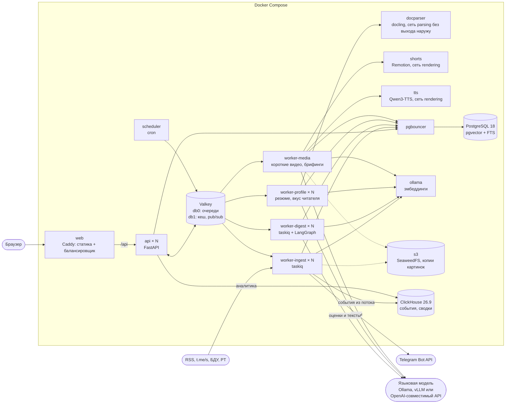
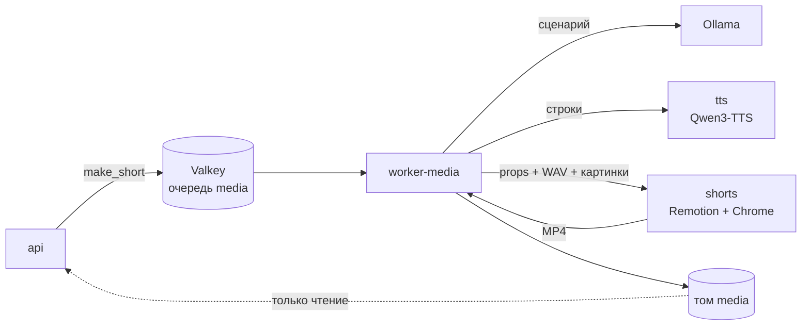
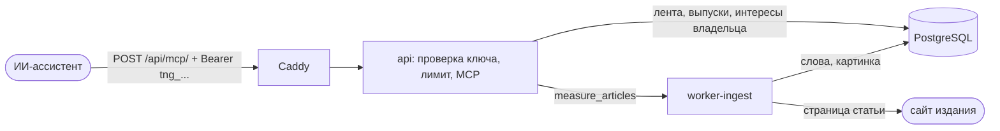
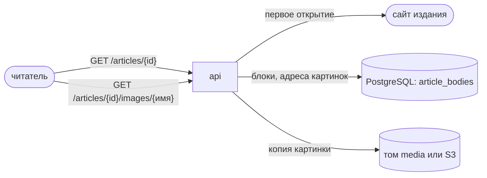
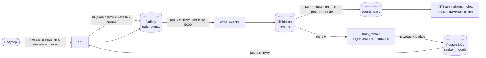
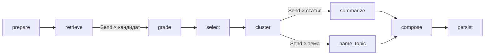

# Архитектура

Документ описывает, как сделано каждое требование задания, чем отличаются режимы без модели и с моделями, из чего состоит Scrap&Grep, как данные проходят от RSS-ленты до готового выпуска, персональной ленты и поста в Telegram-канале, как устроены аккаунты, разбор резюме, события и обучаемое ранжирование и что происходит, когда что-то ломается; в конце структура репозитория. Обоснование выбора технологий и замеры вынесены в [DECISIONS.md](DECISIONS.md).

## Что реализовано

| Требование | Как сделано |
|---|---|
| Получать публикации из источников | 104 источника: 68 лент RSS и Atom, 22 Telegram-канала, 12 сайтов без ленты, которые читаются как страницы новостей, CISOCLUB через WordPress API и бюллетени Symantec через API страницы Broadcom; из 62 позиций списков датасета организаторов читаются 60 (DECISIONS.md, «Источники из датасета»); опрос каждые 15 минут с условными запросами, загрузка полного текста там, где в ленте только анонс, добавление своих источников из интерфейса, публичные Telegram-каналы; сайты, которые не пускают бота, читаются лестницей способов: заголовки браузера, TLS-отпечаток Chrome через curl_cffi, браузер в стеке, FlareSolverr, прокси |
| Отбирать по интересам пользователя | гибридный поиск (векторный и полнотекстовый) по каждому интересу, оценка каждого кандидата языковой моделью, исключения, порог, склейка пересказов по тексту, заголовку, смыслу и номерам CVE и БДУ, а после карточек - по номерам из справочных баз, поправка по оценкам читателя |
| Группировать по темам, сохранять ссылки | по датасету организаторов ([docs/task](task/TASK.md)): специалисту разделы «Атаки» и «Уязвимости» с приоритетом по правилам датасета и карточкой с его полями, остальное по темам; руководству темы и признаки из датасета (в РФ, ущерб, утечка, энергетика и другие). Темы - кластеризация по векторам, названия и обзоры от модели. Ссылка на источник у каждой записи и у каждого пересказа |
| Формировать дайджест в Markdown или DOCX | оба формата, с гиперссылками; карточки атак и уязвимостей в порядке полей «желаемого вывода» датасета |
| Применение инструментов | у модели есть инструмент `lookup_vulnerability`: по номеру CVE или БДУ он отвечает, есть ли уязвимость в каталоге CISA KEV, что о ней пишут БДУ ФСТЭК и NVD (CVSS, CWE, продукты, решение CISA SSVC), какова вероятность эксплуатации по EPSS и опубликован ли эксплойт в Exploit-DB. Все базы - локальные копии, которые обновляет воркер сбора. Модель вызывает его сама, а номера, о которых она не спросила, проверяет граф |
| Проверка результатов | каждая карточка сверяется с текстом статьи и ответами справочных баз: идентификаторы, оценка и вектор CVSS, версии, группировка, инструменты, признак эксплойта. Чего в статье нет, убирается с пометкой. Число в пересказе, которого нет в статье, модель исправляет по замечанию, иначе пересказ заменяется предложениями самой статьи. Совет в «почему важно» сверяется с тем, вышло ли исправление: пока статья или строка «Обновление» говорят, что его нет, совет поставить патч заменяется временными мерами из карточки |
| Показать изменение подборки при смене интересов | мгновенный предпросмотр в редакторе профиля, версии профиля, сравнение двух выпусков |

Сверх требований:

- что выпуск добавляет к записям, без модели, из записей и их карточек: сколько ручной работы он заменяет по журналу аналитика (правило в той же строке), план на смену специалисту, где у невыпущенного исправления первыми идут временные меры, изменения по уязвимостям прошлых выпусков профиля за 30 дней (вошла в CISA KEV, появился эксплойт, вышло исправление), руководству период в цифрах по признакам датасета против прошлого выпуска; всё есть в Markdown, DOCX и на странице;
- для SOC: индикаторы компрометации, CVE и BDU, техники ATT&CK выпуска выгружаются в STIX 2.1, событием MISP и в CSV; повторная выгрузка сливается в платформе с прежней;
- матрица риска уязвимостей выпуска (опасность против близости к системам компании) и путь каждой уязвимости по датам: NVD, эксплойт, CISA KEV, новость; вопросы к выпуску, ответ только по его записям с их номерами;
- доставка на почту: письмо с текстом выпуска и ссылками, DOCX во вложении, из интерфейса и из консоли, только на адреса компании, если так настроено;
- наши системы: список продуктов компании в профиле, запись, которая их называет, помечена «касается нас» и идёт первой в теме; совпадение считается по целым словам, без модели, поэтому правка списка не сбрасывает кеш оценок;
- брифинг голосом для руководства: пересказ выпуска на две минуты из уже написанных текстов, без номеров, оценок CVSS, адресов и ссылок, голосами сервиса `tts`, WAV на странице выпуска;
- аккаунты: вход по паролю, сессия в httpOnly-cookie, у каждого читателя свои профили, выпуски и оценки; общие аккаунты читателя и администратора открываются одной кнопкой на странице входа, без пароля; временные гостевые аккаунты на сутки включает `RADAR_DEMO_LOGIN=true`;
- резюме при регистрации: разбор через docling или встроенный разборщик, удаление контактов до анализа, должность, навыки и темы от модели или по таблице направлений, файл не хранится после разбора;
- персональная лента: интересы, резюме, темы, выученные по лайкам и сохранениям, темы, которых читатель избегает, предпочтения по источникам, «нравится коллегам с похожим профилем», место для статей вне привычных тем, объяснение каждой позиции;
- короткое видео по выпуску: сценарий от модели с проверкой цифр по тексту новости, четыре голоса Qwen3-TTS на выбор с проверкой каждой строки распознаванием или 12 голосов SpeechKit, страница называет движок и голос, картинки статей на обложке и фоном карточек, рисунок по главному числу новости, QR-код статьи, субтитры по словам, рендер на Remotion, без голоса - ролик с субтитрами;
- публикация в Telegram: несколько ботов и каналов в любых сочетаниях, свой голос, аудитория, подача ссылок и расписание у каждого канала, разный текст одного сюжета в разных каналах, обычные и rich-посты, редактор с предпросмотром, модерация, обзор недели, доставка без дублей, мок Bot API в стеке;
- чтение защищённых сайтов: лестница способов (бот, заголовки Chrome, curl_cffi с TLS- и HTTP/2-отпечатком Chrome, FlareSolverr в стеке), поднимается, только когда сайт отказал: 401/403/429/503, заглушка Cloudflare или DDoS-Guard, пустая страница-приложение, текст короче 300 знаков; ступень и причина запоминаются у источника. Прокси на все запросы (`RADAR_HTTP_PROXY`), свой у источника и пул с ротацией при отказе (`RADAR_HTTP_PROXIES`). Пауза между запросами к одному хосту, `Retry-After`, пауза источника после серии неудач, `robots.txt` записывается, но не блокирует. Защита от SSRF на каждой ступени, в том числе через прокси и в браузере;
- официальные источники: БДУ ФСТЭК с полным текстом каждой уязвимости (уязвимое ПО, CVSS, CWE, CVE, эксплойт, использование в атаках, меры) и новости Positive Technologies; сертификату Минцифры, которым подписаны эти сайты, стек доверяет только для них;
- Telegram-каналы как источники: открытая страница t.me/s без аккаунта и ключей, короткий пост со ссылкой ведёт к статье, на которую указывает, без рекламы, подписи канала и дублей того, что уже пришло из лент;
- картинки статей из лент и страниц, копии в томе или в S3 там, где ссылки недостаточно;
- аватарки источников: у канала Telegram его аватар, у сайта его иконка, у блога компании на Хабре иконка сайта компании; копия хранится в стеке, страница не обращается к чужим адресам;
- два вида ленты на выбор в аккаунте: карточки с причинами и разбором оценки или посты как в канале Telegram, с картинкой статьи, аватаром источника и реакциями; выбор хранится в аккаунте;
- читалка: статья открывается в приложении из ленты, выпуска и публикаций. Страница читается при первом открытии и хранится блоками: абзацы, заголовки, списки, цитаты, код, таблицы и картинки. HTML сайта на страницу приложения не попадает, картинки идут через API, и только те, что есть в статье. Английские и китайские статьи читалка переводит на русский, перевод хранится в базе;
- поиск по публикациям по словам и по смыслу: сначала совпадения по словам, за ними до 30 статей, близких по смыслу, с пометкой. Номера CVE, БДУ и фразы в кавычках ищутся только как написаны;
- MCP-сервер для ИИ-ассистентов: личные ключи, шесть инструментов только по новостям владельца ключа, лимит запросов на ключ;
- время чтения статьи по полному тексту в ленте, выпуске и ответах MCP;
- значок и цвет профиля на выбор: 21 иконка, 9 цветов из общей палитры или свой цвет, без новой версии профиля;
- профиль по ссылке: получатель видит его в отдельном окне и сам решает, добавить ли копию, владелец закрывает ссылку в любой момент;
- выпуск по расписанию: каждый день, по будням или раз в неделю, в ваше время и с новостями с прошлого выпуска;
- знакомство для нового читателя: тур по всем разделам и первый выпуск, профиль по резюме, из шаблона или вручную, повтор со страницы «Аккаунт»;
- поля карточек и блоки выпуска под читателя: профиль прячет ненужные строки карточек атак и уязвимостей на странице, в Markdown, DOCX и письме, а ненужные блоки вокруг записей на странице, в Markdown и DOCX; галочки плана на смену хранятся на сервере;
- модели Яндекса: языковая модель, эмбеддинги и голос SpeechKit из Yandex AI Studio переменными в `.env`;
- аватарка читателя: одна из девяти готовых, новому читателю достаётся случайная, или своё фото, из любой обычной картинки получается квадрат 256 px без данных о съёмке;
- профиль, который подстраивается под читателя: смысл интересов поворачивается к понравившимся статьям, вес интересов следует доле лайков, понравившееся вне профиля и то, что читают похожие читатели, приходит предложениями новых тем, отклонённое - предложениями исключений; всё видно в панели и сбрасывается;
- события в ClickHouse: показы с местом в списке, открытия, отметки и их снятие, выпуски, предложения, вызовы MCP; запись через поток Valkey без потерь и без дублей, удаление вместе с аккаунтом;
- аналитика для администратора: доли открытий и отметок по дням, местам в ленте, источникам и категориям, с разбросом и сравнением с прошлым периодом;
- обучаемое ранжирование ленты: LightGBM LambdaRank с поправкой на место каждую ночь, включение только по проверке на днях, которых модель не видела, постоянные группы читателей для сравнения с ручными весами;
- интерфейс на HeroUI v3: тема и компоненты на React Aria и Tailwind 4, иконки Gravity UI, светлая и тёмная тема, ленивая загрузка страниц, заголовок выпуска, который вырастает из строки истории, свой диапазон дат для выпуска;
- перевод заголовков и выжимок англоязычных источников, строка «почему важно» под роль, прозрачность отбора, работа без модели, возобновление сборки после сбоя.

## Два режима

| | Автономный | С моделями |
|---|---|---|
| Поиск | хеширование n-грамм и полнотекстовый поиск PostgreSQL | эмбеддинги `embeddinggemma:300m` или Yandex text-embeddings-v2 и полнотекстовый поиск |
| Оценка релевантности | по совпадению ключевых слов | Qwen3.6 35B-A3B локально или в Yandex AI Studio, шкала 0-3 с объяснением |
| Темы | по интересам профиля | кластеризация и названия от модели |
| Тексты | первые предложения статьи | выжимка, перевод, «почему важно» |
| Резюме | таблица из 17 профессиональных направлений | должность, сводка, навыки и темы от модели |
| Сценарий видео | заголовки и первые фразы выжимок | фразы для диктора от модели, цифры сверяются с новостью |
| Сборка выпуска | 0,5 с | 24 с специалисту и 17 с руководству на Qwen3.6 35B в Yandex AI Studio; полторы минуты на локальной `qwen3.5:9b`; повторная по тому же профилю 7-10 с |
| Требования | любой компьютер с Docker | ключ Yandex AI Studio или видеокарта NVIDIA для локальной модели; без неё модель работает на процессоре |

На локальной `qwen3.5:9b` (RTX 5070 12 ГБ, Ollama 0.35.0 в Docker Desktop на Windows 11) выпуск из 60 кандидатов собрался за 81, 91, 91 и 102 с в четырёх замерах. С облачной `gpt-oss:120b` - за 93,4 и 89,7 с на двух профилях, повторно за 7,3 с (2 октября 2026 года). Повторная сборка быстрее, потому что ответы модели кешируются. Если модель отказывает посреди сборки, выпуск достраивается автономным алгоритмом и в нём указано, какая часть сделана без модели.

Почему выбраны именно эти модели и что показали замеры, описано в [DECISIONS.md](DECISIONS.md).

## Компоненты



Один образ бэкенда запускается в шести ролях: `api`, `worker-ingest`, `worker-digest`, `worker-profile`, `worker-media`, `scheduler`. Состояния в них нет, поэтому все, кроме планировщика, масштабируются флагом `--scale` без перенастройки. Всё, что хранит данные, вынесено в отдельные сервисы. Разборщик документов `docparser` - отдельный образ на Python 3.13 с docling и CPU-сборкой PyTorch.

| Сервис | Что делает | Масштабирование |
|---|---|---|
| `web` | Caddy 2.11 отдаёт собранный фронтенд и проксирует `/api/*` на реплики `api` | реплики за внешним балансировщиком |
| `api` | REST, поток прогресса SSE, постановка задач в очередь, MCP-сервер для ассистентов на `/api/mcp/` | `--scale api=N` |
| `worker-ingest` | опрос лент, загрузка полного текста, эмбеддинги новых статей; планирование и отправка постов в Telegram; запись событий в ClickHouse и ночное обучение ранжирования | `--scale worker-ingest=N` |
| `worker-digest` | сборка выпуска: граф LangGraph с чекпоинтами; написание постов | `--scale worker-digest=N`, упирается в модель |
| `worker-profile` | разбор резюме, пересчёт вектора вкуса после оценок: работа, которую читатель ждёт у экрана | `--scale worker-profile=N` |
| `docparser` | docling: документ на входе, Markdown на выходе; профиль `docling` | реплики за DNS-именем |
| `worker-media` | сценарий, голос и монтаж короткого видео, запись MP4 в том `media`; брифинг голосом для руководства, запись WAV туда же; профили `video` и `voice` | один ролик за раз на воркер |
| `shorts` | Remotion 4 и Chrome Headless Shell: props и WAV на входе, MP4 на выходе; профиль `video` | реплики за DNS-именем, упирается в процессор |
| `tts` | Qwen3-TTS 0.6B Base голосами из `tts/voices/`, каждая строка проверяется whisper: строки на входе, WAV и разметка строк на выходе; профиль `voice` | по экземпляру на GPU |
| `scheduler` | раз в 15 минут ставит задачу опроса, раз в час обновление каталога CISA KEV и записей NVD, раз в сутки EPSS и Exploit-DB, раз в шесть часов поиск аватарок источников, раз в минуту планирование постов и запись событий, раз в 10 минут чистит зависшие выпуски и резюме, истёкшие сессии и гостевые аккаунты старше суток, в 03:30 обучает ранжирование | один экземпляр |
| `telegram-mock` | мок Bot API для проверки публикации без Telegram, страница отправленного на `127.0.0.1:8089`; профиль `telegram-mock` | не нужно |
| `mail` | Mailpit: принимает письма с выпусками и показывает их на `127.0.0.1:8025`, ничего не отправляя; профиль `mail` для проверки доставки на почту | не нужно |
| `s3` | SeaweedFS 4.48, хранилище S3 для копий картинок статей; профиль `s3`, без опубликованных портов | не нужно |
| `pgbouncer` | пул соединений в режиме transaction | не нужно |
| `postgres` | статьи, векторы, пользователи, сессии, профили, выпуски, оценки читателей, чекпоинты графа | вертикально, реплики на чтение |
| `valkey` | очереди (Streams), кеш, блокировки, pub/sub, поток событий по пути в ClickHouse | отдельные экземпляры под очередь и кеш |
| `clickhouse` | события: что показано, увидено, открыто и отмечено, выпуски, вызовы MCP; дневные сводки для аналитики; потолок памяти 1 ГБ | реплики и шарды ClickHouse, когда событий станут миллиарды |
| `ollama` | эмбеддинги, профиль `ollama`; языковая модель здесь же, только если она локальная | по экземпляру на GPU |

Наружу опубликован один порт, `web`. База, брокер и Ollama доступны только внутри сети Compose. В режиме с моделями языковая модель по умолчанию работает в Ollama внутри стека; её можно заменить сервером vLLM или любым OpenAI-совместимым адресом из `.env`. Ключ, если адрес его просит, передаётся только этому адресу, Ollama эмбеддингов его не получает. `docparser` подключён только к сети `parsing`, у которой нет выхода наружу; кроме него в ней один `worker-profile`. Разборщик получает чужие файлы, поэтому у него нет ни паролей, ни доступа к базе, ни интернета, а модели запечены в образ при сборке. Так же устроена сеть `rendering`: в ней `shorts`, `tts` и `worker-media`, наружу из неё выхода нет, шрифты, браузер и модель голоса лежат в образах.

Языковая модель, эмбеддинги и голос подключаются и из облака Яндекса, тоже без правки кода. Языковая модель Yandex AI Studio идёт через OpenAI-совместимый API (`RADAR_LLM_PROVIDER=openai`, адрес `https://ai.api.cloud.yandex.net/v1`): выключенные рассуждения уходят как `reasoning_effort: none`, а необязательное поле, которое модель вернула как `null`, получает значение по умолчанию. Эмбеддинги считает `text-embeddings-v2`, одна модель для статей и другая для запросов (`RADAR_EMBEDDING_PROVIDER=openai`, пороги в `ai/factory.py`). Голос роликов и брифингов даёт Yandex SpeechKit (`RADAR_TTS_PROVIDER=yandex`, `shorts/yandex_voice.py`) с тем же WAV и той же разметкой строк, что у сервиса `tts`; видеокарта и контейнер `tts` тогда не нужны. На полном стеке Yandex сквозная проверка прошла: выпуск собрался за 21,6 с, ролик на 55 с с голосом SpeechKit - за 175 с.

## Стек

Бэкенд: Python 3.14, FastAPI, SQLAlchemy 2.1, LangGraph 1.2, LangChain, taskiq, pwdlib (Argon2). Разбор документов: docling 2.131 на Python 3.13 в отдельном контейнере. Видео: Remotion 4.0.531 на Node 24, голос Qwen3-TTS 12Hz 0.6B Base (`qwen-tts` 0.1.1, PyTorch 2.14 с CUDA 13) и проверка строк faster-whisper 1.2.1 на Python 3.13, QR-коды `qrcode` 1.5.4, иконки `lucide-react` 1.49. Хранилище: PostgreSQL 18 с pgvector 0.8.6 за PgBouncer, Valkey 9.1. События: ClickHouse 26.9.8 и `clickhouse-connect` 1.9.0, ранжирование LightGBM 4.7.0. Публикация: cryptography 50.0.2 (Fernet), копии картинок в S3 через SDK MinIO 7.2.20 и SeaweedFS 4.48. Фронтенд: Vite 8, React 19, TypeScript 6, Tailwind CSS 4, Motion 13, компоненты и тема HeroUI 3.2 на React Aria Components 1.22, редактор постов TipTap 3.31, иконки Gravity UI через unplugin-icons 24. MCP-сервер: официальный SDK `mcp` 2.2.0. Версии библиотек - последние на 30 сентября 2026 года (HeroUI - на 9 октября), они зафиксированы в `backend/uv.lock`, `docparser/uv.lock`, `tts/uv.lock`, `shorts/package-lock.json` и `frontend/package-lock.json`.

## Путь данных

### Сбор

Планировщик ставит задачу `ingest_all`, та раскладывает по одной задаче на источник. Воркер берёт блокировку на источник в Valkey, запрашивает ленту с `If-None-Match` и `If-Modified-Since` и на ответ 304 ничего не делает. Из записей ленты получаются статьи: заголовок и анонс очищаются от HTML, адрес приводится к каноническому виду (без `utm_*`, якоря, `www.`), будущая дата обрезается до текущего момента. Вставка идёт через `ON CONFLICT (url) DO NOTHING`, поэтому повторная доставка задачи не создаёт дублей.

У источников, где в ленте только анонс, включена загрузка полного текста через trafilatura: не больше 40 страниц за проход и не больше 4 одновременно. Если страница не открылась, остаётся анонс.

Источник вида `telegram` - публичный канал. Воркер читает его открытую страницу `t.me/s/<имя>`: двадцать последних постов и ссылка `?before=` на более ранние. Курсор `sources.last_post_id` хранит номер последнего прочитанного поста, и следующий проход листает назад, пока не дойдёт до него, но не дальше пяти страниц. Новый канал читается на три дня назад, а если он молчал дольше, берётся его последняя страница. Курсор записывается после вставки, так что упавший проход перечитает те же посты, и дублей не будет из-за того же `ON CONFLICT`.

Пост становится статьёй с адресом `https://t.me/<канал>/<номер>`: заголовок из первого предложения без эмодзи, текст по абзацам, хештеги в теги, автор пересланного поста в поле автора, фото или кадр видео в картинку. Короткий пост, меньше 600 знаков, со ссылкой на статью (карточка ссылки или голый адрес последней строкой) становится этой статьёй: её адрес, анонс из поста, полный текст потом загружает trafilatura, как для лент с анонсами. Если эту статью уже принесла лента сайта, пост не добавляет ничего. Ссылка на видео или соцсеть статьёй не считается. Реклама с пометкой по закону («Реклама. ООО ...», `erid`) пропускается, как и короткие поздравления, служебные сообщения и цитата, на которую пост отвечает. Строка, которой канал заканчивает треть постов, считается подписью и отрезается с конца.

Страница без ленты или с постами, ни один из которых не разобрался, - ошибка источника: так видна смена разметки t.me, а не пустой канал. Канал без превью отвечает редиректом на `t.me/<имя>`, и источник показывает «канала нет или у него закрыто веб-превью». Адреса берутся из `RADAR_TELEGRAM_PREVIEW_URLS` по очереди: сначала `t.me`, потом `telegram.me`. Следующий адрес пробуется только при сетевой ошибке, 5xx или 429, а отказ вроде 404 возвращается сразу.

Ссылки на картинки в CDN Telegram со временем перестают работать. Когда копия картинки нужна (пост в канал, видео), а сохранённый адрес не отвечает, адрес ищется заново: для поста на t.me - на странице встраивания `?embed=1`, где разметка та же, для остальных - в `og:image`. Страница самого поста не годится: у поста без фото её `og:image` - аватар канала.

После вставки ставится задача эмбеддинга. Векторы лежат в отдельной таблице с ключом `(article_id, model)`. При смене модели старые векторы остаются, а новые досчитываются в фоне или прямо при сборке первого выпуска.

Адрес ленты вводит пользователь, а запрос уходит изнутри сети, поэтому каждый запрос проходит проверку: схема только `http` или `https`, все адреса хоста публичные, соединение идёт на тот адрес, который прошёл проверку (имя остаётся в `Host` и SNI). Редиректы обрабатываются вручную с той же проверкой на каждом шаге, размер ответа ограничен 8 МБ, общее время загрузки 60 секундами.

Официальный источник - БДУ ФСТЭК. Её сайт, как и `ptsecurity.com`, откуда приходят новости Positive Technologies, подписан удостоверяющим центром Минцифры. У загрузчика два пула соединений: обычный и тот, что вдобавок доверяет корневому и промежуточным сертификатам Минцифры из `backend/src/radar/ingest/certs/`. Пул выбирается по имени, с которым TLS сверяет сертификат (SNI запроса с привязкой к адресу или хост адреса), и второй достаётся только доменам из `RADAR_RUSSIAN_CA_HOSTS`. Для остальных сайтов сертификат этого центра недействителен, как и раньше.

У БДУ читаются две RSS-ленты: уязвимости, которые используют в атаках, и самые опасные за неделю. Анонс в них - одна фраза по шаблону, а страница уязвимости рисует поля в браузере из JSON внутри страницы. Поэтому полный текст для адреса `bdu.fstec.ru/vul/<номер>` собирается из этого JSON (`radar.ingest.bdu`):
- уязвимое ПО с версиями;
- уровень опасности, вектор CVSS 3.1 и CWE;
- CVE;
- эксплойт и использование в атаках;
- статус и меры по устранению.

Остальные страницы читает trafilatura, тот же выбор делает и замер времени чтения.

### Отбор

Профиль читателя состоит из роли, списка интересов (название, описание, ключевые слова, важность), исключений, порога релевантности и размера выпуска.

Для каждого интереса выполняется один SQL-запрос по окну периода. Он считает косинусную близость вектора интереса ко всем статьям окна, берёт лучшие по близости и лучшие по полнотекстовому поиску и возвращает их объединение вместе со средним и стандартным отклонением близости по окну.

Порог применяется к z-оценке близости, то есть к тому, насколько статья ближе к интересу, чем типичная статья периода. Сырые косинусы у разных моделей несравнимы: одна укладывает всё в 0,4-0,7, другая в 0,0-0,3. С z-оценкой порог 0,5 в профиле значит одно и то же при любой модели.

```
оценка поиска = 0,2 + 0,18 · z + 0,12 (если есть совпадение по ключевым словам)
```

Дальше каждого кандидата оценивает языковая модель по шкале 0-3 со структурированным ответом по JSON-схеме. Итог складывается так: 70% оценки модели и 30% оценки поиска, затем умножение на важность интереса. Без модели в итог идёт только оценка поиска.

После оценки применяются правила, и они не зависят от модели:

1. Исключения. Статья отбрасывается, если в ней есть все значимые слова исключения или она по смыслу ближе к исключению, чем к интересу, причём z не меньше 3,5.
2. Порог релевантности из профиля.
3. Склейка пересказов. Две статьи считаются одной новостью, если совпадает хеш текста, либо заголовки делят не меньше трёх слов при коэффициенте Жаккара от 0,6, либо косинус векторов выше порога модели (0,76 для `embeddinggemma:300m`, 0,77 для `text-embeddings-v2` Yandex, 0,72 для хеширующего эмбеддера), либо у них общий номер CVE или БДУ и каждая называет не больше четырёх. Подборка из 5-12 номеров склеивается с публикацией, только если называет все её номера и у заголовков есть общее латинское имя продукта. Остаётся версия с большей оценкой, остальные сохраняются как ссылки «также об этом».
4. Лимит выпуска.

Все оценённые кандидаты, включая отброшенных, записываются в базу с причиной отказа. В интерфейсе они видны в блоке «Не вошло в выпуск».

### Группировка и тексты

Отобранные статьи кластеризуются по векторам: агломеративная кластеризация со связью Уорда на нормированных векторах. Число тем берётся из размера выпуска, примерно одна тема на пять записей, от двух до шести. Если при этом получается тема из одной статьи, число уменьшается. Порог расстояния не используется по той же причине, что и сырой косинус в отборе. Почему число тем берётся из размера выпуска, а не по силуэту, написано в DECISIONS.md.

Модель даёт каждой теме название и обзор, каждой статье пишет выжимку и строку «почему важно» под роль читателя, английские заголовки переводит. Формат зависит от профиля, как в датасете организаторов. Специалисту при оценке модель называет тип записи: атака, уязвимость или новость. Атаки и уязвимости идут отдельными разделами в начале выпуска, по приоритету правила датасета, с карточкой: у атаки страна жертвы, группировка, дата, отрасли, первоначальный доступ, инструменты, уязвимости, индикаторы; у уязвимости продукт, версии, обновление, временные меры, эксплойт, идентификаторы, CVSS, последствия. Руководству модель пишет три-четыре предложения и ставит признаки из двенадцати меток датасета. Модель подключается через `ModelChat` (`ai/llm.py`): Ollama, локальная или облачная, или любой OpenAI-совместимый сервер, выбор в `RADAR_LLM_PROVIDER`. Пока модель пишет карточку, она может вызвать инструмент `lookup_vulnerability` (`radar/vulns/lookup.py`): каталог CISA KEV, который `refresh_kev` обновляет раз в час, и записи БДУ ФСТЭК из базы. Номера карточки, о которых модель не спросила, граф ищет сам. После ответа шаг `summarize` сверяет карточку с текстом статьи и с ответами баз (`radar/cards.py`), а `radar/fix_status.py` согласует совет с тем, вышло ли исправление: если статья или строка «Обновление» говорят, что его ещё нет, строка так и пишет, а совет поставить патч заменяется временными мерами из карточки. Шаг `compose` склеивает записи об одной уязвимости ещё раз, уже по карточкам: `merge_written` (`radar/selection/scoring.py`) сравнивает их номера вместе с номером БДУ из справки баз (`same_vulnerability`) и название продукта эксплуатируемой 0-day (`same_exploited_product`). Русские заголовки остаются как в источнике, модель их не перефразирует: так в заголовке не меняется смысл, «выпустит» не становится «представил».

Рядом с записями выпуск показывает четыре блока, которые считает код, а не модель (`radar/digest_extras.py`): сколько ручной работы он заменяет по журналу аналитика, план на смену специалисту из карточек срочных уязвимостей и атак (у невыпущенного исправления первыми идут временные меры), что изменилось у уязвимостей прошлых выпусков профиля за 30 дней и руководству записи по признакам датасета против прошлого выпуска той же длины. Ручная работа и план считаются из записей при каждом показе выпуска. Историю прошлых выпусков `save_result` читает один раз, когда сборка сохраняется, и кладёт изменения и прошлые признаки в `stats` выпуска. «Наши системы» профиля (`radar/systems.py`) сверяются со словами заголовка, выжимки и полей карточки тоже при показе: запись, которая называет систему целиком, получает `ours` и встаёт первой в теме. Модель списка не видит, и в отпечаток профиля для кеша оценок он не входит.

Галочки плана на смену живут на сервере, в колонке `digests.plan_done` (миграция 0035). `PUT /api/v1/digests/{id}/plan` отмечает пункт или снимает отметку, строка выпуска при этом берётся с блокировкой, так что две отметки подряд не затирают друг друга. После перезагрузки и на другом устройстве читатель видит те же галочки.

Строки карточек атак и уязвимостей, которые читателю не нужны, профиль скрывает: блок «Поля карточек» в редакторе профиля пишет их в `ProfileSpec.hidden_card_fields` (`radar/domain.py`). Выпуск убирает эти строки на странице, в Markdown, DOCX и в письме. Так же «Блоки выпуска» пишут в `ProfileSpec.hidden_digest_blocks` блоки вокруг записей, которые читателю не нужны, например матрицу риска или короткое видео: страница, Markdown и DOCX их пропускают, данные выпуска остаются. Экспорт кешируется отдельно для каждого набора скрытых строк и блоков: к ключу добавляется хеш набора (`api/routes/digests.py`).

### Аккаунты и доступ

Вход по почте и паролю. Пароль хешируется Argon2id (pwdlib) в отдельном потоке, чтобы не держать цикл событий. Для неизвестного адреса проверка идёт против подставного хеша, так что время ответа не выдаёт, зарегистрирован ли адрес, и текст ошибки в обоих случаях один.

Сессия - случайный токен из 32 байт в cookie `radar_session` с флагами `HttpOnly` и `SameSite=Lax`. В таблице `sessions` лежит только SHA-256 токена, поэтому утечка таблицы не даёт готовых cookie. Любая реплика `api` проверяет сессию сама; разрешённая сессия кешируется в Valkey на 60 секунд. Выход удаляет строку и запись в кеше.

Каждая строка профиля и выпуска принадлежит пользователю (`user_id`), и каждый запрос фильтрует по нему. Чужой идентификатор получает 404, а не 403, чтобы ответ не подтверждал, что такая запись есть. Поток прогресса SSE сначала проверяет владельца и только потом подписывается на канал. Каталог источников общий: читать его может любой вошедший, менять - администратор. Роль выдаётся командой `radar grant-admin`, а не по адресу при регистрации: иначе её получил бы тот, кто первым зарегистрирует нужный адрес.

На странице входа две кнопки общих аккаунтов: «Войти как читатель» (`reader@radar.local`, все примеры профилей) и «Войти как администратор» (`admin@radar.local`, те же профили, аналитика и инструменты каталога). `POST /api/v1/auth/preset/{name}` открывает сессию в готовой учётной записи без пароля; её заводит засев при старте, а удалить её нельзя. Кнопки прячет `RADAR_PRESET_LOGIN=false`. Гостевой вход «Войти без регистрации» выключен по умолчанию (`RADAR_DEMO_LOGIN=false`); с `true` он создаёт гостевой аккаунт с копиями примеров профилей, каждый гость видит только своё и не может испортить демонстрацию другим. Гости не бывают администраторами, не участвуют в подборке «нравится коллегам» и удаляются через сутки.

Новый зарегистрированный читатель попадает на знакомство `/start`: десять шагов: приветствие, по шагу на каждый раздел в порядке меню, профиль интересов (по резюме, из шаблона или вручную) и первый выпуск. Знакомство предлагается один раз: `POST /api/v1/auth/me/onboarded` записывает время в `users.onboarded_at` (миграция 0036, у читателей, которые были до неё, время уже стоит). Гостю и общим аккаунтам знакомство не показывается, а пройти его заново можно кнопкой «Пройти знакомство ещё раз» на странице аккаунта.

От подделки запросов с чужих сайтов защищают два слоя: cookie с `SameSite=Lax` и проверка заголовка `Sec-Fetch-Site` у всех изменяющих запросов (для старых браузеров - `Origin`). Разрешены только `same-origin` и прямые запросы, и адрес dev-сервера Vite из настроек.

### Резюме


`api` читает тело запроса с ограничением 8 МБ, считая байты по мере прихода, и определяет формат по сигнатуре, а не по имени: PDF, DOCX, PPTX и ODT различаются по содержимому архива, архив, который распаковывается больше чем в 30 МБ, отклоняется. Файл ложится в строку `resumes` и ждёт воркер. Имя файла не сохраняется.

Воркер отправляет байты в `docparser`. Если docling не отвечает, PDF, DOCX и текст читает встроенный разборщик (pypdf, python-docx), а сканы и слайды возвращаются в очередь на повтор. Встроенный разборщик работает в отдельном процессе с ограничением памяти и таймаутом 60 секунд: поток после таймаута продолжил бы работать, процесс убивается.

До анализа из текста вырезаются почта, телефоны, ссылки, строки с адресом, датой рождения и другими личными данными и имя в первых строках. Все шаблоны работают за линейное время: мегабайт пустых строк или одного длинного слова обрабатывается за полсекунды. Дальше модель по JSON-схеме пишет должность, уровень, сводку в третьем лице, навыки, области и от трёх до шести тем новостей с ключевыми словами. Без модели те же поля заполняются по таблице из 17 направлений: у каждого есть названия технологий и основы слов, по которым оно узнаётся в тексте.

После разбора файл удаляется из строки, текст не сохраняется нигде. Остаются только извлечённые факты и предложенный профиль, который читатель просматривает и правит перед сохранением.

### Персональная лента

Вкус читателя - набор граней:

| Грань | Откуда | Вектор | Ключевые слова |
|---|---|---|---|
| интерес | интересы всех профилей читателя, повторы склеиваются | эмбеддинг описания | да |
| резюме | должность, области, навыки и сводка | эмбеддинг этого текста | навыки |
| выученная | лайки, сохранения и открытые статьи, сгруппированные по смыслу | взвешенный центр группы | нет |
| избегаемая | дизлайки и скрытые статьи, сгруппированные так же | взвешенный центр группы | нет |

Сигналы весят по-разному (сохранение 1,2, лайк 1,0, открытие 0,4, скрытие -0,7, дизлайк -1,0) и вдвое слабеют за три недели. Одна группа приходится на каждые четыре сигнала, групп не больше четырёх: читатель, который лайкает статьи на две разные темы, получает две грани вместо одного размытого среднего.

Один SQL-запрос считает близость каждой статьи окна (две недели) к каждой грани, переводит её в z-оценку внутри окна и возвращает пул: лучшие по каждой грани по смыслу и по ключевым словам плюс самые свежие статьи. Дальше оценка статьи складывается так:

```
совпадение с гранью = 0,2 + 0,18 · z + 0,12 при совпадении ключевого слова
доверие к грани     = интерес 0,45; резюме 0,10; выученная 0,35 · уверенность
релевантность       = 0,3 · лучшее совпадение с поправкой на доверие
                    + 0,7 · среднее совпадение, взвешенное доверием
оценка              = релевантность + свежесть + источник + «нравится коллегам»
                      − близость к избегаемому − уже открыта
```

Уверенность растёт с суммой положительных сигналов и равна единице с шести. Веса подобраны перебором по сетке на данных одного читателя и проверены на другом (DECISIONS.md). Статьи ниже 0,35 в ленту не попадают. Список проходит перестановку по принципу максимальной предельной релевантности: копии одной истории выбрасываются, серии из одного источника разбиваются. Каждое седьмое место отдаётся статье вне привычных тем: свежей и не похожей на отвергнутое. Выбор стабилен в течение дня и у каждого читателя свой.

Лента кешируется снимком на 30 минут: первая страница строит список и получает его идентификатор, следующие страницы берут тот же снимок, поэтому лайк между страницами не перемешивает продолжение. Оценки на карточках всегда читаются из базы.

Те же грани работают и в дайджесте. На шаге отбора выученные и избегаемые грани, предпочтения по источникам и выбор похожих читателей дают поправку к оценке кандидата от -0,2 до +0,15, а статьи, которые читатель скрыл или отметил дизлайком, не попадают в выпуск. Поправка и её причина сохраняются у каждой записи выпуска.

Подборка «нравится коллегам с похожим профилем» ищет до 20 соседей по вектору вкуса (центр граней за вычетом среднего вектора статей, иначе все читатели похожи друг на друга) и учитывает только лайки и сохранения. Статья помечается, только если её выбрали не меньше трёх соседей: с одним-двумя подсказка выдавала бы, что читает конкретный коллега.

### Короткие видео

Из готового выпуска можно сделать вертикальный ролик 1080×1920 на полминуты-минуту, как в TikTok или Shorts: крупный заход, карточка на каждую новость с цифрой, субтитры по словам с подсветкой произносимого слова и озвучка.



1. Отбор. В ролик идут до четырёх записей: сначала сильнейшая запись каждой темы, затем сильнейшие из остальных, по убыванию оценки.
2. Сценарий. Модель по JSON-схеме пишет заход, для каждой новости тип («Уязвимость», «Регулятор»), заголовок для экрана до 90 знаков, крупный факт, два-три коротких факта списком, вид новости для рисунка и одну-две фразы для диктора, и финальную фразу. Источник, адрес статьи для QR-кода и дата у каждой карточки берутся из выпуска, а не из ответа модели; из адреса убираются метки отслеживания. Факт показывается, только если каждое его число есть в тексте самой новости: «CVSS 9.1» при «9.8» в статье выбрасывается. Строки модели со ссылкой, почтой, телефоном или чужим числом заменяются текстом выпуска. Без модели сценарий собирается из заголовков и выжимок, факт ищется шаблонами (CVE, оценка CVSS, проценты, суммы), а вид новости угадывается по словам.
3. Голос. Читатель выбирает голос из списка сервиса `tts`: модель Qwen3-TTS 0.6B Base говорит голосами из `tts/voices/`, синтетическими образцами носителей русского языка. Сервис озвучивает все строки одним пакетом, потом whisper base на процессоре слушает каждую и сравнивает с текстом; строка, которая сказала не то, генерируется заново, до двух раз. Дальше обрезается тишина по краям строк, выравнивается громкость, строки склеиваются с паузой 380 мс. В ответе WAV и место каждой строки на дорожке в миллисекундах. Модель загружается при первом запросе и выгружается через 10 минут простоя: видеокарта общая с языковой моделью выпусков. Список голосов медиа-воркер кладёт в Valkey при старте и раз в 10 минут, а `api` отдаёт его в `meta`: сам `api` до сервиса голоса не достаёт. С `RADAR_TTS_PROVIDER=yandex` строки озвучивает Yandex SpeechKit по ключу каталога: длинная строка делится по предложениям, части озвучиваются по четыре одновременно и склеиваются с той же паузой.
4. Раскладка. Внутри строки время делится между словами по слогам, с добавкой после запятых и точек; цифры считаются по два слога, аббревиатуры вроде «ФСТЭК» и «CVE» - по буквам. Карточки сменяются посередине паузы между строками, поэтому картинка не забегает вперёд голоса.
5. Картинки. Для каждой новости воркер берёт картинку статьи: из ленты, со страницы статьи, из сохранённой копии; скачанная копия сохраняется для следующего раза. В рендер идут JPEG, PNG и WebP до 3 МБ; новость без картинки остаётся с иконкой.
6. Монтаж. `shorts` - сервис на Node 24 с Remotion 4. Он проверяет props по схеме zod (длины строк, число слов, порядок отметок времени, не длиннее двух минут), держит WAV и картинки в памяти и отдаёт их своему же Chrome по случайным адресам, собирает кадры и кодирует H.264 с CRF 23. В кадре: заход с оглавлением и полосой картинок новостей, карточки новостей на фоне картинки статьи с рисунком по главному числу (шкала CVSS, кольцо процентов, счётчик) или резким фото, фактами и QR-кодом статьи, финал. Шрифты Unbounded и Onest лежат в образе, в сеть рендер не ходит.
7. Файл. Воркер пишет MP4 в том `media` через временный файл и переименование, `api` отдаёт его владельцу с поддержкой Range, чтобы работала перемотка. Файлы удалённых выпусков и гостей удаляет задача на том же воркере: только у него том открыт на запись.

Без сервиса `tts` получается ролик без звука с теми же субтитрами, в темпе чтения, а не речи. Если голос отказал посреди работы, ролик тоже собирается без звука, а не падает. Повторный заказ по тому же выпуску заменяет предыдущий ролик.

### Брифинг голосом

Выпуск для руководства можно заказать как аудио на две минуты. `POST /digests/{id}/briefing` создаёт строку в `briefings` и ставит `make_briefing` в очередь `media`; `GET` того же адреса отдаёт, есть ли голос, список голосов и ход работы, `briefing.wav` - файл.

1. Сценарий. `briefing/script.py` берёт из выпуска заголовок, «Что это значит для нас», тезисы и до пяти сильнейших записей и вырезает из каждой строки номера, оценки CVSS, адреса, хеши и ссылки. Модель не вызывается. Длина оценивается по слогам; что не помещается в две минуты, отбрасывается по шагам, начиная с записей.
2. Голос. Воркер отправляет строки в `tts` по четыре за запрос, с выбранным голосом; если голоса больше нет, запрос повторяется голосом по умолчанию. Части склеиваются в один WAV с той же паузой, что в роликах.
3. Файл. WAV пишется в том `media` через временный файл, `api` отдаёт его владельцу выпуска. Строка брифинга удаляется вместе с выпуском, файлы удалённых выпусков и читателей и остатки неудачной работы воркер убирает после каждого готового брифинга.

У читателя один брифинг в работе, у выпуска один брифинг; брифинг, который не закончился за два тайм-аута очереди, считается неудачным и заказывается заново. Брифинг включается голосом: сервисом `tts` по `RADAR_TTS_URL` или SpeechKit с `RADAR_TTS_PROVIDER=yandex`. Он делается для выпусков руководству.

### Публикация в Telegram


У читателя есть боты (`tg_bots`, токен зашифрован) и каналы (`tg_channels`). У канала свой бот, профиль аудитории и настройки в JSONB: голос, ссылки, формат, расписание, отбор, обзор недели, модерация. Пост (`tg_posts`) проходит состояния `composing` → `draft` или `queued` → `sending` → `sent`, а также `failed` и `skipped`.

1. Планирование. Раз в минуту задача `plan_posts` создаёт посты для слотов расписания, до которых осталось меньше `prepare_minutes`. Уникальный частичный индекс по `(channel_id, kind, slot_at)` не даёт создать второй пост на тот же слот.
2. Отбор. Под профиль аудитории канала тем же поиском, что и в предпросмотре выпуска, выбирается самая сильная свежая статья (окно `freshness_hours`, порог `min_score`), которой ещё не было в этом канале, а в режиме `spread` и в других каналах владельца.
3. Текст. Модель пишет пост в голосе канала и видит, как этот сюжет уже вышел в других каналах владельца. Каждая строка проверяется по статье: числа, ссылки, домены, `@имена`, телефоны. Без модели пост собирается из заголовка и первых предложений статьи. К посту добавляются картинка статьи, ссылка в выбранной подаче и подпись канала, и он ужимается под лимит формата.
4. Модерация. В режиме `auto` пост встаёт в очередь, в `manual` становится черновиком. Владелец правит его в редакторе с предпросмотром «как в Telegram» и одобряет. Правку сервер пересобирает из безопасного подмножества HTML.
5. Отправка. Раз в минуту посты, у которых наступило время, одним `UPDATE ... RETURNING` переводятся в `sending` и уходят задачам `send_post`. Пост переводится в формат канала (обычный пост или `sendRichMessage`). Если Telegram не смог скачать картинку, она загружается файлом из копии, а без копии пост уходит без картинки, с превью ссылки.

Правила доставки (повторы, 429, потерянный ответ, опоздавшие посты) описаны в [DECISIONS.md](DECISIONS.md#доставка-один-раз-или-ни-разу).

### Доставка на почту

`POST /digests/{id}/mail` и консольная `radar digest --mail-to` собирают письмо из экспорта выпуска (`radar/mail.py`): Markdown в HTML и простым текстом, DOCX во вложении. Письмо уходит через почтовый сервер из `RADAR_SMTP_*`, получатель проверяется по `RADAR_MAIL_DOMAINS`, писем не больше шести в минуту на читателя. `GET` того же адреса говорит интерфейсу, настроена ли почта и какой адрес предложить; без почтового сервера кнопки «На почту» нет. Решения - в DECISIONS.md, «Выпуск на почту».

### MCP для ассистентов и время чтения



Запрос к MCP сначала проходит обёртку `KeyAuth`: она ищет SHA-256 ключа среди неотозванных, считает вызов в лимите читателя и только потом передаёт запрос SDK. Владелец ключа доходит до инструментов через контекст запроса, ни один инструмент не принимает его аргументом. Сервер без состояния: каждый POST - самостоятельный вызов, его может принять любая реплика.

Лента, выпуск и вызовы MCP ставят задачу `measure_articles` для показанных статей, у которых неизвестна длина. Воркер сбора помечает их одним `UPDATE`, читает страницы тем же загрузчиком с защитой от SSRF, что и ленты, считает слова и берёт `og:image`, если картинки нет. В следующем ответе у этих статей уже есть время чтения.

### Вид ленты

У ленты два порядка одного и того же снимка ранжирования: «Важное» по оценке и «Новое», где статьи, прошедшие отбор, идут от новых к старым, а уже встреченные читателем стоят после остальных. Порядок «Нового» считается при первой странице и хранится в Valkey рядом со снимком, так что следующие страницы его не перетасовывают. Открытая страница раз в две минуты спрашивает `GET /feed/fresh`: есть ли в свежем снимке подходящие статьи, которых нет на экране. Последний выбранный порядок хранится в `users.feed_order`.

Лента рисуется карточками или постами в духе канала Telegram. Переключатель «Вид ленты» стоит рядом с вкладками ленты на странице «Для вас»: «Карточки» или «Посты». Выбор хранится в `users.feed_view` и меняется запросом `PATCH /auth/me/settings`. Порядок, причины и события у обоих видов общие, отличается только отрисовка. У поста картинка статьи идёт через `GET /articles/{id}/picture`: API скачивает её один раз и кладёт в хранилище картинок, как для публикации в канал. Признак `has_picture` читается при каждой странице ленты, а не берётся из снимка ранжирования: картинку часто находят уже после того, как лента собрана.

### Читалка и поиск по публикациям



При первом открытии статьи API читает её страницу тем же загрузчиком, что и сбор, с проверкой адреса на каждом переходе. trafilatura разбирает страницу в блоки: абзацы с жирным, курсивом, кодом и ссылками, заголовки, списки, цитаты, код, таблицы и картинки. Блоки и адреса картинок ложатся в `article_bodies`, и следующее открытие страницу уже не читает. Пока страница грузится, API не держит соединение с базой.

HTML сайта в браузер не попадает: интерфейс рисует блоки своими элементами, ссылки допускаются только `http` и `https`. Имя картинки - первые 16 знаков SHA-256 её адреса. API скачивает только адреса из сохранённой статьи, так что открытым прокси он не становится. Формат определяется по первым байтам, SVG не принимается. Копия кладётся в то же хранилище картинок, что у публикации и видео; если записать её не вышло, картинка всё равно уходит читателю. Картинку, которую сайт не отдал, API 10 минут не запрашивает снова.

Пост Telegram показывается из базы: другого текста у него нет. Уязвимость БДУ берётся из данных страницы, как при сборе. Если сайт не отдал страницу, читатель видит текст из ленты с пометкой, а страница читается снова через 6 часов. Изменения разбора поднимают `READER_VERSION`, и прочитанные раньше страницы перечитываются при следующем открытии. Если сайт в этот момент не ответил, остаётся текст, прочитанный раньше.

Статью на английском или китайском читалка показывает по-русски (`GET /api/v1/articles/{id}/translation`, `radar/reader/translate.py`). Модели уходят только слова: заголовок, абзац, пункт списка, цитата, подпись к картинке и ячейка таблицы идут отдельными фрагментами, код не отправляется, а ссылки и выделения абзаца идут нумерованными метками, адреса остаются на сервере. Ответ, который потерял фрагмент, метку, идентификатор или число, переспрашивается один раз. Готовый перевод сохраняется в таблице `article_translations` (миграция 0033), и второй читатель получает его без обращения к модели. Оригинал открывается одной кнопкой.

Поиск по публикациям сначала отдаёт совпадения по словам в порядке `ts_rank`, после них - до 30 статей, близких к запросу по смыслу, которых слова не нашли. Такая статья должна выделяться среди статей под фильтрами (z от 3 при выборке от 50 статей) и быть близкой в абсолютных числах: у `embeddinggemma` косинус от 0,38, у `text-embeddings-v2` от 0,41. Номера CVE, BDU, PT, GHSA и фразы в кавычках ищутся только по словам.

### События, аналитика и обучаемое ранжирование



API записывает выдачу ленты, когда отдаёт её страницу: каждую статью с местом, причиной показа (по интересам, «Что-то новое», свежее для читателя без вкуса) и частями оценки на этот момент. Браузер присылает показы и отметки вместе с номером снимка ленты или выпуска и местом статьи в нём. Всё это без ожидания уходит в поток Valkey, а задача `write_events` раз в минуту переносит его в ClickHouse. Схема ClickHouse лежит рядом с кодом (`events/schema`), её применяет `radar migrate` и, если ClickHouse тогда не отвечал, сам писатель при первом запуске.

Дневные сводки для аналитики считает материализованное представление при вставке, раздел «Аналитика» читает только их и время последнего события. Статьи, профили и текущие отметки живут в PostgreSQL, история событий - в ClickHouse; почему так, а не всё в одной базе, написано в DECISIONS.md.

Ночью `train_ranker` строит из событий обучающие списки: выдача ленты, соединённая с показами и отметками в том же списке за сутки, признаки из записи выдачи. Модель и её цифры сохраняются в `ranker_models`, включённая модель одна. Каждая реплика `api` раз в минуту проверяет, какая модель включена, и держит её в памяти. Читатели делятся по хешу id: часть получает порядок модели, остальные остаются контрольной группой на ручных весах. Модель переставляет только то, что ручные веса и так показали бы, дальше идут тот же проход разнообразия и вставка «Что-то новое». Как модель включается и снимается, описано в DECISIONS.md.

### Граф сборки



Граф из девяти узлов описан в `backend/src/radar/pipeline/graph.py`. Состояние хранит только JSON-совместимые словари. Оценка и выжимка расходятся веером через `Send`: одна задача на кандидата, одна на статью, одна на тему.

Чекпоинты пишутся в PostgreSQL через `AsyncPostgresSaver`, идентификатор потока графа равен идентификатору выпуска. После падения воркера сборка продолжается с того шага, на котором оборвалась, а завершённые шаги (поиск, отбор) не повторяются.

Внутри шага-веера работают два слоя. Если одна задача шага упала с ошибкой, результаты остальных сохраняются и при повторе выполняется только она. Если процесс убит, LangGraph повторяет шаг целиком, потому что записывает результаты задач шага при его завершении, а от повторной оплаты вызовов модели защищает кеш: каждый ответ модели кешируется в момент получения, и перезапущенный шаг берёт уже готовые оценки из кеша.

Узлы сообщают о прогрессе через `get_stream_writer()`. Воркер публикует события в канал Valkey, любая реплика `api` отдаёт их браузеру по SSE. Раз в несколько процентов прогресс пишется в строку выпуска, поэтому клиент, подключившийся позже, сразу видит текущее состояние.

## Кеш

| Что | Ключ | Срок |
|---|---|---|
| Векторы интересов и исключений | модель + текст | 7 дней |
| Оценка статьи моделью | модель + версия промпта + отпечаток профиля + хеш текста | 7 дней |
| Выжимка статьи | модель + версия промпта + роль + интерес + хеш текста | 30 дней |
| Предпросмотр отбора | модель + отпечаток профиля + окно, округлённое до 5 минут | 60 секунд |
| Экспорт Markdown и DOCX | идентификатор выпуска + хеш скрытых строк карточек | сутки |
| Разрешённая сессия | SHA-256 токена | 60 секунд |
| Вкус читателя | читатель + модель + номер поколения | час; 60 секунд, если эмбеддинги не посчитались |
| Снимок ленты с меткой ранжирования | читатель + случайный идентификатор | 30 минут |
| Включённая модель ранжирования | в памяти реплики | минута |
| Состояние ленты (ETag, Last-Modified) | в таблице `sources` | до следующего ответа 200 |

В кеш попадают только ответы модели. Ответ резервного алгоритма не кешируется, иначе после восстановления модели он подменял бы её.

Вкус читателя не удаляется из кеша, а устаревает сменой поколения: любая оценка, правка профиля или резюме увеличивает счётчик читателя, и ключи с новым номером пусты. Удаление ключа гонялось бы с запросом, который начался до изменения: он дописал бы старый вкус обратно под тем же ключом.

Любая операция с кешем при ошибке Valkey превращается в промах. Политика вытеснения `volatile-lru` удаляет только ключи со сроком жизни, а у сообщений очереди срока нет.

## Отказы

| Что сломалось | Что происходит |
|---|---|
| Упала реплика `api` | Caddy получает отказ соединения, повторяет запрос на другой реплике и 10 секунд не шлёт на упавшую |
| Упал `worker-digest` посреди сборки | сообщение остаётся неподтверждённым в потоке; по истечении `RADAR_DIGEST_TASK_TIMEOUT_SECONDS` (по умолчанию 20 минут) его забирает другой воркер и продолжает с прерванного шага; оценки, полученные до сбоя, берутся из кеша ответов модели |
| Сборка идёт дольше лимита | задача прерывается до истечения блокировки и повторяется с чекпоинта, всего до трёх попыток; после третьей выпуск помечается неудачным |
| Недоступен сервер LLM | после трёх ошибок подряд предохранитель на 30 секунд перестаёт к нему обращаться; оценки и тексты делает резервный алгоритм, в выпуске указано, какая часть обработана без модели |
| Недоступен сервер эмбеддингов | поиск идёт только полнотекстовый, ранее посчитанные векторы продолжают работать; поиск по публикациям ждёт вектор запроса не дольше 10 секунд |
| Сайт не отдал страницу читалке | текст из ленты с пометкой, новая попытка через 6 часов; если страница уже была прочитана, остаётся прежний текст |
| Сайт не отдал картинку читалке | картинка не показывается, повторный запрос к сайту не раньше чем через 10 минут |
| Недоступен Valkey | чтение работает без кеша, ограничение частоты запросов отключается, создание выпуска отвечает 503 |
| Лента отвечает ошибкой | три попытки с растущей паузой, затем ошибка записывается у источника и видна в интерфейсе; остальные источники не затронуты |
| t.me недоступен | то же с каждым адресом из `RADAR_TELEGRAM_PREVIEW_URLS` по очереди; курсор канала не двигается, и следующий проход дочитает пропущенное, если постов между проходами меньше сотни |
| На странице БДУ нет данных уязвимости | полный текст не собирается, у статьи остаётся анонс из ленты; меню сайта в текст не попадает |
| Изменилась разметка t.me | страница, где ни один пост не разобрался, - ошибка источника с текстом «не прочитан ни один из N постов», а не пустой канал |
| Ссылка на картинку поста протухла | адрес ищется заново на странице встраивания поста, и копия делается по нему; не нашёлся - пост или ролик идёт без картинки |
| Недоступен `docparser` | PDF, DOCX и текст читает встроенный разборщик; сканы и слайды возвращаются в очередь и повторяются, после трёх попыток резюме помечается неудачным с понятным сообщением |
| Разбор резюме завис | встроенный разборщик убивается через 60 секунд; если воркер пропал, фоновая задача через 18 минут помечает резюме неудачным и удаляет файл |
| Недоступен сервер эмбеддингов при построении вкуса | грани остаются с ключевыми словами, лента строится полнотекстовым поиском, такой вкус кешируется на минуту и не перезаписывает вектор для подборки «нравится коллегам» |
| Недоступен голос (`tts` или SpeechKit) или он ответил не тем | ролик собирается без звука, с субтитрами в темпе чтения |
| Недоступна модель при написании сценария | сценарий собирается из заголовков и выжимок выпуска, в карточке ролика написано «сценарий из выжимок» |
| Telegram не отвечает или ответил 5xx | соединение не открылось или ответ 5xx: до пяти попыток с паузой 2-8 минут; запрос ушёл, а ответ потерян: пост помечается неудачным с просьбой проверить канал, повтора нет |
| Воркер умер посреди отправки поста | через 15 минут пост помечается неудачным с той же просьбой: он мог выйти |
| Telegram попросил подождать (429) | пост ждёт `retry_after` и уходит следующим проходом |
| Бот лишился прав в канале | канал помечается ошибкой с текстом от Telegram, его посты ждут, автопостинг в него не идёт |
| Telegram не может скачать картинку поста | картинка загружается файлом из копии; нет копии - пост уходит без картинки, с превью ссылки |
| Модель не ответила при написании поста | пост собирается из заголовка и первых предложений статьи |
| Недоступен `shorts` или рендер упал | две попытки, затем ролик помечается неудачным с понятным сообщением; кнопка «Смонтировать заново» ставит его заново |
| Недоступен ClickHouse | события копятся в потоке Valkey (до 200 000, дальше вытесняются самые старые), приложение работает как обычно; аналитика отвечает 503 с понятным сообщением; после восстановления писатель переносит накопленное, повторённая пачка не задваивается |
| Писатель событий умер посреди пачки | следующий запуск берёт те же границы пачки и тот же токен, ClickHouse отбрасывает уже вставленное |
| Запись события упала | запрос читателя не замечает: ошибка пишется в журнал, ответ тот же |
| Обученная модель не загрузилась или ответила NaN | читатели получают ручной порядок с честной пометкой в выдаче, модель не обслуживает никого |
| Выпуск завис: задача потеряна или воркер падает на каждой попытке | если сборка не подаёт признаков жизни три лимита подряд (час при настройках по умолчанию), фоновая задача помечает выпуск неудачным; повторная доставка его уже не оживляет |

Остановка реплики `api`, Valkey, воркера сборки и сервера модели посреди работы проверена на запущенном стеке, результаты в [DECISIONS.md](DECISIONS.md).

## Масштабирование

Запросы на чтение упираются в процессор реплик `api`, и добавление реплик помогает сразу. Замер с двумя и четырьмя репликами приведён в DECISIONS.md.

Сборка выпусков упирается в скорость генерации модели. На одной видеокарте параллельные запросы к Ollama общую пропускную способность не увеличили (76 против 84 токенов в секунду), поэтому больше воркеров сборки на одну карту не ускоряют работу, а только удлиняют очередь. Прирост даёт второй экземпляр Ollama на второй карте или другой сервер моделей, который меняется в `.env`: vLLM собирает запросы в пакеты (`RADAR_LLM_CONCURRENCY=8`), а в Yandex AI Studio Qwen3.6 35B собрала выпуск специалисту за 24 с и руководству за 15 с.

Сбор лент ограничен сетью, и его воркеры масштабируются независимо от сборки: у них отдельная очередь. Так пачка запросов на выпуски не задерживает опрос источников.

Масштабирование без правки конфигурации:

```bash
docker compose up -d --scale api=4 --scale worker-ingest=2 --scale worker-digest=2 --scale worker-profile=2
```

На одном экземпляре PostgreSQL система проживёт долго, а путь роста известен заранее:

- Поиск точный, полным проходом по окну периода: на неделе публикаций (около 850 статей) это миллисекунды. На сотнях тысяч статей в окне плотная часть запроса переходит на индекс HNSW с итеративным сканом, а статистика считается по выборке; индекс уже создан.
- Поиск по публикациям по смыслу проходит все статьи под фильтрами: на 2 357 статьях это незаметно, а на сотнях тысяч он переходит на тот же индекс.
- На миллионах статей таблица `articles` делится на секции по месяцам.
- Очередь и кеш делят один экземпляр Valkey в разных логических базах, а под нагрузкой расходятся по отдельным экземплярам: очереди нужна надёжность, кешу скорость.

## Безопасность

Аккаунты с сессиями в httpOnly-cookie и хешем токена в базе, Argon2id для паролей, одинаковый ответ на неверный пароль и неизвестный адрес, ограничение неудачных попыток входа на адрес и на клиента, разделение данных по владельцу с ответом 404 на чужое, роль администратора только с сервера, проверка `Sec-Fetch-Site` у изменяющих запросов, ограничение числа потоков SSE на читателя. Резюме: проверка формата по сигнатуре, лимит размера по потоку, защита от архивных бомб и от картинок на миллиарды пикселей, разборщик без сети и паролей с лимитами памяти и процессора, встроенный разбор в процессе, который убивается, удаление контактов до модели, файл удаляется после разбора. Общее для всего стека: защита от SSRF с привязкой соединения к проверенному адресу, экранирование текста в Markdown, проверка схемы ссылок во фронтенде, CSP без inline-скриптов, ограничение частоты изменяющих запросов, контейнеры без root, с файловой системой только на чтение и без capabilities, текст статьи и резюме в промпте обёрнут в блок данных, ответ модели ограничен JSON-схемой.

Видео: текст из лент попадает в кадр только как текст React-элементов, props проверяются схемой zod с лимитами длины, адрес звука сервис рендера ставит сам, а звук отдаёт своему Chrome по случайному 128-битному адресу только на время рендера. Строки модели с ссылкой, почтой, телефоном или числом, которого нет в новости, заменяются текстом выпуска. `shorts` и `tts` сидят в сети `rendering` без выхода наружу и без опубликованных портов, у обоих файловая система только на чтение, без root и с лимитами памяти, процессора и числа процессов. Том с роликами открыт на запись только воркеру, `api` читает его и отдаёт файл только владельцу выпуска. У читателя может быть один ролик в работе, это держит уникальный индекс в базе, а не проверка в коде.

Публикация: токены ботов зашифрованы ключом из `RADAR_SECRET_KEY` и не возвращаются API, адреса Bot API с токеном не попадают ни в исключения, ни в логи. Боты, каналы и посты доступны только владельцу, строка поста при правке берётся с блокировкой. HTML поста пересобирается на сервере из списка разрешённых тегов, фронтенд рисует его React-элементами без `innerHTML`, ссылки только `http`, `https` и `tg`. Текст модели не может принести адрес или `@имя`, которых нет в статье. Мок Bot API слушает только `127.0.0.1` и не получает ни базы, ни секретов. Картинки статей скачиваются защищённым от SSRF загрузчиком с лимитом 8 МБ, формат проверяется по байтам, ключи хранилища - хеши адресов. CSP разрешает картинки с любого `https:`, чтобы предпросмотр показывал картинку так, как её увидит Telegram.

События: в них только идентификаторы и числа, без заголовков, текстов и почты. Удаление аккаунта пишет надгробие в той же транзакции, писатель удаляет по нему события читателя и сутки отбрасывает запоздавшие. У каждого читателя бюджет 3000 событий в час. Место и причину показа присылает браузер, поэтому обучение берёт их из записи выдачи, а не из показа. ClickHouse не опубликован наружу, порт есть только в `docker-compose.dev.yml` на `127.0.0.1`. Аналитику видит только администратор, и в ней только сводные числа.

Читалка: страницы и картинки скачиваются через `safe_get` с проверкой адреса на каждом переходе. Лимиты: страница 3 МБ, картинка 8 МБ, 40 картинок и 150 000 знаков на статью, 4 страницы и 8 картинок одновременно на процесс. Картинки отдаются с `Content-Security-Policy: default-src 'none'`. Открыть статью можно 120 раз в минуту, картинок - 300, поиск - 120 запросов в минуту. Том `media` у API открыт на запись ради копий картинок; имя файла проверяется по шаблону, видео пишет только медиа-воркер.

MCP: ключи хранятся хешем, показываются один раз и отзываются со следующего запроса; ключ одного читателя не открывает данные другого, это проверяет тест. Лимит 60 вызовов в минуту на читателя, создание ключей ограничено как вход. Задача дочитывания получает только номера статей, не адреса, поэтому ключом нельзя заставить сервер открыть произвольную страницу.

Почта: письмо собирается из уже экранированного экспорта, получатели ограничены доменами компании (`RADAR_MAIL_DOMAINS`), в адресе нет символов, которыми можно подмешать заголовок, писем не больше шести в минуту на читателя.

Код проверяли три отдельных ревью: безопасность, бэкенд и фронтенд. Правила, которые они закрепили, записаны в DECISIONS.md, «Что укрепили ревью и проверки». Конвейеры CI в GitLab и GitHub Actions запускают одни и те же скрипты из `ci/`: `ruff` и `mypy --strict`, `oxlint` и `tsc`, тесты бэкенда на настоящих PostgreSQL, Valkey и ClickHouse, тесты фронтенда, рендера и браузера, hadolint и shellcheck, поиск секретов gitleaks и аудит зависимостей osv-scanner ([CI.md](CI.md)).

Для сервера в открытой сети: TLS перед шлюзом и флаг `Secure` у cookie (`RADAR_COOKIE_SECURE=true`), вход по паролю для всех (`RADAR_AUTH=on`) и выключенный гостевой вход (`RADAR_DEMO_LOGIN=false`), оба стоят по умолчанию, скрытые кнопки общих аккаунтов (`RADAR_PRESET_LOGIN=false`), чтобы администратором нельзя было войти одной кнопкой, свои пароли PostgreSQL и ClickHouse (`POSTGRES_PASSWORD`, `CLICKHOUSE_PASSWORD`). Защита от команд внутри статей описана в DECISIONS.md, «Команды внутри статей».

## Структура репозитория

```
backend/                 сервис на Python
  src/radar/
    ingest/              загрузка лент, защита от SSRF
    selection/           поиск, правила отбора, кластеризация, предпросмотр
    ai/                  эмбеддеры, модель, автономный алгоритм, предохранитель
    pipeline/            граф LangGraph и его запуск
    auth/                пароли, сессии, общие и гостевые аккаунты
    resume/              приём файла, разбор, удаление контактов, извлечение профиля
    recsys/              вкус читателя, оценка и перестановка ленты
    events/              события: поток Valkey, запись в ClickHouse, схема, сводки для аналитики
    ranker/              обучаемое ранжирование: датасет, обучение, проверка, группы читателей
    shorts/              сценарий, голос, картинки и разметка короткого видео
    publishing/          боты, каналы, расписание, тексты постов, отправка, мок Bot API
    mcp_server/          MCP-сервер для ассистентов и ключи доступа
    images/              картинки статей: поиск, проверка, копии в томе или S3
    reader/              читалка: страница статьи в блоки, картинки через API, перевод
    render/              Markdown и DOCX
    api/, worker/        HTTP и фоновые задачи
    migrations/          схема базы
  tests/                 модульные тесты и тесты API
  scripts/               оценка поиска и ленты, симуляция обучаемого ранжирования
docparser/               сервис разбора документов на docling
shorts/                  сцены ролика на Remotion и сервис рендера
tts/                     сервис голоса на Qwen3-TTS
clickhouse/              настройки ClickHouse под небольшую память
frontend/                интерфейс (Vite, React) и конфигурация Caddy
  src/**/*.test.ts(x)    тесты рядом с кодом: модульные в Node, компоненты и страницы в jsdom
  src/test/              общая настройка тестов, подстановка API через MSW
data/samples/            снимок публикаций
examples/                готовые выпуски, резюме и что из них извлечено
docs/                    архитектура, решения и замеры
scripts/                 сквозная проверка, нагрузочный сценарий, сборка примеров
docker-compose*.yml      основной стек, GPU, vLLM, разработка
ci/                      скрипты проверок, общие для GitLab, GitHub Actions и своей машины
.gitlab-ci.yml           конвейер GitLab: проверки, тесты, образы, стенд
.github/workflows/       те же проверки в GitHub Actions
```
