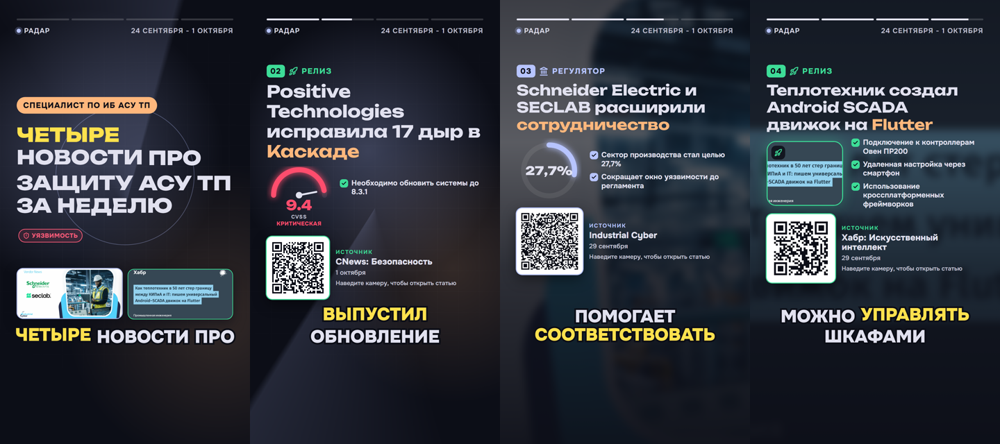

# Установка и настройка

Первый запуск и вход описаны в [README](../README.md#быстрый-запуск). Здесь остальное: ключи консоли, модели, модули стека, закрытый контур, железо, условия работы и запуск для разработки.

## Выпуск из консоли

```bash
docker compose run --rm cli digest --audience specialist   # специалисту за сутки
docker compose run --rm cli digest --audience management   # руководству за неделю
```

Без `--audience` собираются оба выпуска. Период меняет `--days`, он отсчитывается назад от момента сборки. `--period-end 2026-10-03T04:27` переносит конец периода в прошлое, и выпуск собирается из публикаций, которые уже есть в базе, например из снимка. Время без смещения считается московским. Начало вместо `--days` задаёт `--period-start`. Свежий опрос источников перед сборкой - `--fresh`, свой профиль берётся из файла: `--profile-file profile.json` в формате [examples/profiles](../examples/profiles). Свои источники добавляет `--sources out/sources.txt`: в файле по адресу на строку, сайт, раздел новостей, лента или `@канал`; каждый адрес определяется и опрашивается до сборки, как «Любой адрес» в браузере. Файлы для `--profile-file` и `--sources` кладутся в `out/`, в контейнере это `/out`. Пока идёт сборка, в терминале видны её этапы.

## События

События пишутся в ClickHouse, он входит в стек и получает до 1 ГБ памяти (`CLICKHOUSE_MEMORY`). Пустое значение `RADAR_CLICKHOUSE_URL=` в `.env` выключает события, остальное работает как раньше. Пароль ClickHouse, как и пароль PostgreSQL, на сервере стоит задать своим: `CLICKHOUSE_PASSWORD`.

## Модели

Режим с моделями включается командой из [README](../README.md#быстрый-запуск). При первом запуске скачаются модель эмбеддингов `embeddinggemma:300m` (0,6 ГБ) и языковая модель `qwen3.6:35b-a3b` (22,6 ГБ, Q4_K_M). Второй файл Compose отдаёт Ollama видеокарту NVIDIA. На карте 12-16 ГБ слои, которые не поместились, Ollama считает на процессоре. Без карты файл можно убрать, тогда модель целиком работает на процессоре. Для карты от 8 ГБ в `.env.example` есть блок `qwen3.5:9b` (6,6 ГБ).

Модель меняется в `.env`, код не трогается. Кроме Ollama поддерживается любой сервер с OpenAI-совместимым API. Для карты от 24 ГБ та же Qwen3.6 35B-A3B запускается в vLLM внутри стека: `docker-compose.vllm.yml`, четыре переменные из `.env.example` и команда

```bash
docker compose -f docker-compose.yml -f docker-compose.vllm.yml --profile ollama --profile vllm up -d
```

Готовые блоки для других серверов тоже лежат в `.env.example`, облако Ollama для разработки - в его конце.

## Модели Яндекса

Что нужно в Yandex Cloud и какие переменные вписать в `.env`, сказано в [README](../README.md#модели-яндекса). Стек с роликами поднимается так:

```bash
docker compose --profile video up -d --build
```

Профиль `video` поднимает рендер и воркер роликов, контейнер голоса `tts` и видеокарта не нужны: озвучивает SpeechKit, у него 12 русских голосов. `RADAR_LLM_REASONING=off` уходит в запрос как `reasoning_effort: none`, и Qwen отвечает сразу, без скрытых рассуждений. Пороги склейки дублей и поиска по смыслу для text-embeddings-v2 стоят в `backend/src/radar/ai/factory.py`: 0,77 и 0,41, пересчитаны с порогов `embeddinggemma` на 1 124 статьях.

Замеры на стеке Yandex: на одном сценарии Qwen3.6 35B собрала выпуск специалисту за 24 с и выпуск руководству за 15 с, `gpt-oss-120b` в облаке Ollama - за 193 и 113 с. На датасете организаторов Qwen3.6 35B нашла 24 из 36 признаков выпуска руководству, `gpt-oss-120b` 23, Alice AI LLM 22. На профиле «Специалист по ИБ АСУ ТП» эмбеддинги Yandex v2 дали точность первых 20 кандидатов 0,65 против 0,40 у `embeddinggemma`, полноту первых 60 - 0,443 против 0,426. Сквозная проверка прошла на полном стеке Yandex: выпуск собран за 21,6 с, ролик на 55 с с голосом SpeechKit - за 175 с.

## Модули

Разбор резюме через docling (вёрстка в две колонки, сканы и фотографии страниц, PPTX, ODT, HTML) включается отдельным профилем. В `.env` раскомментируйте `RADAR_DOCPARSER_URL=http://docparser:8000` и добавьте `--profile docling` к команде запуска. Образ разборщика занимает около 4 ГБ, модели в нём уже лежат.

Сайты, которые проверяют посетителя скриптом, как тестовая страница Cloudflare Challenge или McAfee за Akamai, читает FlareSolverr: добавьте `--profile solver` к команде запуска и раскомментируйте в `.env` `RADAR_FLARESOLVERR_URL`.

Короткие видео по выпуску, как в TikTok и Shorts, включаются двумя профилями. `video` добавляет сервис рендера на Remotion и воркер роликов: ролики получаются с субтитрами по словам, но без звука. `voice` добавляет озвучку Qwen3-TTS; на видеокарте NVIDIA к нему нужен `docker-compose.gpu.yml`. В `.env` раскомментируйте `RADAR_SHORTS_URL` и `RADAR_TTS_URL` для запущенных профилей:

```bash
docker compose -f docker-compose.yml -f docker-compose.gpu.yml \
  --profile ollama --profile video --profile voice up -d --build
```

Профиль `voice` с `RADAR_TTS_URL` даёт выпускам руководства брифинг голосом и без `video`: вместе с сервисом голоса поднимается воркер `worker-media`, рендер для брифинга не нужен. Без видеокарты сервису голоса дают больше ядер (`TTS_CPUS`, по умолчанию 4) и время на запрос (`RADAR_TTS_TIMEOUT_SECONDS`, по умолчанию 300, в `.env.example` пример на 1800) или озвучивают ролики и брифинги голосом SpeechKit ([«Модели Яндекса»](#модели-яндекса)).

Образ рендера занимает 1,3 ГБ: Node 24, Chrome Headless Shell и шрифты. Образ голоса занимает 14,8 ГБ на диске и 5,4 ГБ при скачивании. Из них 4,4 ГБ - PyTorch с библиотеками CUDA 13, 2,4 ГБ - сама модель, она уже лежит в образе.



Публикация в Telegram включается секретом для шифрования токенов ботов. Чтобы попробовать без настоящего Telegram, добавьте профиль `telegram-mock` и направьте ботов в мок: подойдёт любой токен вида `123456789:AA...` и любой `@канал`, а отправленное видно на <http://localhost:8089>.

```bash
# в .env: RADAR_SECRET_KEY=<вывод openssl rand -base64 32>
#         RADAR_TELEGRAM_API_URL=http://telegram-mock:8089
docker compose --profile telegram-mock up -d --build
```

Для настоящего Telegram `RADAR_TELEGRAM_API_URL` не задавайте, а бота создайте у @BotFather и добавьте администратором в канал. Копии картинок статей по умолчанию лежат в томе `media`; профиль `s3` поднимает SeaweedFS, и с `RADAR_IMAGE_STORE=s3` копии уходят туда.

Доставка на почту включается почтовым сервером компании: блок «Digest by email» в `.env.example`, а `RADAR_MAIL_DOMAINS` оставляет в получателях только адреса компании. Тогда в шапке готового выпуска появляется «На почту», а консоль отправляет выпуск сама: `docker compose run --rm cli digest --mail-to you@company.ru`. Письмо - текст выпуска со ссылками на источники, DOCX во вложении. Без своего сервера письма собирает Mailpit: профиль `mail`, настройки из того же блока, письма на <http://localhost:8025>.

Подключить ассистента: на странице «Аккаунт» создайте ключ в блоке «Доступ для ИИ-ассистентов». Ключ показывается один раз, рядом готовая команда для Claude Code и настройки для Cursor:

```bash
claude mcp add --transport http scrap-and-grep http://localhost:8080/api/mcp/ \
  --header "Authorization: Bearer tng_..."
```

Инструменты сервера: `my_feed` (лента с причинами и временем чтения), `search_my_news` (поиск только по своей ленте), `saved_news`, `my_digests`, `read_digest` (выпуск в Markdown со ссылками), `my_interests`.

Администратор может менять каталог источников и видит раздел «Аналитика». Посмотреть на это можно кнопкой «Войти как администратор» на странице входа. Своему аккаунту роль выдаётся командой на сервере, по адресу почты при регистрации её не получить:

```bash
docker compose exec api radar grant-admin you@example.org
docker compose exec api radar train-ranker   # обучить ранжирование сейчас, не дожидаясь ночи
```

Проверить, что всё работает от начала до конца:

```bash
uv run scripts/smoke.py            # или: uv run scripts/smoke.py http://host:port
```

Скрипт проходит путь пользователя: каталог, предпросмотр отбора, сборка выпуска с отслеживанием прогресса, оба экспорта, правка интересов и сравнение выпусков. Затем регистрирует нового читателя, загружает резюме, создаёт профиль из предложенного, проверяет ленту и реакцию на дизлайк и удаляет аккаунт.

## Закрытый контур

### Установка без интернета

Модель эмбеддингов лежит внутри образа Ollama (`ollama/Dockerfile`), а `ollama-pull` скачивает только то, чего в Ollama нет. Поэтому стек, у которого модели уже на месте, при старте в интернет не ходит. Модели docling и голоса тоже лежат в своих образах и читаются с `HF_HUB_OFFLINE=1`.

На машине с интернетом собирается поставка: все образы, модели Ollama и сам репозиторий.

```bash
scripts/offline_bundle.sh save /media/radar-bundle          # ядро и модели
scripts/offline_bundle.sh save /media/radar-bundle docling  # плюс нужные профили
```

На целевой машине нужен только Docker:

```bash
bash /media/radar-bundle/offline_bundle.sh load /media/radar-bundle /srv/radar
cd /srv/radar
docker compose -f docker-compose.yml -f docker-compose.gpu.yml -f docker-compose.airgap.yml --profile ollama up -d --no-build
```

`load` сверяет контрольные суммы, загружает образы, распаковывает модели в `/srv/radar/ollama-models` и пишет `.env`, где `OLLAMA_MODELS_DIR` указывает на эту папку. Веса для vLLM в поставку не входят: каталог кеша Hugging Face копируется на целевую машину отдельно, в `.env` задаются `VLLM_MODELS_DIR=<каталог>` и `VLLM_OFFLINE=1`.

### Без выхода в интернет

`docker-compose.airgap.yml` закрывает стеку дорогу наружу: все сети Docker внутренние, у сервисов нет ни маршрута, ни внешнего DNS. Источники читаются через один прокси стека, `egress` (squid): он резолвит имена сам, пускает только к публичным адресам на портах 80 и 443 и пишет каждый запрос в свой журнал. С `EGRESS_UPSTREAM=proxy.corp.local:3128` в `.env` он ходит через корпоративный прокси. Наружу смотрит только порт интерфейса.

```bash
docker compose -f docker-compose.yml -f docker-compose.airgap.yml --profile ollama up -d
docker compose -f docker-compose.yml -f docker-compose.airgap.yml logs -f egress   # что уходит наружу
```

Если прокси нет совсем, выпуски собираются из того, что уже в базе: снимок публикаций и прошлые опросы. Список хостов, к которым стек обращается, и что работает без каждого из них - в DECISIONS, «Закрытый контур».

## Требования к железу

«Сборка» - выпуск специалисту по ИБ АСУ ТП за неделю примеров: 60 кандидатов, 20 записей, кеш ответов пуст. «Выпусков в час» - 3600, делённое на время сборки: одна карта собирает выпуски по очереди. В таблице наши замеры, у каждой строки указано, на чём.

| Конфигурация | Где замерено | Видеокарта | Память | Диск | Сборка | Выпусков в час |
|---|---|---|---|---|---|---|
| Без языковой модели | сборка - машина с RTX 5070 (карта не нужна); память и диск - ноутбук: Ryzen 7 7840HS (8 ядер), 16 ГБ, 2 октября | не нужна | стек без Ollama - 2,3 ГБ в пике | образы ядра 3,0 ГБ | 0,5 с | тысячи |
| `qwen3.5:9b` в Ollama | RTX 5070 12 ГБ, 12 потоков, 32 ГБ, 30 сентября | 12 ГБ | - | + 10,4 ГБ и 6,6 ГБ | 81-102 с | 35-44 |
| `qwen3.5:0.8b` на процессоре | ноутбук: Ryzen 7 7840HS, 16 ГБ, Docker 10 ГБ, 2 октября | нет | стек 7,0 ГБ в пике, из них Ollama 4,8 ГБ | + 10,4 ГБ и 1,0 ГБ | 731,5 с; руководству 488,2 с | 4-5 |

Модели финала. Qwen3.6 35B-A3B в Ollama весит 22,6 ГБ (Q4_K_M), рядом образ Ollama 10,4 ГБ; на карте 12-16 ГБ слои, которые не поместились, Ollama считает на процессоре. В vLLM та же модель идёт с весами AWQ 25 ГБ на карте от 24 ГБ, как в опубликованном запуске на NVIDIA A10. gpt-oss-120b в MXFP4 помещается на одну карту 80 ГБ, H100 или A100, веса занимают 65 ГБ ([model card](https://arxiv.org/abs/2508.10925)). По опубликованным замерам скорости выпуск специалисту на ней собирается примерно за 45 с на H100 и за 70 с на A100, это около 80 и 50 выпусков в час.

Скорости взяты при 1-4 одновременных запросах, как шлёт сервис: 1×H100 80 ГБ в vLLM генерирует 233 токена/с на запрос и 511 суммарно при четырёх, обрабатывает запрос со скоростью около 12 700 токенов/с ([Millstone](https://www.millstoneai.com/inference-benchmark/gpt-oss-120b-mxfp4-1x-h100-sxm), февраль 2026); 1×A100 80 ГБ в vLLM 0.11 - 326 токенов/с суммарно при четырёх ([GPUStack](https://docs.gpustack.ai/latest/performance-lab/gpt-oss-120b/a100/)); RTX PRO 6000 96 ГБ - 181 и 361 ([Millstone](https://www.millstoneai.com/inference-benchmark/gpt-oss-120b-mxfp4-1x-rtx-pro-6000-blackwell)). Выпуск специалисту - 110 обращений, 166 511 токенов на вход и 16 127 на выход; время - вход / скорость обработки + выход / суммарная генерация.

Строка `qwen3.5:0.8b` показывает, что весь путь проходит и без видеокарты: выпуск на процессоре собирается за 12 минут, а прерванная сборка продолжается с чекпоинта. Без своего железа выпуски собирает Yandex AI Studio ([«Модели Яндекса»](#модели-яндекса)). Замер на своей карте снимает `backend/scripts/measure_model.sh` ([examples/models](../examples/models/README.md#как-повторить)), он же записывает карту, пиковую видеопамять, процессор и память.

## Условия работы

- Вход по паролю включён по умолчанию (`RADAR_AUTH=on`), рядом с ним две кнопки общих аккаунтов (`RADAR_PRESET_LOGIN=true`). Гостевой вход «Войти без регистрации» выключен (`RADAR_DEMO_LOGIN=false`), код его остался, и `true` включает его для показа. На сервере в открытой сети кнопки общих аккаунтов прячет `RADAR_PRESET_LOGIN=false`; что ещё задать там, перечислено в [ARCHITECTURE, «Безопасность»](ARCHITECTURE.md#безопасность).
- Контакты из резюме вырезаются до анализа: телефоны, почта, ссылки, строки вида «Адрес: ...» и имя в начале. Сам текст резюме нигде не хранится, остаются только должность, сводка, навыки и темы. Сканы распознаются на процессоре, около 40 секунд на страницу.
- Ленте хватает десятка-полутора оценок, чтобы заметно подстроиться под читателя. Подстройка профиля бережная: смысл интереса сдвигается со второго лайка по нему, вес меняется не больше чем на десятую часть, а профиль, далёкий от интересов читателя, разворачивают принятые предложения новых тем. Подсказка «нравится коллегам» появляется, когда похожих читателей с одинаковым выбором трое и больше: так она не выдаёт, что читает конкретный коллега.
- Смену разметки у источника видно сразу. Бюллетени Broadcom, страницы новостей и Telegram-каналы, где не разобралась ни одна карточка или пост, встают с ошибкой разметки, например «не прочитана ни одна из N карточек», а не выглядят пустыми.
- `bdu.fstec.ru` и `ptsecurity.com` подписаны удостоверяющим центром Минцифры. Его сертификаты лежат в репозитории, и доверие к ним действует только для хостов из `RADAR_RUSSIAN_CA_HOSTS` и их поддоменов (по умолчанию `bdu.fstec.ru` и `ptsecurity.com`). Промежуточный сертификат 2022 года действует до 6 марта 2027 года, сертификат 2024 года - до 19 июля 2029-го; следующий кладётся в `backend/src/radar/ingest/certs/`.
- Telegram-канал читается через открытое веб-превью `t.me/s/<канал>`, без аккаунта и ключей. Для сервера в России адреса превью задаёт `RADAR_TELEGRAM_PREVIEW_URLS`, первым можно поставить зеркало t.me. За один опрос канал дочитывается на сто постов назад, до последнего прочитанного.
- Примеры собраны на Qwen3.6 35B в Yandex AI Studio, видео - на `gpt-oss:120b` в облаке Ollama. С облачной моделью, Yandex AI Studio или облаком Ollama, заголовки и текст статей, темы выпуска и резюме без контактов обрабатывает провайдер модели. Локальная Qwen3.6 35B-A3B в стеке держит всё внутри, а в закрытом контуре (`docker-compose.airgap.yml`) наружу уходят только запросы к источникам через прокси. Если модель отказывает, шаг собирается автономно, и выпуск об этом говорит.
- Проверка по тексту статьи сверяет числа, идентификаторы, версии и названия. Признак эксплойта берётся из формулировок статьи («используется в атаках», «exploited in the wild» и другие, закреплённые тестами) и из справки CISA KEV, БДУ и NVD.
- Строка «Вместо ручной работы» считает по журналу аналитика: 1,3 с на публикацию периода и 4,6 мин на запись специалисту, 7,2 мин руководству (DECISIONS, «Что выпуск считает сам»). «Наши системы» ищутся по целым словам названия: «Cisco ASA» помечает записи о Cisco ASA, «Cisco» - все записи о Cisco. План на смену берёт из карточки обновление, временные меры, первоначальный доступ, индикаторы и техники.
- Текст статьи и резюме идёт модели JSON-строками, обращения к модели («игнорируй предыдущие инструкции», `SYSTEM:` в начале строки) вырезаются, ответ зажат JSON-схемой, а предложенный по резюме профиль читатель просматривает перед сохранением (DECISIONS, «Команды внутри статей»).
- Одна видеокарта с локальной моделью собирает выпуски по очереди. Параллельность дают вторая карта или vLLM, который собирает запросы в пакеты (`RADAR_LLM_CONCURRENCY=8`). Облако отвечает на запросы параллельно, их число на воркер задаёт та же переменная.
- Видео рендерит Remotion, условия его лицензии описаны в DECISIONS, «Короткие видео». Изоляцию рендера даёт контейнер: без root, файловая система только на чтение, сеть без выхода наружу. Время слов в субтитрах делится по слогам внутри фразы, и на странице субтитров из двух-четырёх слов подсветка идёт в такт голосу.
- Ролики и брифинги озвучивает сервис голоса на видеокарте или на процессоре (брифинг из 95 с звука озвучен за 17 минут при `TTS_CPUS=12` и `RADAR_TTS_TIMEOUT_SECONDS=1800`, ноутбук без NVIDIA, 4 октября) либо SpeechKit без своего железа. Без голоса ролики собираются с субтитрами в темпе чтения. Голоса сервиса - четыре синтетических образца, сделанных моделью по описанию, свой голос добавляется файлом в `tts/voices/`; каждая строка проверяется распознаванием и при расхождении с текстом генерируется заново.
- Время чтения считается по полному тексту статьи: из ленты, если она его отдаёт, или со страницы статьи, которую воркер дочитывает, когда статья попалась читателю.
- Выпуск по расписанию собирают планировщик и воркеры. После простоя стека один выпуск покрывает всё пропущенное время, до 90 дней, и появляется в истории.
- Фото читателя хранится в базе, 10-30 КБ, и отдаётся только самому читателю.
- Обучаемое ранжирование включается, только если на последних днях обгоняет ручные веса, а до этого ленту ведут ручные веса. Место статьи для обучения берётся из записи выдачи. Сводки по дням хранят только счётчики, события удаляются вместе с аккаунтом, события гостей живут двое суток.
- Ссылка на профиль отдаёт его в текущем виде, владелец закрывает её в любой момент. Открывает ссылку вошедший читатель, общий аккаунт тоже подходит.
- Свой цвет профиля рисуется функцией CSS `light-dark()`: Chrome 123, Safari 17.5, Firefox 120 и новее.
- MCP-сервер отвечает только на запросы с ключом, CORS разрешает лишь свой адрес. Ключ действует до отзыва.
- Публикация в Telegram сверена с документацией Bot API и проверена на моке в стеке, включая rich-посты Bot API 10.x. Пост, ответ на который потерялся, помечается неудачным и ждёт человека: так пост не выходит дважды. Токены ботов шифрует ключ `RADAR_SECRET_KEY`, при его смене ботов подключают заново.
- Читалка показывает текст и картинки издания внутри приложения, с источником, автором и ссылкой на оригинал. Сайт, который отказал на всех ступенях лестницы, читалка показывает текстом из ленты с пометкой и пробует снова через 6 часов; полный текст источников за FlareSolverr забирается при опросе (`fetch_full_text`).
- FlareSolverr стоит в отдельной сети без доступа к базе, очередям и api. Адрес запроса через прокси проверяется до того, как запрос уходит прокси.
- Предпросмотр поста показывает картинку с сайта издания так, как её увидит Telegram; для этого CSP разрешает картинки с `https:`.
- QR-код ведёт на статью на сайте издания. Адреса до 200 знаков кодируются так, что камера читает код с экрана другого телефона.

## Разработка

Бэкенд на хосте (Python ставит `uv`), база и брокер в Docker:

```bash
docker compose -f docker-compose.yml -f docker-compose.dev.yml up -d postgres valkey clickhouse
cd backend
uv sync
uv run radar migrate --seed --sample ../data/samples/articles.jsonl
uv run pytest && uv run ruff check src tests && uv run mypy
uv run radar digest --audience specialist --out ../tmp   # или --profile "<имя>" --email <почта>
```

Тесты через HTTP сами создают базу `radar_test` на том же сервере PostgreSQL и не трогают рабочую. Тесты событий так же заводят базу `radar_test` в ClickHouse и запускаются, когда он поднят. Мок Bot API запускается и без Docker: `uv run radar telegram-mock --port 8089`, тогда в `.env` `RADAR_TELEGRAM_API_URL=http://127.0.0.1:8089`.

Те же проверки запускает CI в GitLab и GitHub Actions теми же скриптами из `ci/` ([CI.md](CI.md), результаты - в [QUALITY, «Тесты»](QUALITY.md#тесты)). Адреса сервисов для тестов меняют `RADAR_TEST_ADMIN_DSN`, `RADAR_TEST_CACHE_URL`, `RADAR_TEST_BROKER_URL` и `RADAR_TEST_CLICKHOUSE_URL`.

Фронтенд с горячей перезагрузкой, API берётся из запущенного стека на `8080`:

```bash
cd frontend
npm ci
npm run dev        # http://localhost:5173
npm run lint && npm run typecheck && npm test
npm run test:coverage         # то же с покрытием, отчёт в coverage/
node scripts/icons.mjs        # иконки Gravity UI для src/components/icons.tsx
```

Сцены ролика правятся в Remotion Studio на примере из `shorts/src/sample.ts`, сервис голоса запускается на хосте с видеокартой:

```bash
cd shorts
npm ci
npm run studio          # предпросмотр сцен
npm run render:sample   # out/sample.mp4 без бэкенда
npm run typecheck && npm test

cd ../tts
uv sync
uv run pytest
TTS_PORT=8201 uv run radar-tts    # в .env: RADAR_TTS_URL=http://host.docker.internal:8201
```
